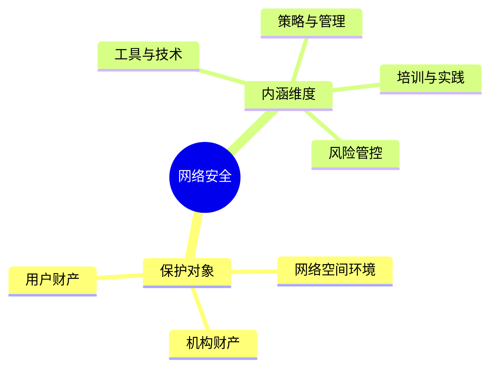

# 网络安全的定义（ITU定义与本课程定义）及Cyber概念说明

## 网络安全的定义与 Cyber 概念说明

### 从“保护什么”说起

如果请你用一句话回答“什么是网络安全”，你会怎么组织语言？你大概会说：要保护网络、保护计算机里的数据、防止黑客攻击……但很快会发现，不同人给出的答案差异极大：做密码学的人说“网络安全就是加密”，做系统运维的人说“网络安全就是防火墙和入侵检测”，做管理的人说“网络安全是制度和合规”。这些说法各有道理，但都只是拼图的一块。

这正是网络安全定义“混乱”的根源：==网络安全不是一个单一技术，而是一个多维度、多层次的综合性概念==。要准确理解它，需要先抓住两个核心问题：**保护的对象是什么**，以及**安全具体包含哪些内涵**。

### ITU 的定义：一份“能力清单”

国际电信联盟（ITU）对网络安全的定义如下：

> 网络安全是用于保护网络空间环境、以及机构和用户财产的**工具、策略、安全概念、安全防护、安全指南、安全风险管理方案、安全行动、安全培训、安全最佳实践、安全保障和安全技术**的汇集。

这个定义有几个值得注意的特点。其一，它没有把网络安全归结为某一种具体技术，而是用一个“汇集”来概括；其二，它明确指出了保护对象——==“网络空间环境”（cyber environment）以及“机构和用户财产”==；其三，它把“策略”“管理方案”“培训”“最佳实践”与“工具”“技术”并列，说明 ==安全不只是技术问题，更是管理问题==。

### Cyber 到底指什么

ITU 定义中反复出现的“cyber”（网络空间）容易和“network”（网络）混淆。在本课程语境下：

- **Network（网络）**：狭义上指计算机通信网络，如局域网、广域网、互联网，是物理或逻辑上的互联系统。
- **Cyber（网络空间）**：==不仅包括网络基础设施，还包括依托网络运行的各类信息系统、数据、用户身份、交互行为乃至由此形成的社会关系空间==。

为什么这个区分重要？因为如果只把网络安全理解为“保护网络设备”，就会遗漏大量真实攻击面。例如，钓鱼邮件攻击的不是网络链路本身，而是利用人的认知漏洞；数据泄露可能发生在服务器硬盘被丢弃之后，而非传输过程中。==网络安全面向的是 cyber 空间，保护范围远大于 network 基础设施==。

[!NOTE]
> 考试中如果出现“网络安全保护的对象是什么”，只回答“网络”是不够准确的。应当回答“网络空间环境，以及机构和用户的财产”，体现 ITU 定义的完整表述。

### 本课程的定义视角

本课程在 ITU 定义的基础上，进一步强调网络安全内涵的**可操作性**。换句话说，定义一个概念不是为了背诵，而是为了指导我们“设计和实现”安全系统。因此，本课程将网络安全的内涵具体化为几个可以落地的维度：

| 维度 | 关注的问题 | 对应技术举例 |
|------|-----------|-------------|
| 加密方法 | 数据如何保密？ | 对称加密、公钥加密 |
| 真实性验证 | 通信对方是谁？ | 数字签名、消息认证码 |
| 访问控制 | 谁能访问什么资源？ | 身份认证、权限管理 |
| 攻击防御 | 如何抵御恶意行为？ | 防火墙、入侵检测、恶意代码防护 |

这也帮助理解复习提纲里那句话——“网络安全的定义和内涵、加密方法、真实性验证、访问控制、攻击防御的定义及其原理”。==四个维度不是并列的知识点清单，而是网络安全定义的具体展开==。

[!IMPORTANT]
> 核心结论：ITU 定义回答了“网络安全是什么”——它是一套保护网络空间环境及机构用户财产的综合性汇集；本课程定义则回答了“网络安全具体做什么”——通过加密、验证、访问控制和攻击防御等手段来实现保护目标。两者是抽象概括与具体展开的关系，而非两个矛盾的定义。

### 一个容易踩的坑

许多初学者会把“网络安全”等同于“网络边界安全”，即认为在内外网之间部署防火墙就实现了网络安全。这是一个典型的**边界思维误区**。

[!WARNING]
> 现代攻击手段（如社工钓鱼、内部威胁、供应链攻击、侧信道攻击）可以直接绕过网络边界。如果把网络安全窄化为边界防护，将导致大量防护盲区。ITU 定义中列举“培训”“安全行动”“风险管理方案”正是为了避免这种窄化——人是安全体系中的关键环节，管理流程与技术同等重要。

### 算对了的例子：概念辨析题

**题目**：判断下列说法是否正确，并简要说明理由。“网络安全就是保护计算机网络设备不被入侵。”

**解答**：不正确。根据 ITU 定义，网络安全保护的对象是==网络空间环境==以及机构和用户的**财产**，而不仅仅是计算机网络设备本身。网络设备只是网络空间基础设施的一部分，数据资产、用户隐私、系统可用性、操作规范性等同样属于保护范畴。此外，网络安全的内涵还包括策略、管理、培训和风险管理方案，而不仅是“防入侵”这一种技术行为。因此，该说法将网络安全的保护对象和内涵都过度窄化了。

[!TIP]
> 记忆口诀：**“对象记全——空间加财产；内涵记全——技术加管理。”** 遇到概念题时，先检查是否遗漏了管理维度，再检查保护对象是否写全。
