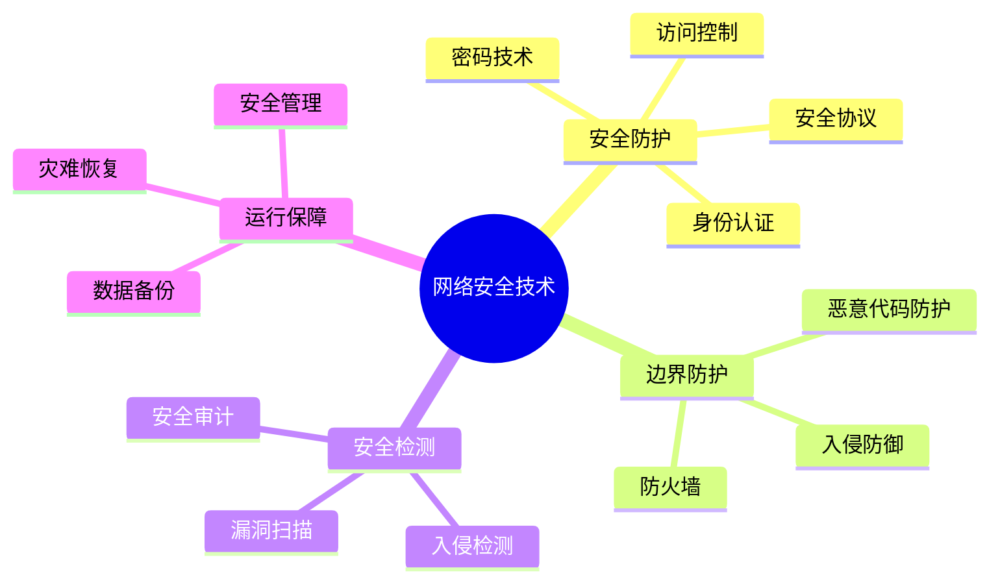
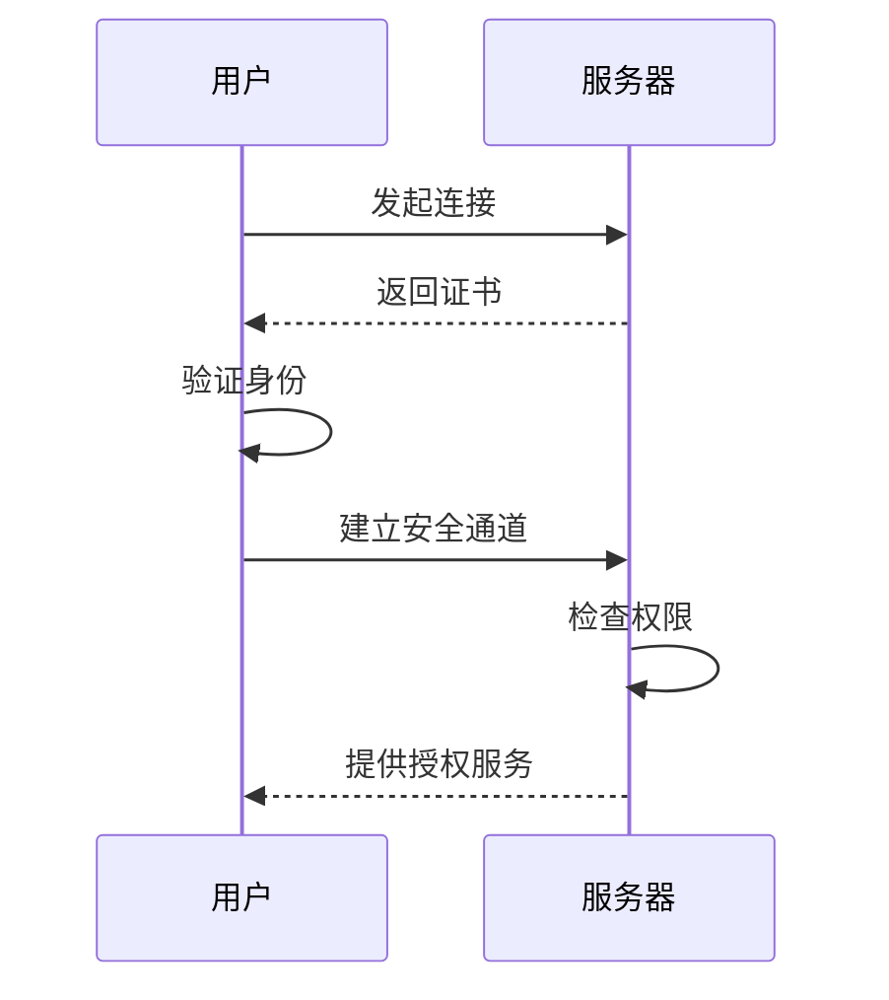

# 网络安全的目标和网络安全技术组成

## 网络安全的目标

网络安全的目标可以概括为：在网络环境中，保证信息和系统资源能够被**合法、正确、持续地使用**，同时防止泄露、篡改、破坏和抵赖。常见目标如下：

| 目标 | 含义 | 典型威胁 | 对应技术举例 |
|---|---|---|---|
| 机密性 | 信息不被未授权者获取 | 窃听、数据泄露 | 加密、访问控制 |
| 完整性 | 信息不被未授权修改，且能发现修改 | 篡改、恶意注入 | 散列、消息认证码、数字签名 |
| 可用性 | 授权用户需要时能够正常访问 | 拒绝服务、系统破坏 | 冗余备份、入侵防御、抗 DoS |
| 真实性 | 能确认通信实体或数据来源 | 冒充、钓鱼 | 身份认证、数字证书 |
| 不可否认性 | 行为发生后不能抵赖 | 否认发送或操作 | 数字签名、安全审计 |

其中，==机密性、完整性、可用性通常合称 CIA，是最基本的三个目标==。真实性、不可否认性等是在此基础上对网络行为的进一步约束。

> [!IMPORTANT]
> 网络安全不是单纯“把数据加密”。加密主要解决机密性问题，不能自动保证数据未被篡改，也不能保证服务始终可用。

## 网络安全技术组成

网络安全技术不是某一种设备或算法，而是由预防、检测、响应和恢复等环节共同构成的技术体系。

各部分可以这样理解：

- **密码技术**：提供加密、完整性校验、身份认证和数字签名等基础能力，是许多安全机制的基础。
- **身份认证**：回答“对方是谁”，常见方式有口令、动态验证码、数字证书等。
- **访问控制**：回答“已确认身份的主体能做什么”，按照权限限制其对资源的访问。
- **防火墙与入侵防御**：依据安全策略过滤网络流量，阻断部分攻击。
- **入侵检测与安全审计**：发现异常行为、记录安全事件，为报警和追责提供依据。
- **备份与灾难恢复**：攻击或故障已经造成破坏时，恢复数据和服务，主要保障可用性。
- **安全管理**：配置策略、修补漏洞、管理密钥和权限，使各种技术持续有效。

> [!NOTE]
> 认证与访问控制不能混为一谈：认证解决“你是谁”，访问控制解决“你能做什么”。用户登录成功，只说明身份得到确认，并不意味着可以访问全部资源。

## 技术如何配合

以用户通过 HTTPS 访问学校系统为例，可以按目标分析各项技术：

数字证书和身份认证帮助确认服务器身份，安全协议保护传输数据的机密性与完整性，访问控制限制用户权限，日志审计记录关键操作，备份与恢复机制应对服务故障。这说明安全目标通常需要多种技术共同实现。

一个正确的判断例子是：某网站给文件计算散列值，用户下载后重新计算并比较。若散列函数满足安全要求且散列值通过可信渠道获得，则结果一致可以支持“文件未被篡改”的判断，因此该措施主要保障**完整性**；它并没有隐藏文件内容，所以不能据此认为实现了机密性。

> [!WARNING]
> 常见误区是把安全目标与技术机械地一一对应。数字签名可同时支持完整性、真实性和不可否认性；防火墙也不能识别所有攻击。答题时应先判断题目要防的威胁，再选择目标和技术。

> [!TIP]
> 记忆主线：**先定安全目标，再选防护技术；事前预防、事中检测、事后恢复。** 不要把“装了防火墙”或“使用了加密”等同于整个网络已经安全。
