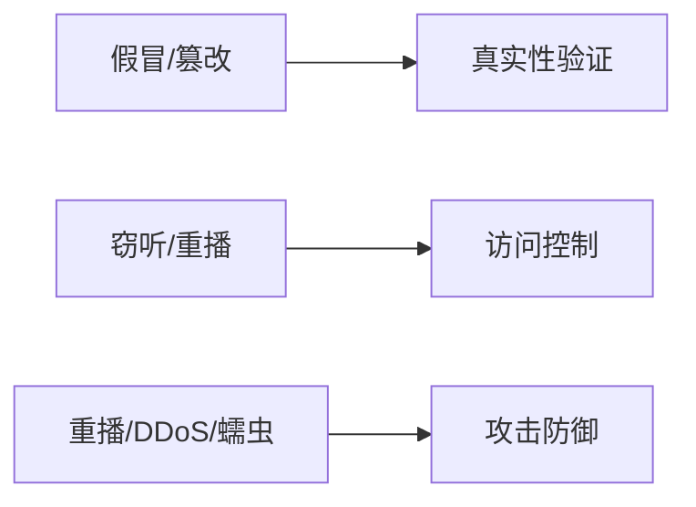

# 网络安全的六种风险形式（假冒、窃听、篡改、重播、中断服务、蠕虫攻击）

## 六种风险形式是什么

网络安全风险并非抽象概念，而是对通信安全属性的具体破坏。若将一次正常通信视为基准，六种风险分别对应了不同维度的异常：

-   **假冒**：攻击者伪装成合法用户或IP地址，破坏==身份真实性==。
-   **窃听**：未经授权截获传输数据，破坏==机密性==。
-   **篡改**：修改传输中的数据或系统配置，破坏==完整性==。
-   **重播**：截获合法报文后原样转发，欺骗接收方，破坏==时效性与真实性==。
-   **中断服务**：使网络或应用无法正常工作，破坏==可用性==。
-   **蠕虫攻击**：利用漏洞自我繁殖传播，窃取数据并耗尽资源，是==当前最大安全威胁==。

> [!IMPORTANT]
> 核心考点：前四种针对“通信过程”，后两种针对“系统与网络整体”。==蠕虫攻击兼具窃密与破坏可用性双重特征==，需单独记忆。

## 为什么需要区分它们

如果无法精准识别风险类型，防御措施就会失效。例如，仅靠加密能防窃听，却防不住重播；仅靠防火墙可能挡住外部入侵，却拦不住内部蠕虫横向扩散。课件明确指出：**真实性验证防假冒与篡改，访问控制防窃听与重播，攻击防御技术应对重播、DDoS及蠕虫**。只有先定性风险，才能匹配正确的技术栈。

## 如何针对性防御

| 风险形式 | 核心防御技术 | 作用机理 |
| :--- | :--- | :--- |
| 假冒、篡改 | 身份/报文真实性验证 | 甄别实体与数据来源，确保真实 |
| 窃听、重播 | 网络访问控制 | 严密权限管控，限制非法读取与回放 |
| 重播、中断、蠕虫 | 网络攻击防御 | 检测异常流量、恶意代码与拒绝服务行为 |

> [!TIP]
> 记忆口诀：“真验防假改，控访防窃重，攻防兜底全”。==真实性验证是抵御假冒和篡改的第一道防线==。

## 与相近概念的区别

-   **重播 vs 篡改**：重播是“原文照发”，报文内容未变但时机非法；篡改是“内容已改”。两者都可用真实性验证（如时间戳+数字签名）联合防范。
-   **中断服务 vs 蠕虫攻击**：中断服务强调结果（不可用），手段多样；蠕虫强调手段（自繁殖恶意代码），后果包含不可用与数据泄露。==蠕虫是中断服务的常见成因之一，但不等同==。

> [!WARNING]
> 易错坑：认为“加密=防一切”。加密只保机密性，对重播、假冒、中断服务无效。考试中常设此陷阱。

## 一个算对了的例子

某邮件系统遭攻击，用户收到大量重复的“密码重置”邮件，且服务器响应极慢。分析如下：

1.  邮件内容未被修改 → 排除篡改；
2.  邮件为合法历史报文重复发送 → ==判定为重播==；
3.  服务器响应慢、服务降级 → ==同时存在中断服务==；
4.  若该重播由自动传播的恶意程序触发 → 升级为==蠕虫攻击==。

防御组合：启用报文时间戳验证（防重播）+ 流量清洗（缓解中断）+ 主机漏洞补丁与杀毒（遏制蠕虫）。三者缺一不可，单一措施无法完全解决问题。

> [!CAUTION]
> 高危误区：将“重播”简单归为“假冒”。重播者未必伪造身份，而是滥用合法凭证的时效窗口。必须通过序列号或时间戳机制单独应对。
