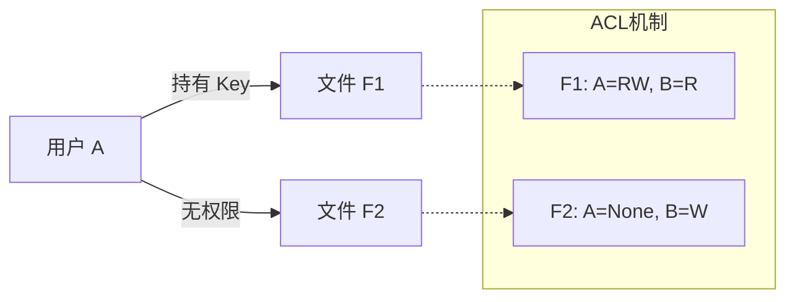

# 自主访问控制策略（实现方法、举例、潜在威胁与弱点）

## 什么是自主访问控制（DAC）

自主访问控制（Discretionary Access Control, DAC）的核心在于“自主”。==主体（用户/进程）拥有决定谁可以访问其资源的权力==。在 DAC 模型中，资源的所有者可以随意修改访问权限，系统仅负责执行这些策略，而不强制干预。

> [!IMPORTANT]
> DAC 的本质特征：**访问权由资源所有者自主分配**，而非由系统安全管理员强制规定。

## 实现方法：ACL 与能力表

DAC 最常见的实现机制是**访问控制列表（ACL）**和**能力表（Capabilities）**。

- **ACL（Access Control List）**：依附于客体（如文件）。每个文件附带一个列表，记录哪些主体拥有何种权限（读、写、执行）。
- **能力表**：依附于主体。每个用户持有一组“令牌”，证明其有权访问特定资源。

## 典型场景与潜在威胁

假设用户 $A_1$ 拥有目录 $D_1$ 的读写权，用户 $A_2$ 拥有目录 $D_2$ 的写权但无 $D_1$ 读权。若 $A_2$ 在 $A_1$ 主机中植入木马 $T$：

1. 木马 $T$ 继承 $A_1$ 的权限。
2. $T$ 读取 $D_1$ 中的敏感文件 $F_1$。
3. $T$ 将 $F_1$ 写入 $A_2$ 可访问的 $D_2$。
4. $A_2$ 间接获取了 $F_1$ 的内容。

> [!CAUTION]
> **特洛伊木马攻击**是 DAC 的典型弱点。因为权限随主体流动，恶意程序可伪装成合法用户窃取数据。

## DAC 与 MAC 的核心区别

| 特性 | 自主访问控制 (DAC) | 强制访问控制 (MAC) |
| :--- | :--- | :--- |
| **决策者** | 资源所有者 | 系统/安全管理员 |
| **灵活性** | 高，易于管理 | 低，配置复杂 |
| **安全性** ==核心结论== | **较低**，易受木马渗透 | **较高**，防止信息非法流动 |
| **适用场景** | 商业环境、个人PC | 军事、政府高密级系统 |

## 常见误区与复习提示

- **误区**：认为 DAC 完全不可控。实际上，DAC 可以通过审计日志追踪异常访问，但其本身无法从机制上阻断越权。
- **记忆技巧**：DAC 像“自家大门”，主人给谁钥匙谁就能进；MAC 像“军区哨所”，级别不够即使有熟人带路也进不去。

> [!TIP]
> 考试中若遇到“Bell-LaPadula 模型”，请注意它主要描述的是 **MAC**（简单安全特性 *-property*），不要混淆为 DAC。DAC 的重点在于**所有者的自由度**及其带来的**特洛伊木马风险**。
