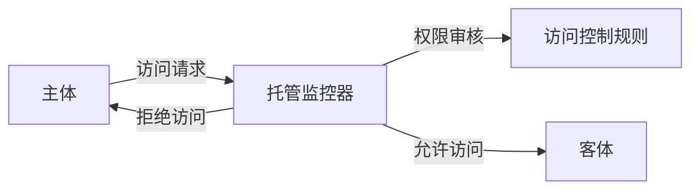

# 访问控制基本概念（策略、机制、主体、客体与托管监控器模型特性及应用）

## 访问控制策略、机制与模型

访问控制解决的是“**谁，在什么条件下，能对什么资源执行什么操作**”。例如，用户 A 可以访问文件服务器 B 中目录 C 下的所有文件，这条规则同时限定了用户、环境和资源范围。

- **访问控制策略**：表示访问控制的总体要求及约束条件，描述进行访问控制的规则，即哪些用户在何种环境下可以访问哪些信息。典型策略有自主访问控制（DAC）、强制访问控制（MAC）等。
- **访问控制机制**：策略的具体实现，是一组硬件或软件方法。典型机制包括访问控制列表（ACL）和访问控制矩阵，例如用 ACL 为不同用户设置不同的文件访问权限。
- **访问控制模型**：描述访问控制系统的安全控制规则，以及支撑访问控制策略的规则，如 Bell-LaPadula 模型支撑 MAC 策略。

> [!IMPORTANT]
> 三者的关系可概括为：==策略规定“控制什么”，模型给出“依据什么规则控制”，机制解决“具体怎样实现”==。模型不是 ACL 之类的具体实现机制。

## 主体、客体与访问过程

**主体（Subject）**是代表用户访问网络或使用网络应用的实体，是访问请求的发起方，也是被控制方；**客体（Object）**是被访问的网络实体或被使用的网络应用实体，是被保护方。文件、目录、数据库等都可以作为客体。

主体和客体之间需要设置访问控制实体。主体提出请求后，必须经过托管监控器的访问权限审核，才能访问相应客体。

> [!WARNING]
> 主体不等于“人”，进程等代表用户活动的实体也能成为主体；客体也不等于“文件”，提供网络服务或网络应用的实体均可作为客体。主体与客体的角色还取决于具体访问关系，不能仅凭实体名称判断。

## 托管监控器的特性

为了保证托管监控器按照访问控制规则实现访问控制策略，它必须具备以下特性：

| 特性 | 含义 |
|---|---|
| 孤立性 | 采用独立的安全机制，不依赖其他系统，不受其他系统干扰 |
| 可验证性 | 控制机制及其实现必须通过安全验证 |
| 灵活性 | 能够实现任何访问控制策略 |

其中，孤立性防止监控机制被绕过或干扰，可验证性保证其实现可信，灵活性保证它能够支撑不同策略，三者不能混为一谈。

## 一个权限判定例子

设用户 A1 请求读取目录 D1，ACL 中有如下表项：

| 主体 | 客体 | 控制 | 操作 |
|---|---|---|---|
| A1 | D1 | 允许 | 读/写 |

判定过程是：A1 是主体，D1 是客体；托管监控器依据 ACL 审核，发现该表项允许 A1 对 D1 进行读、写操作，因此本次“读”请求被允许。这里，**允许读/写是策略要求，ACL 表项是机制实现，托管监控器负责执行审核**。

> [!TIP]
> 答题时按“策略定规则—模型给支撑—机制做实现”区分三者；分析一次访问时，再按“请求方是主体—被访问方是客体—托管监控器先审核”组织答案。
