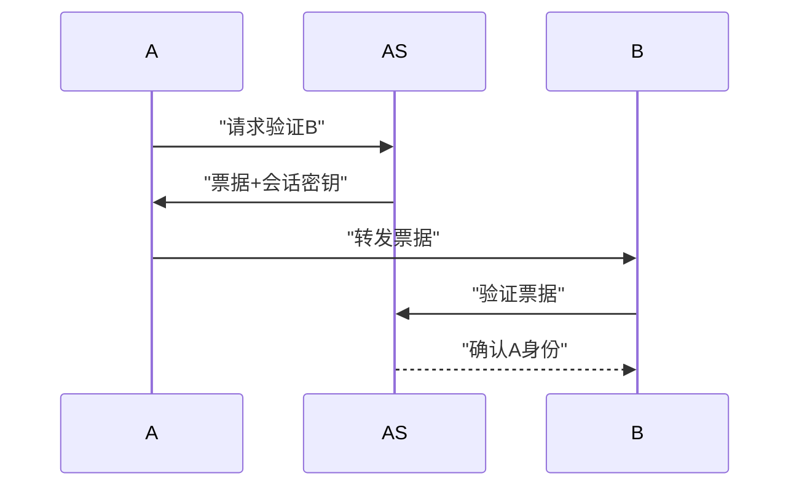

# 身份验证协议的定义、作用、基本方法、分类与表示方式（当事方与验证方）

## 什么是身份验证协议

> [!IMPORTANT]
> ==身份验证协议==是网络真实性验证的核心机制，用于鉴别网络实体身份或报文真伪。它不仅是安全控制系统的第一步，还承担密钥分发与抗重放攻击的功能。

若仅靠口令或静态凭证，攻击者截获后即可假冒合法用户。因此，协议必须引入动态挑战（如一次性数）和加密绑定，确保“此时此地”的真实性。

## 为什么需要三方交互

双方交互虽简单，但在大规模网络中，每个用户需与其他所有用户预共享密钥，密钥量呈 $O(n^2)$ 增长。如何解决可缩放性问题？

答案是引入==身份验证服务器（AS）==作为可信第三方。AS 与每个注册用户预共享对称密钥（如 $K_{AS,A}$），当事方通过 AS 间接完成互验，密钥管理降为 $O(n)$。

## 基本方法与分类

身份验证内容通常基于三类要素：

| 验证要素 | 示例 | 优点 | 不足 | 适用场景 |
| :--- | :--- | :--- | :--- | :--- |
| 知识 | 口令、PIN | 成本低 | 易泄露/猜测 | 低安全登录 |
| 标志 | 智能卡、令牌 | 难伪造 | 可能丢失 | 门禁、网银 |
| 特征 | 指纹、虹膜 | 唯一性强 | 隐私风险、误识率 | 高安全终端 |

按密码体系可分为两类：

- **传统密码体系**：依赖共享密钥 $K$。若当事方能正确用 $K$ 加密数据，则验证方确信其身份。常结合==一次性数==（Nonce）防重放，例如登录验证码由服务器生成，仅一次有效。
- **公钥密码体系**：依赖私钥签名。若当事方能用私钥 $VK_A$ 对 Nonce 签名，且验证方持有对应公钥 $PK_A$，则身份成立。公钥可通过 CA 或 AS 获取。

## 表示方式：当事方与验证方

> [!NOTE]
> ==当事方==是具有身份标识、可独立行为的实体；==验证方==是检验当事方身份的实体。注意：“僵尸主机”可能假冒当事方，故验证不能仅凭IP或主机名。

协议至少包含两方角色。在双向验证中，双方互为当事方与验证方；单向验证则仅一方被验。

## 常见误区与辨析

> [!WARNING]
> 身份验证 ≠ 报文验证！前者验“人”，后者验“数据完整性”。HMAC 属于报文验证方法，虽可用于身份验证协议内部，但其本身不是身份验证协议。

> [!CAUTION]
> 一次性数必须由==验证方生成==！若由当事方自选，攻击者可重放旧响应。服务器生成的登录验证码即典型正确实践。

## 正确示例：基于传统密码的两方验证

设当事方 A 向验证方 B 证明身份，共享密钥为 $K_{AB}$，B 生成一次性数 $N$：

1. B → A：发送 $N$
2. A → B：返回 $E_{K_{AB}}(N)$
3. B 解密得 $N'$，若 $N' = N$，则 A 身份真实

此过程满足：① 身份真实性（仅知 $K_{AB}$ 者能正确加密）；② 抗重放（$N$ 仅用一次）；③ 无密钥泄露（密文不暴露 $K_{AB}$）。若缺少 Nonce，攻击者截获 $E_{K_{AB}}(N)$ 后可无限重放，协议失效。
