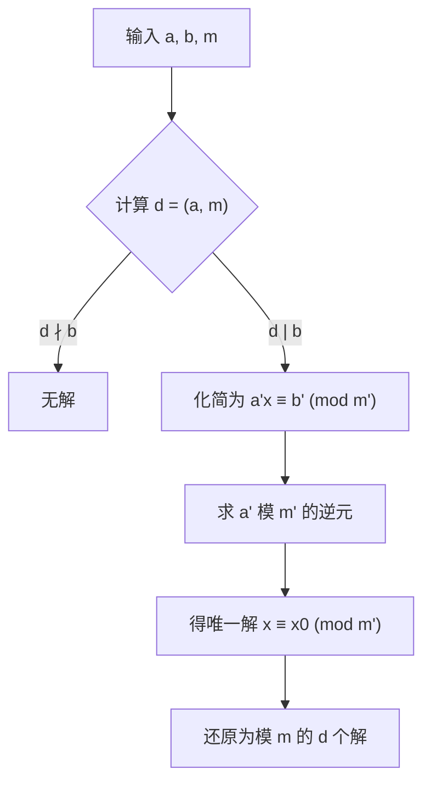

# 一次同余方程ax≡b(mod m)的解的存在性与求解

## 它是什么

一次同余方程是形如

$$ax \equiv b \pmod m$$

的方程，其中 $a, b, m \in \mathbb{Z}$，$m > 1$，求解的目标是找到所有满足条件的整数 $x$。它本质上是在模 $m$ 的剩余类环 $\mathbb{Z}_m$ 中解线性方程，与解不定方程 $ax + my = b$ 完全等价。

> [!IMPORTANT]
> **解的存在性定理**：方程 $ax \equiv b \pmod m$ 有解 $\iff (a, m) \mid b$。有解时，在模 $m$ 的完全剩余系中**恰有 $(a, m)$ 个解**。

## 为什么需要

在密码学中，RSA 解密、仿射密码求逆、椭圆曲线点运算都离不开模逆元；而模逆元存在的充要条件正是 $(a, m) = 1$，这正是一次同余方程 $ax \equiv 1 \pmod m$ 有解的特例。理解存在性条件能避免在密钥生成时选到不可逆的参数。

## 怎么做

求解遵循以下流程：

具体步骤：
1. **判断**：计算 $d = (a, m)$，检验 $d \mid b$ 是否成立；
2. **化简**：两边同除以 $d$，得 $a'x \equiv b' \pmod{m'}$，此时 $(a', m') = 1$；
3. **求逆**：用扩展 Euclid 算法求 $a'^{-1} \pmod{m'}$；
4. **求解**：$x \equiv a'^{-1} b' \pmod{m'}$，此为模 $m'$ 的唯一解；
5. **还原**：原方程在模 $m$ 下有 $d$ 个解：$x \equiv x_0 + k \cdot m' \pmod m$，$k = 0, 1, \dots, d-1$。

> [!TIP]
> 当 $m$ 较小且 $a$ 与 $m$ 互素时，可直接观察或试算 $a$ 的逆元（如习题 2.1 中观察到 $17 \times 9 = 153 \equiv 1 \pmod{19}$，故 $17^{-1} \equiv 9$）。

## 算例

解 $17x \equiv 4 \pmod{19}$（习题 2.1 第 8 题）：

由于 $(17, 19) = 1 \mid 4$，方程有唯一解。观察到 $17 \times 9 = 153 = 8 \times 19 + 1 \equiv 1 \pmod{19}$，故 $17^{-1} \equiv 9 \pmod{19}$。于是

$$x \equiv 17^{-1} \times 4 \equiv 9 \times 4 = 36 \equiv 17 \pmod{19}$$

验证：$17 \times 17 = 289 = 15 \times 19 + 4 \equiv 4 \pmod{19}$，正确。

## 与相近概念的区别

| 概念 | 形式 | 解的存在条件 | 解的个数（模 $m$） |
| :--- | :--- | :--- | :--- |
| **一次同余方程** | $ax \equiv b \pmod m$ | $(a,m) \mid b$ | $(a,m)$ 个 |
| **二元一次不定方程** | $ax + my = b$ | $(a,m) \mid b$ | 无穷多组（整数解） |
| **模逆元存在** | $ax \equiv 1 \pmod m$ | $(a,m) = 1$ | 唯一 |

> [!WARNING]
> 常见错误：忽略存在性判断直接求逆。若 $(a, m) > 1$ 且 $d \mid b$，方程有解但**不能求逆**，必须先化简；若 $d \nmid b$，方程无解。

> [!CAUTION]
> 化简后模数变为 $m' = m/d$，最终必须将解还原到原模数 $m$ 下，遗漏其余 $d-1$ 个解是典型失分点。
