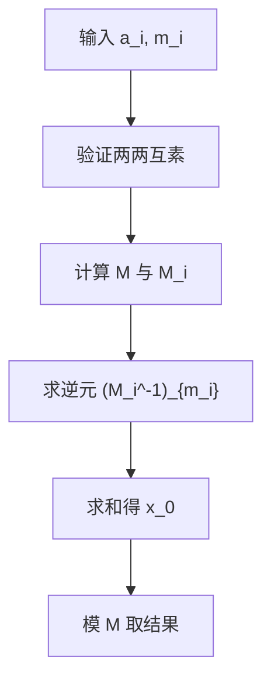

# 中国剩余定理（孙子定理）的内容与构造性证明

## 它是什么

中国剩余定理（孙子定理）回答这样一个问题：给一组**两两互素**的模数 $m_1,\dots,m_n$ 和任意余数 $a_1,\dots,a_n$，同余方程组

$$
\begin{cases}
x \equiv a_1 \pmod{m_1}\\
\vdots\\
x \equiv a_n \pmod{m_n}
\end{cases}
$$

在模 $M=m_1\cdots m_n$ 下**恰有一个解**。

> [!IMPORTANT]
> ==模数必须两两互素==，这是定理成立的前提，也是最容易被忽略的条件。

## 为什么需要

模 $M$ 很大时，直接对 $M$ 取模运算代价高。孙子定理把"大模数问题"拆成若干"小模数问题"分别求解，再合并回原模数——这正是复习提纲里"利用孙子定理求 $37^{31}\bmod 77$"的思路：把 $\bmod\ 77$ 拆成 $\bmod\ 7$ 与 $\bmod\ 11$，用 Fermat 小定理快速化简后再合并。

## 构造性证明（怎么做）

记 $M=\prod m_i$，$M_i=M/m_i$（即除 $m_i$ 外所有模数的乘积）。由于模数两两互素，$(M_i,m_i)=1$，故 $M_i$ 在模 $m_i$ 下有唯一逆元 $(M_i^{-1})_{m_i}$。构造

$$
x_0=\sum_{i=1}^{n} a_i M_i (M_i^{-1})_{m_i}
$$

**验证：** 固定 $i$，当 $j\neq i$ 时 $m_i\mid M_j$，所以 $x_0\equiv a_i M_i(M_i^{-1})_{m_i}\equiv a_i\pmod{m_i}$，确实是解。

**唯一性：** 若 $x_1,x_2$ 都是解，则 $m_i\mid(x_1-x_2)$ 对所有 $i$ 成立，由两两互素得 $M\mid(x_1-x_2)$，故在模 $M$ 下唯一。

> [!TIP]
> 记忆口诀：=="除自己、求逆元、乘余数、再求和"==——$M_i$ 是"除自己"，$(M_i^{-1})_{m_i}$ 是"求逆元"。

## 一个算对的例子

求 $37^{31}\bmod 77$。拆成模 $7$、模 $11$：

- $37^{31}\equiv 37\equiv 2\pmod 7$，$37^{31}\equiv 37\equiv 4\pmod{11}$
- $M_1=11$，$11^{-1}\bmod 7=2$；$M_2=7$，$7^{-1}\bmod{11}=8$

$$
x\equiv 11\cdot2\cdot2+7\cdot8\cdot4=44+224=268\equiv 37\pmod{77}
$$

与快速指数算法结果一致。

## 常见的坑

> [!WARNING]
> - 模数不互素时定理**不适用**，需先判断方程组是否相容。
> - 逆元是 $M_i$ 模 $m_i$ 的逆，不是模 $M$ 的逆，方向极易写反。
> - 方程形如 $2x\equiv5\pmod7$ 时，==先化成 $x\equiv a\pmod m$ 的标准形==（如 $x\equiv-1\pmod7$）再套公式。

## 与相近概念的区别

| 概念 | 条件 | 结论 |
|---|---|---|
| 一次同余方程 $ax\equiv b\pmod m$ | $(a,m)\mid b$ | 模 $m$ 下 $(a,m)$ 个解 |
| ==孙子定理== | 模数两两互素 | 模 $M$ 下**唯一**解 |
| 一般同余方程组 | 模数未必互素 | 需逐对检查相容性 |
