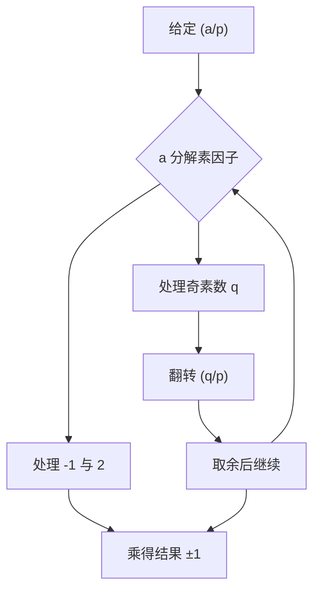

# 二次互反律的内容及使用勒让德符号进行计算的流程

## 二次互反律与勒让德符号计算

判断一个整数是否为模 $p$ 的二次剩余，直接计算所有平方数在模 $p$ 下显然不现实，尤其当 $p$ 很大时。**二次互反律**把“大的模数”与“小的模数”挂起钩来，使得勒让德符号的计算可以通过不断“翻转”和“取余”快速降阶。

### 勒让德符号与基本性质

设 $p$ 为奇素数，$a$ 与 $p$ 互素，勒让德符号定义为：

$$
\left(\frac{a}{p}\right)=
\begin{cases}
1, & x^2\equiv a \pmod p\ \text{有解},\\
-1, & x^2\equiv a \pmod p\ \text{无解}.
\end{cases}
$$

计算时先利用可乘性把 $a$ 分解成素因子：

$$
\left(\frac{ab}{p}\right)=\left(\frac{a}{p}\right)\left(\frac{b}{p}\right),
$$

然后对每个因子分别处理。两个补充公式处理 $-1$ 与 $2$：

$$
\left(\frac{-1}{p}\right)=(-1)^{\frac{p-1}{2}},\qquad
\left(\frac{2}{p}\right)=(-1)^{\frac{p^2-1}{8}}.
$$

> [!IMPORTANT]
> $\left(\frac{-1}{p}\right)=1$ 当且仅当 $p\equiv 1\pmod 4$；$\left(\frac{2}{p}\right)=1$ 当且仅当 $p\equiv \pm 1\pmod 8$。

### 二次互反律：翻转大符号

当 $\left(\frac{q}{p}\right)$ 中 $q$ 本身也是奇素数时，二次互反律允许将符号“上下翻转”：

$$
\left(\frac{q}{p}\right)=(-1)^{\frac{p-1}{2}\cdot\frac{q-1}{2}}\left(\frac{p}{q}\right).
$$

翻转后，较大的 $p$ 可对 $q$ 取余，继续分解、继续翻转。这个过程的计算量远小于直接枚举平方剩余。

> [!TIP]
> 记忆口诀：==奇素数之间翻转一次，除非两者都是 $3\bmod 4$，符号才变号==。因为 $\frac{p-1}{2}\cdot\frac{q-1}{2}$ 为奇数的充要条件是 $p,q$ 均为 $3\bmod 4$。

### 计算流程

整个计算可以概括为下面的流程：

每一步只做三件事：**分解、翻转、取余**。循环直到只剩 $\left(\frac{\pm1}{p}\right)$ 或 $\left(\frac{2}{p}\right)$。

> [!WARNING]
> 翻转前必须确认分子是**奇素数**。若分子是合数（如 $30$、$52$），先分解为素因子再分别翻转，不能直接互反。若分子含 $2$ 或 $-1$，先提出用补充公式处理。

### 一个算对的例子

计算 $\left(\frac{118}{229}\right)$，其中 $229$ 为奇素数。

先分解：

$$
\left(\frac{118}{229}\right)
=\left(\frac{2}{229}\right)\left(\frac{59}{229}\right).
$$

$229\equiv 5\pmod 8$，所以 $\left(\frac{2}{229}\right)=(-1)^{\frac{229^2-1}{8}}=-1$。再翻转：

$$
\left(\frac{59}{229}\right)
=(-1)^{\frac{59-1}{2}\cdot\frac{229-1}{2}}\left(\frac{229}{59}\right)
=(-1)^{29\cdot 114}\left(\frac{52}{59}\right)
=\left(\frac{52}{59}\right).
$$

继续分解、提出平方因子：

$$
\left(\frac{52}{59}\right)
=\left(\frac{2^2}{59}\right)\left(\frac{13}{59}\right)
=\left(\frac{13}{59}\right).
$$

再翻转：

$$
\left(\frac{13}{59}\right)
=(-1)^{\frac{13-1}{2}\cdot\frac{59-1}{2}}\left(\frac{59}{13}\right)
=(-1)^{6\cdot 29}\left(\frac{7}{13}\right)
=\left(\frac{7}{13}\right).
$$

继续：

$$
\left(\frac{7}{13}\right)
=(-1)^{\frac{7-1}{2}\cdot\frac{13-1}{2}}\left(\frac{13}{7}\right)
=(-1)^{3\cdot 6}\left(\frac{-1}{7}\right)
=(-1)^{\frac{7-1}{2}}=-1.
$$

代回原式：

$$
\left(\frac{118}{229}\right)=(-1)\times(-1)=1.
$$

因此 $x^2\equiv 118\pmod{229}$ 有解。

> [!NOTE]
> 像 $\left(\frac{59^{87}\times23}{89}\right)$ 这类带幂次的符号，可先利用 $a^{p-1}$ 的周期性或直接对幂底取模化简，再按上述流程计算。核心始终是==分解 → 翻转 → 取余==三步。
