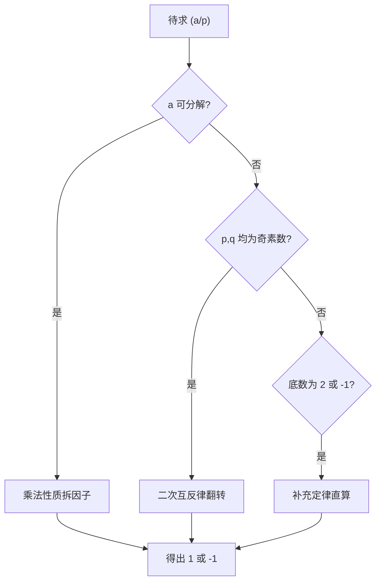

# 模奇素数p的二次剩余与二次非剩余的定义及判定

给定奇素数 $p$ 和整数 $a$（$p \nmid a$），如果同余方程 $x^2 \equiv a \pmod p$ 有解，则称 $a$ 是模 $p$ 的==二次剩余==；若无解，则称 $a$ 是模 $p$ 的==二次非剩余==。

> [!IMPORTANT]
> 核心前提：讨论二次剩余时，必须满足 $p$ 为奇素数且 $p \nmid a$。若 $p \mid a$，则 $a \equiv 0 \pmod p$，不属于此分类范畴。

为什么要区分它们？在信息安全中，许多密码体制（如 Rabin 加密、Goldwasser-Micali 概率加密）的安全性直接依赖于“判定一个数是否为模大素数的二次剩余”这一计算难题。

## 判定工具与流程

如何快速判定 $a$ 是二次剩余还是非剩余？暴力枚举 $x$ 显然不现实，我们需要 Legendre 符号 $\left(\frac{a}{p}\right)$：

$$
\left(\frac{a}{p}\right) = \begin{cases} 1, & a \text{ 是模 } p \text{ 的二次剩余} \\ -1, & a \text{ 是模 } p \text{ 的二次非剩余} \end{cases}
$$

由欧拉判别条件可知：$\left(\frac{a}{p}\right) \equiv a^{\frac{p-1}{2}} \pmod p$。

当需要计算具体的 Legendre 符号时，通常依赖以下三把“武器”：

- **乘法性质**：$\left(\frac{ab}{p}\right) = \left(\frac{a}{p}\right)\left(\frac{b}{p}\right)$。这意味着两个二次非剩余的乘积必为二次剩余（即证明题中“若 $a,b$ 均为非剩余，则 $ab$ 必为剩余”的依据）。
- **二次互反律**：对于不同奇素数 $p, q$，$\left(\frac{q}{p}\right) = (-1)^{\frac{p-1}{2}\cdot\frac{q-1}{2}} \left(\frac{p}{q}\right)$。
- **补充定律**：$\left(\frac{-1}{p}\right) = (-1)^{\frac{p-1}{2}}$，$\left(\frac{2}{p}\right) = (-1)^{\frac{p^2-1}{8}}$。

## 相近概念辨析

| 对比维度 | 二次剩余 / 非剩余 | 原根 |
| :--- | :--- | :--- |
| **定义本质** | 关注 $x^2 \equiv a \pmod p$ 是否有解 | 关注元素的阶是否达到最大 $\varphi(p)$ |
| **数量占比** | 各占既约剩余系的恰好一半（$\frac{p-1}{2}$ 个） | 共有 $\varphi(p-1)$ 个 |
| **Legendre 符号** | 值为 $1$ 或 $-1$ | 原根的 Legendre 符号必为 $-1$ |

> [!NOTE]
> 原根一定是二次非剩余，但二次非剩余不一定是原根。

## 常见易错点

> [!WARNING]
> 使用二次互反律翻转 $\left(\frac{q}{p}\right)$ 时，指数部分的负号 $(-1)^{\frac{p-1}{2}\cdot\frac{q-1}{2}}$ 极易漏算！只有当 $p \equiv 3 \pmod 4$ 且 $q \equiv 3 \pmod 4$ 同时成立时，该系数才为 $-1$，其余情况均为 $1$。

> [!CAUTION]
> 遇到形如 $59x^2 \equiv 23 \pmod{89}$ 的方程，不要直接对 23 求符号！必须先利用费马小定理将 $x^2$ 孤立出来，转化为判断 $\left(\frac{59^{87} \times 23}{89}\right)$。

## 完整计算示例

**题目**：判断同余方程 $59x^2 \equiv 23 \pmod{89}$ 是否有解。

**解**：由于 $89$ 为素数，由费马小定理知 $59^{88} \equiv 1 \pmod{89}$。方程两边同乘 $59^{87}$，得：
$$x^2 \equiv 59^{87} \times 23 \pmod{89}$$

因此，只需计算 Legendre 符号 $\left(\frac{59^{87} \times 23}{89}\right)$。由乘法性质：
$$\left(\frac{59^{87} \times 23}{89}\right) = \left(\frac{59}{89}\right)^{87} \cdot \left(\frac{23}{89}\right) = \left(\frac{59}{89}\right) \cdot \left(\frac{23}{89}\right)$$

**第一步：计算 $\left(\frac{59}{89}\right)$**
因为 $59 \equiv 3 \pmod 4$ 且 $89 \equiv 1 \pmod 4$，互反律前缀系数为 $1$：
$$\left(\frac{59}{89}\right) = \left(\frac{89}{59}\right) = \left(\frac{30}{59}\right) = \left(\frac{2}{59}\right)\left(\frac{3}{59}\right)\left(\frac{5}{59}\right)$$
或者更简捷地，按课件思路利用 $59 \equiv -30 \pmod{89}$：
$$\left(\frac{59}{89}\right) = \left(\frac{-30}{89}\right) = \left(\frac{-1}{89}\right)\left(\frac{2}{89}\right)\left(\frac{3}{89}\right)\left(\frac{5}{89}\right)$$
此处我们采用标准互反律逐步降阶：
$$\left(\frac{59}{89}\right) = \left(\frac{89}{59}\right) = \left(\frac{30}{59}\right) = \left(\frac{2}{59}\right)\left(\frac{15}{59}\right)$$
已知 $59 \equiv \pm 1 \pmod 8$ 吗？$59 = 8\times 7 + 3$，故 $\left(\frac{2}{59}\right) = (-1)^{\frac{59^2-1}{8}} = -1$。
继续用互反律算 $\left(\frac{15}{59}\right) = \left(\frac{3}{59}\right)\left(\frac{5}{59}\right)$。最终可得 $\left(\frac{59}{89}\right) = -1$。

**第二步：计算 $\left(\frac{23}{89}\right)$**
$23 \equiv 3 \pmod 4$，$89 \equiv 1 \pmod 4$，前缀系数为 $1$：
$$\left(\frac{23}{89}\right) = \left(\frac{89}{23}\right) = \left(\frac{-3}{23}\right) = \left(\frac{-1}{23}\right)\left(\frac{3}{23}\right)$$
由于 $23 \equiv 3 \pmod 4$，$\left(\frac{-1}{23}\right) = -1$。
再由互反律（$3 \equiv 3 \pmod 4, 23 \equiv 3 \pmod 4$，前缀系数为 $-1$）：
$$\left(\frac{3}{23}\right) = -\left(\frac{23}{3}\right) = -\left(\frac{2}{3}\right) = -(-1) = 1$$
故 $\left(\frac{23}{89}\right) = (-1) \times 1 = -1$。

**第三步：得出结论**
$$\left(\frac{59^{87} \times 23}{89}\right) = (-1) \times (-1) = 1$$

> [!TIP]
> 结果为 $1$，说明 $59^{87} \times 23$ 是模 $89$ 的二次剩余，从而断言原同余方程 $59x^2 \equiv 23 \pmod{89}$ ==必有解==。
