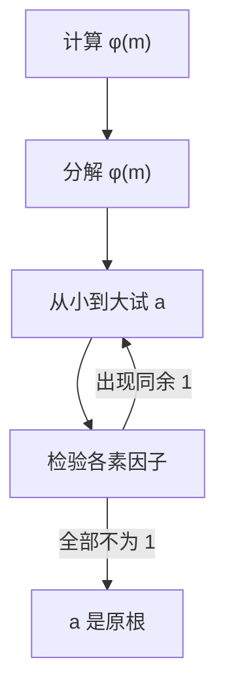

# 原根的定义及存在原根的模m的条件（2,4,p^k,2p^k）

## 原根是什么

设 $m>1$，$(a,m)=1$，$a$ 对模 $m$ 的阶记为 $\delta_m(a)$。若
$$
\delta_m(a)=\varphi(m),
$$
则称 $a$ 是模 $m$ 的一个==原根==。

也就是说，$a$ 的幂要“尽可能久”才第一次回到 $1$。例如模 $5$ 时，$2^1,2^2,2^3,2^4$ 依次为 $2,4,3,1$，所以 $\delta_5(2)=4=\varphi(5)$，故 $2$ 是模 $5$ 的原根。

为什么需要原根？若 $g$ 是模 $m$ 的原根，则
$$
g^0,g^1,\ldots,g^{\varphi(m)-1}
$$
恰好构成模 $m$ 的缩系。于是每个与 $m$ 互素的数都能写成 $g^k$，指数 $k$ 就是离散对数研究的对象。

## 哪些模存在原根

模 $m$ 存在原根，当且仅当
$$
\boxed{m=2,\ 4,\ p^k,\ 2p^k}
$$
其中 $p$ 为奇素数，$k\ge 1$。

> [!IMPORTANT]
> 奇素数 $p$、奇素数幂 $p^k$ 及其二倍 $2p^k$ 都有原根；除此之外，只补上 $2$ 和 $4$。

| 模 $m$ | 是否有原根 | 原因或例子 |
|---|---:|---|
| $2,4$ | 有 | 缩系本身即为循环结构 |
| $7,7^2$ | 有 | 属于 $p,p^k$ |
| $14=2\cdot7$ | 有 | 属于 $2p^k$ |
| $8$ | 无 | $1,3,5,7$ 的平方均同余 $1\pmod 8$，但 $\varphi(8)=4$ |
| $12$ | 无 | 不属于上述四类 |

> [!WARNING]
> 不要记成“所有素数幂都有原根”：$2^3=8$ 就没有原根；也不要漏掉 $2p^k$，如模 $14$ 有原根。

## 怎么求最小正原根

求模 $p$ 的原根时，不必逐个计算到 $a^{p-1}$。设
$$
p-1=q_1^{e_1}\cdots q_s^{e_s}
$$
为素因数分解。若对每个 $q_i$ 都有
$$
a^{(p-1)/q_i}\not\equiv1\pmod p,
$$
则 $a$ 是模 $p$ 的原根。因为阶若不是 $p-1$，就必整除某个 $(p-1)/q_i$。

以求模 $23$ 的最小正原根为例：$\varphi(23)=22=2\cdot11$。试算得
$$
2^{11}\equiv1,\qquad 3^{11}\equiv1,\qquad 4^{11}\equiv1\pmod{23},
$$
所以 $2,3,4$ 的阶都不是 $22$。而
$$
5^2\equiv2\pmod{23},\qquad 5^{11}\equiv-1\pmod{23},
$$
两个关键检验均不得到 $1$，故 $\delta_{23}(5)=22$，==模 $23$ 的最小正原根是 $5$==。

> [!TIP]
> 若已知 $g$ 是原根，则 $g^k$ 也是原根当且仅当 $(k,\varphi(m))=1$；原根共有 $\varphi(\varphi(m))$ 个。原根不是唯一的，“最小正原根”才强调从小到大找到的第一个。

> [!NOTE]
> 原根与二次剩余紧密相连：对奇素数 $p$ 及其原根 $g$，偶次幂 $g^2,g^4,\ldots,g^{p-1}$ 是二次剩余，奇次幂是二次非剩余；特别地，$g^{(p-1)/2}\equiv-1\pmod p$。
