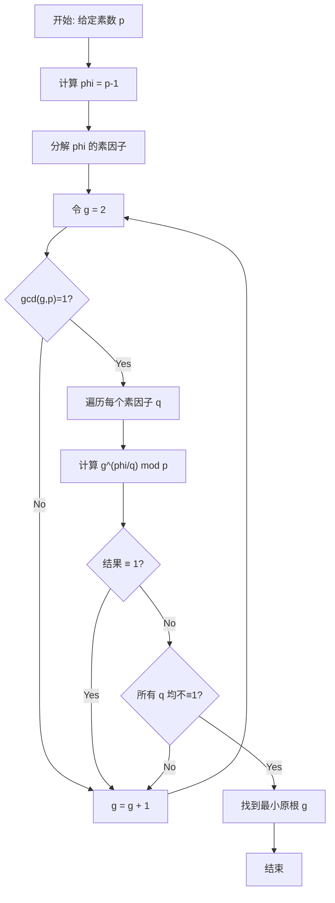

# 寻找模m的原根的具体算法与判定方法

## 什么是原根与判定逻辑

在模 $m$ 的剩余类环中，若整数 $g$ 的阶 $\delta_m(g)$ 等于欧拉函数值 $\varphi(m)$，则称 $g$ 为模 $m$ 的==原根==。原根的存在意味着乘法群是循环群，这对于离散对数、公钥密码体制（如 Diffie-Hellman）至关重要。

> [!IMPORTANT]
> 核心判定定理：设 $g$ 与 $m$ 互素，$\varphi(m)$ 的所有不同素因数为 $q_1, \dots, q_k$。$g$ 是模 $m$ 原根的充要条件是：
> $$ g^{\frac{\varphi(m)}{q_i}} \not\equiv 1 \pmod m, \quad \forall i=1,\dots,k $$

为什么不用定义直接算 $g^{\varphi(m)} \equiv 1$？因为那只能证明阶整除 $\varphi(m)$，无法排除阶是真因子的情况。上述定理通过检查“最大真因子”幂次，高效排除了非原根。

## 寻找最小正原根的算法流程

寻找模 $m$（通常为素数 $p$）的最小原根，本质是从小到大遍历整数 $g=2,3,\dots$，直到找到满足判定条件的 $g$。

> [!TIP]
> 解题技巧：对于素数 $p$，$\varphi(p)=p-1$。先对 $p-1$ 进行素因数分解，只需用这些素因子作为指数分母进行测试，无需测试所有因子。

## 常见误区与概念辨析

| 概念 | 定义/性质 | 易混点 |
| :--- | :--- | :--- |
| **阶** $\delta_m(a)$ | 使 $a^d \equiv 1$ 的最小正整数 $d$ | 阶一定整除 $\varphi(m)$，但不一定相等 |
| **原根** | 阶等于 $\varphi(m)$ 的元素 | 原根一定是生成元，但生成元未必是最小原根 |
| **二次剩余** | $x^2 \equiv a$ 有解 | 若 $g$ 是原根，则 $g$ 必不是二次剩余 |

> [!WARNING]
> 高频坑点：
> 1. 忽略 $g$ 必须与 $m$ 互素的前提（虽然素数模下自动满足，但合数模需小心）。
> 2. 判定条件记反：必须是 $\not\equiv 1$。只要有一个素因子对应的幂次同余于 1，该 $g$ 就不是原根。
> 3. 计算指数时未使用快速幂或费马小定理简化，导致手算出错。

## 典型例题解析

**题目**：试求模 23 的最小正原根。

**解析步骤**：
1.  **准备数据**：$m=23$ 是素数，$\varphi(23)=22$。
2.  **分解因子**：$22 = 2 \times 11$，素因子为 $q_1=2, q_2=11$。
3.  **判定条件**：需同时满足 $g^{11} \not\equiv 1 \pmod{23}$ 且 $g^{2} \not\equiv 1 \pmod{23}$。

*   **试 $g=2$**：
    $2^2 = 4 \not\equiv 1$。
    $2^{11} = 2048$。$2048 \div 23 = 89 \dots 1$，即 $2^{11} \equiv 1 \pmod{23}$。
    $\Rightarrow$ 2 不是原根（阶为 11）。

*   **试 $g=3$**：
    $3^2 = 9 \not\equiv 1$。
    $3^{11} \equiv 1 \pmod{23}$（可通过 $3^5=243 \equiv 13, 3^{10} \equiv 169 \equiv 8, 3^{11}=24 \equiv 1$ 验证）。
    $\Rightarrow$ 3 不是原根。

*   **试 $g=4$**：
    $4=2^2$，其阶为 $11/\gcd(2,11)=11$。或直接算 $4^{11} = (2^2)^{11} = (2^{11})^2 \equiv 1^2 = 1$。
    $\Rightarrow$ 4 不是原根。

*   **试 $g=5$**：
    $5^2 = 25 \equiv 2 \not\equiv 1$。
    $5^{11} \equiv -1 \not\equiv 1 \pmod{23}$（注：$5^2=2, 5^4=4, 5^8=16, 5^{11}=5^8 \cdot 5^2 \cdot 5 = 16 \cdot 2 \cdot 5 = 160 = 7 \times 23 - 1 \equiv -1$）。
    $\Rightarrow$ 两个条件均满足。

==结论==：模 23 的最小正原根为 **5**。
