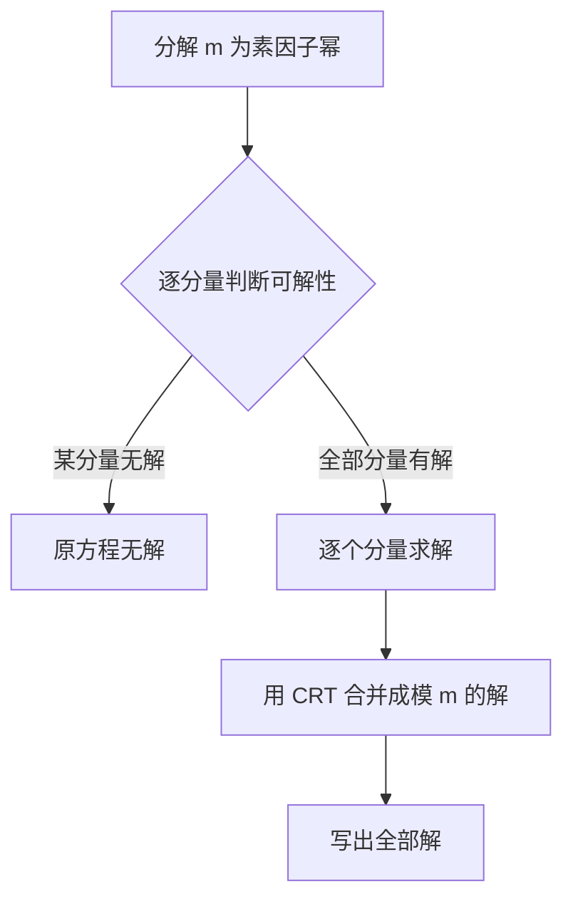

# x²≡a(mod m)在一般模数下的可解性与求解步骤

## 一般模数下 $x^2\equiv a\pmod m$ 的可解性

前面已经知道：对奇素数 $p$，可以用 Euler 判别法判断 $x^2\equiv a\pmod p$ 是否有解。但当模数 $m$ 不是素数时，问题会复杂得多。现在要回答两个问题：

- 对一般的 $m$，怎么判断 $x^2\equiv a\pmod m$ 有没有解？
- 如果有解，怎么把它求出来？

### 从模素数到模素数幂

先回顾一个关键结论：

> [!IMPORTANT]
> 设 $p$ 为奇素数，$\gcd(a,p)=1$，则 $x^2\equiv a\pmod {p^k}$（$k\geq 1$）有解的充要条件是 $x^2\equiv a\pmod p$ 有解，即 $\left(\frac{a}{p}\right)=1$。

为什么？直观地说，模 $p$ 有解是模 $p^k$ 有解的必要条件；反过来，如果模 $p$ 有解，可以通过 **Hensel 提升** 把解从模 $p$ “抬”到模 $p^2$、$p^3$、……、$p^k$。

对 $p=2$ 的情况要单独处理，因为 $2$ 是偶素数，行为特殊。实用中记住：

- $\bmod 2$：$x^2\equiv a\pmod 2$ 当 $a\equiv 0,1\pmod 2$ 时有解；
- $\bmod 4$：$x^2\equiv a\pmod 4$ 有解当且仅当 $a\equiv 0,1\pmod 4$；
- $\bmod 2^k$（$k\geq 3$）：若 $\gcd(a,2)=1$，则 $x^2\equiv a\pmod {2^k}$ 有解当且仅当 $a\equiv 1\pmod 8$。

### 一般模数：先分解再“拼起来”

对一般模数 $m$，标准做法是利用中国剩余定理：

设

$$
m=2^k p_1^{e_1}p_2^{e_2}\cdots p_r^{e_r},
$$

其中 $p_i$ 为奇素数。则同余方程

$$
x^2\equiv a\pmod m
$$

有解当且仅当下列每一个同余方程都有解：

$$
x^2\equiv a\pmod {2^k},\quad
x^2\equiv a\pmod {p_i^{e_i}}\quad (i=1,\dots,r).
$$

> [!TIP]
> 判断原则：把 $m$ 按素因子分解，**一个因子不通过，整体就无解**。

解数也可以数出来：如果每个分量都有解，则原方程的解数为各分量解数的乘积。对奇素数幂 $p^e$，当 $\left(\frac{a}{p}\right)=1$ 且 $p\nmid a$ 时，恰有 $2$ 个解；若 $p\mid a$，需要额外讨论 $a$ 中 $p$ 的幂次。

### 具体求解步骤

面对 $x^2\equiv a\pmod m$，可以按下列流程操作：

- **逐分量判断**：对奇素数幂用 Legendre 符号；对 $2^k$ 用上面 $2$ 的规则。
- **逐分量求解**：先求模 $p$ 的解，再用 Hensel 提升到 $p^e$；模 $2^k$ 直接讨论。
- **合并**：用中国剩余定理把所有分量解组合，得到模 $m$ 的全部解。

### 与 Jacobi 符号的关系：一个高频坑

Jacobi 符号 $\left(\frac{a}{m}\right)$ 是对合数模定义的，但它**不能**直接判断可解性。

> [!WARNING]
> $\left(\frac{a}{m}\right)=1$ **推不出** $x^2\equiv a\pmod m$ 有解；但若有解，则必有 $\left(\frac{a}{m}\right)=1$。

经典反例如下：

取 $p_1=p_2\equiv 3\pmod 4$ 的素数，令 $m=p_1p_2$，$a=-1$。则

$$
\left(\frac{-1}{m}\right)=\left(\frac{-1}{p_1}\right)\left(\frac{-1}{p_2}\right)=(-1)(-1)=1.
$$

但

$$
x^2\equiv -1\pmod m
$$

等价于

$$
\begin{cases}
x^2\equiv -1\pmod {p_1},\\
x^2\equiv -1\pmod {p_2}.
\end{cases}
$$

因为 $p_i\equiv 3\pmod 4$ 时，$-1$ 是模 $p_i$ 的二次非剩余，每个分量都无解，所以原方程无解。

这正说明：Jacobi 符号为 $1$ 只是“看起来像有解”，真正判断必须回到素因子分解。

### 一个算对了的例子

判断并求解 $x^2\equiv 21\pmod {45}$。

**解**：分解 $45=3^2\cdot 5$。逐个判断：

- 模 $5$：$21\equiv 1\pmod 5$，$1$ 是二次剩余，$\left(\frac{1}{5}\right)=1$，模 $5$ 有解 $x\equiv \pm 1\pmod 5$。
- 模 $9$：$21\equiv 3\pmod 9$。先看模 $3$：$x^2\equiv 3\equiv 0\pmod 3$，有解 $x\equiv 0\pmod 3$。提升到模 $9$：令 $x=3t$，则 $x^2=9t^2\equiv 0\pmod 9$，不可能是 $3$，所以模 $9$ 无解。

因此原方程 $x^2\equiv 21\pmod {45}$ ==无解==。

> [!NOTE]
> 这类题的常见错误是只检查 Jacobi 符号。比如有的同学先算 $\left(\frac{21}{45}\right)$，发现是 $1$，就直接说有解，这是不完整的。合数模必须分解后逐分量判断。
