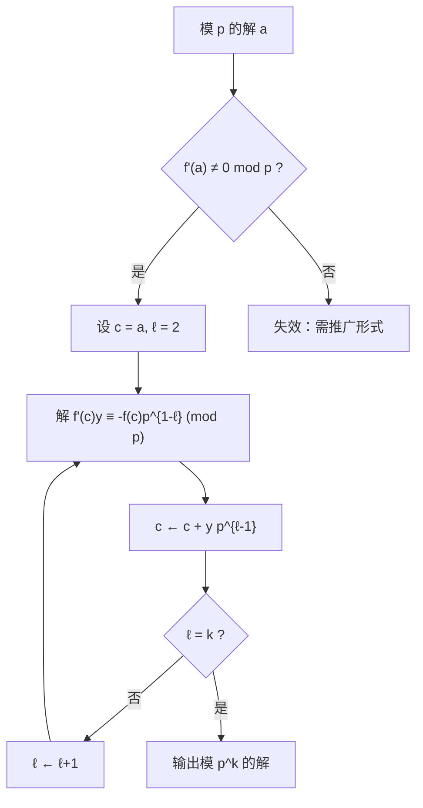

# Hensel引理（从模p的解提升到模p^k的解）

## Hensel 引理：把模 $p$ 的解“抬”到模 $p^k$

### 它要解决的问题

解同余方程时，模越大越难直接试根。模 $p$ 的方程解起来容易（最多试 $p$ 个数），但模 $p^k$ 的候选数有 $p^k$ 个，试不过来。

Hensel 引理的思路是：==如果 $f(x)\equiv 0\pmod p$ 有一个“好”解，就能一步步把它提升成模 $p^2,p^3,\dots,p^k$ 的解==。每步只需求解一个模 $p$ 的一次同余方程。

> [!IMPORTANT]
> 设 $f(a)\equiv 0\pmod p$ 且 $f'(a)\not\equiv 0\pmod p$，则对任意 $k\geq 2$，存在唯一提升链 $x_k\equiv a\pmod p$ 满足 $f(x_k)\equiv 0\pmod{p^k}$。

### 提升公式怎么来

假设已经找到模 $p^{\ell-1}$ 的解 $c$，要找模 $p^{\ell}$ 的解，设

$$
x = c + y\,p^{\ell-1},
$$

其中 $y\in\{0,1,\dots,p-1\}$ 待定。做 Taylor 展开：

$$
f(c + yp^{\ell-1}) \equiv f(c) + yp^{\ell-1} f'(c) \pmod{p^{\ell}}.
$$

因为 $f(c)\equiv 0\pmod{p^{\ell-1}}$，令 $f(c) = t\,p^{\ell-1}$，则上式模 $p^\ell$ 为

$$
t\,p^{\ell-1} + y\,p^{\ell-1} f'(c) \equiv 0 \pmod{p^{\ell}}.
$$

除以 $p^{\ell-1}$，得到决定 $y$ 的方程：

$$
\boxed{\;f'(c)\,y \equiv -t \equiv -f(c)\cdot p^{1-\ell} \pmod p\;}
$$

这就是 ==Hensel 提升公式==。因为 $f'(c)\equiv f'(a)\not\equiv 0\pmod p$，$y$ 唯一存在。

### 一个完整例子

解

$$
x^3 + x^2 - 5 \equiv 0 \pmod{7^3}.
$$

**第 1 步：模 7 找根。** 令 $f(x)=x^3+x^2-5$，试得

$$
f(2)=8+4-5=7\equiv 0\pmod 7,
$$

且 $f'(x)=3x^2+2x$，$f'(2)=16\equiv 2\not\equiv 0\pmod 7$，条件满足。

**第 2 步：提升到模 $7^2$。** 设 $x=2+7y$。此时 $\ell=2$，提升方程为

$$
f'(2)y \equiv -f(2)\cdot 7^{-1} \pmod 7.
$$

$f(2)=7$，$f'(2)=16$，故

$$
16y \equiv -7 \times \frac{1}{7} \equiv -1 \pmod 7.
$$

即 $2y\equiv-1\equiv 6\pmod 7$，得 $y\equiv 3\pmod 7$。所以

$$
x \equiv 2 + 3\cdot 7 = 23 \pmod{7^2}.
$$

**第 3 步：提升到模 $7^3$。** 令 $x=23+7^2 y=23+49y$。此时 $\ell=3$，提升方程为

$$
f'(23)y \equiv -f(23)\cdot 7^{-2} \pmod 7.
$$

算：

$$
f(23)=23^3+23^2-5 = 12167+529-5=12691,
$$

而 $12691 = 7^2 \times 259$，所以 $f(23)\cdot 7^{-2}=259\equiv 0\pmod 7$。又

$$
f'(23)=3\cdot 23^2+2\cdot 23 = 1587+46=1633\equiv 4\pmod 7.
$$

提升方程为 $4y\equiv -0\equiv 0\pmod 7$，得 $y\equiv 0$。于是

$$
x \equiv 23 + 0\cdot 49 = 23 \pmod{7^3}.
$$

验证：$f(23)=12691=7^2\times 259=7^3\times 37$，确实 $\equiv 0\pmod{7^3}$。

> [!TIP]
> 每一步 $y$ 的值都与上一步的模 $p^{\ell-1}$ 解有关，不能用模 $p$ 的根 $a$ 直接代替 $c$ 去算最后一步。过程要 **逐级提升**。

### 与一般 Taylor 展开法的关系

Hensel 引理本质上就是 ==把解按 $p$ 进制逐位确定==：先在模 $p$ 下确定“个位”，再在模 $p^2$ 下确定“$p$ 位”，再确定“$p^2$ 位”等等。它比直接对 $p^k$ 试根高效得多。

### 常见的坑

| 问题 | 后果 |
|---|---|
| $f'(a)\equiv 0\pmod p$ 仍用基本公式 | $y$ 的系数为 0，方程可能无解或多解，不能唯一提升 |
| 跳过模 $p^2$ 直接从 $p$ 跳到 $p^3$ | 提升公式中的 $c$ 必须是模 $p^{\ell-1}$ 的解 |
| 忘除以 $p^{\ell-1}$ | 提升方程不在模 $p$ 下，无法直接解 $y$ |

> [!WARNING]
> 当 $f'(a)\equiv 0\pmod p$ 时，需要更精细的分析：可能每个 $y$ 都行、可能全都不行。考试时优先验证 $f'(a)\not\equiv 0\pmod p$。
