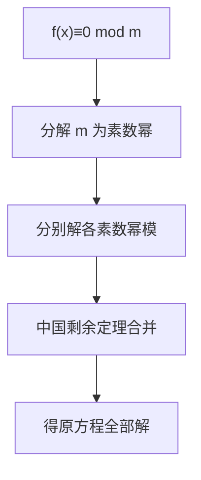

# 高次同余方程f(x)≡0(mod m)化归为素数幂模的方法

求解高次同余方程 $f(x) \equiv 0 \pmod m$ 时，若模数 $m$ 是一个较大的合数，直接穷举往往计算量巨大。我们自然会问：能否把“大模数”拆成几个“小模数”，分别求解后再拼回去？

这正是**化归为素数幂模**的核心思想。

## 核心引理与化归依据

在拆分之前，必须确认一个基本事实：同余类中的整数代入多项式后，结果是否仍然同余？课件中给出了严格证明：

> [!IMPORTANT]
> 设 $f(x)=a_{n}x^{n}+\cdots+a_{0}$ 为整系数多项式，若 $m \mid x_{2}-x_{1}$，则 $m \mid f(x_{1})-f(x_{2})$。

**证明**：对任意 $1 \leq k \leq n$，由因式分解公式有
$$x_{2}^{k} - x_{1}^{k} = (x_{2} - x_{1}) \sum_{i=0}^{k-1} x_{2}^{(k-1)-i} x_{1}^{i}$$
因此 $x_{2}-x_{1} \mid a_{k}x_{2}^{k} - a_{k}x_{1}^{k}$，逐项相加即得 $x_{2}-x_{1} \mid f(x_{2})-f(x_{1})$。再由 $m \mid x_{2}-x_{1}$，传递得到 $m \mid f(x_{1})-f(x_{2})$。

这个引理保证了：==只要 $x_1 \equiv x_2 \pmod m$，必有 $f(x_1) \equiv f(x_2) \pmod m$==。换言之，解只依赖于 $x$ 所在的模 $m$ 剩余类。

## 化归方法：从合数到素数幂

根据算术基本定理，设 $m = p_1^{\alpha_1} p_2^{\alpha_2} \cdots p_k^{\alpha_k}$。因为各素数幂两两互素，原方程等价于一个同余方程组：

$$f(x) \equiv 0 \pmod{p_i^{\alpha_i}}, \quad i=1,2,\dots,k$$

整体求解流程如下：

> [!TIP]
> 解题三步走：**分解模数 $\to$ 逐个击破 $\to$ CRT 拼装**。

## 算例演示

求 $f(x) = x^2 + x + 1 \equiv 0 \pmod{6}$ 的解。

**第一步：分解模数。** $6 = 2 \times 3$，化为两个素数幂（此处指数均为 1）模的方程：
$$\begin{cases} x^2+x+1 \equiv 0 \pmod 2 \\ x^2+x+1 \equiv 0 \pmod 3 \end{cases}$$

**第二步：逐个求解。**
- 模 2：代入 $x=0, 1$。$f(0)=1$, $f(1)=3 \equiv 1$，无解。
- 既然模 2 无解，整个方程组就无解。故原方程 $x^2+x+1 \equiv 0 \pmod 6$ ==无解==。

若改为求 $x^2 - 1 \equiv 0 \pmod{15}$（$15=3\times 5$）：
- 模 3：$x^2 \equiv 1 \Rightarrow x \equiv 1, 2 \pmod 3$
- 模 5：$x^2 \equiv 1 \Rightarrow x \equiv 1, 4 \pmod 5$
- 第三步：用中国剩余定理将 $(1,1), (1,4), (2,1), (2,4)$ 四组解分别合并，得到模 15 下的四个解：$x \equiv 1, 4, 11, 14 \pmod{15}$。

## 易混辨析与避坑

| 比较项 | 素数模 $p$ | 素数幂模 $p^\alpha$ | 合数模 $m$ |
| :--- | :--- | :--- | :--- |
| **求解难度** | 低，可直接试根或用定理 | 较高，需 Hensel 提升 | 最高，必须先化归 |
| **解的个数** | $\leq n$（次数） | 可能多于 $n$ 个 | 各子方程解数之积 |
| **处理方法** | 费马小定理降次等 | 逐次升幂法 | 分解 + CRT |

> [!WARNING]
> 化归后的子模是 $p_i^{\alpha_i}$ 而不是 $p_i$！很多同学在考场上习惯性地把 $m=12$ 拆成模 2 和模 3，漏掉了指数（应为模 4 和模 3），导致后续 Hensel 提升无法进行，全盘皆输。

> [!CAUTION]
> 使用中国剩余定理合并的前提是各子模==两两互素==。如果题目给的模数不是标准分解形式（如模 12 拆成模 4 和模 6），由于 $\gcd(4,6)\neq 1$，不能直接用 CRT，必须先做素数幂分解。
