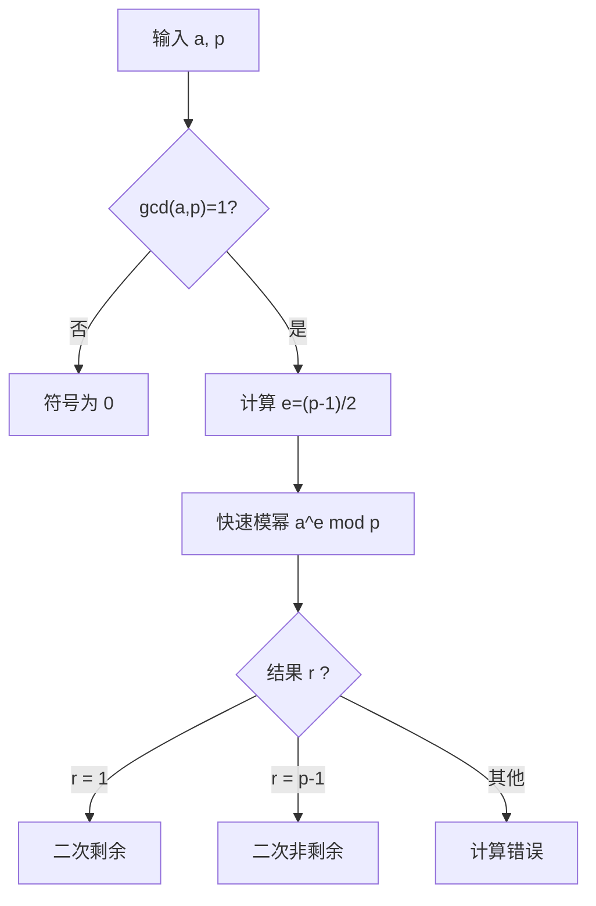

# 欧拉判别准则（a^((p-1)/2)≡(a/p)(mod p)的证明与应用）

## 它是什么与为什么需要

在判断同余方程 $x^2 \equiv a \pmod p$ 是否有解时，直接尝试所有 $x$ 效率极低。欧拉判别准则建立了 ==Legendre 符号与模幂运算的桥梁==，将二次剩余的判定转化为一次模指数计算：

> [!IMPORTANT]
> 设 $p$ 为奇素数，$\gcd(a, p)=1$，则 $\left(\frac{a}{p}\right) \equiv a^{\frac{p-1}{2}} \pmod p$。

这意味着我们无需分解 $a$，仅通过计算 $a^{(p-1)/2} \bmod p$ 即可得知结果：值为 $1$ 则是二次剩余，值为 $-1$（即 $p-1$）则是二次非剩余。它是后续学习二次互反律的计算基石。

## 怎么做与算法流程

计算核心在于 ==快速模幂算法==。面对大指数 $\frac{p-1}{2}$，必须使用二进制拆分法，避免中间结果溢出。

[!TIP]
> 解题口诀：==指数减半取模幂，得一为剩减一非==。当题目给出原根 $g$ 时，可直接利用 $g^{\frac{p-1}{2}} \equiv -1 \pmod p$ 这一推论简化判断。

## 与相近概念的区别

| 概念 | 作用 | 适用场景 | 计算复杂度 |
| :--- | :--- | :--- | :--- |
| 欧拉判别准则 | 直接计算符号值 | $p$ 较小或需验证 | $O(\log p)$ |
| 二次互反律 | 翻转/化简符号 | $p, q$ 均为大素数 | $O(\log p)$ |
| 原根性质 | 奇偶性判定 | 已知模 $p$ 原根 | $O(1)$ |

[!NOTE]
> 欧拉判别准则是“定义级”工具，而二次互反律是“化简级”工具。考试中若 $p$ 不大（如 $<100$），直接用欧拉准则往往比互反律更快；若涉及多个大素数乘积，优先用互反律拆解后再用欧拉准则收尾。

## 常见的坑

> [!WARNING]
> - **前提遗漏**：必须确认 $p$ 是 ==奇素数== 且 $\gcd(a,p)=1$。$p=2$ 时公式失效。
> - **符号混淆**：$a^{\frac{p-1}{2}} \equiv -1 \pmod p$ 中的 $-1$ 在计算中表现为 $p-1$，切勿写成 $1$。
> - **指数错误**：指数是 $\frac{p-1}{2}$ 而非 $p-1$。$a^{p-1} \equiv 1$ 是费马小定理，无法区分剩余与非剩余。

## 算对了的例子

判断 $59x^2 \equiv 23 \pmod{89}$ 是否有解。

**解：** 因 $89$ 为奇素数且 $\gcd(59,89)=1$，方程等价于 $x^2 \equiv 59^{-1} \times 23 \pmod{89}$。由 Legendre 符号乘法性：

$$
\left(\frac{59^{-1} \cdot 23}{89}\right) = \left(\frac{59}{89}\right)^{-1} \left(\frac{23}{89}\right) = \left(\frac{59}{89}\right) \left(\frac{23}{89}\right)
$$

对 $\left(\frac{59}{89}\right)$ 使用欧拉判别准则：$59^{44} \bmod 89$。经快速模幂计算得 $59^{44} \equiv -1 \pmod{89}$，故 $\left(\frac{59}{89}\right)=-1$。同理可算 $\left(\frac{23}{89}\right)$，两符号相乘即得最终结果。此过程避免了求逆元，直接通过模幂判定可解性。

> [!CAUTION]
> 上题课件解法中写 $59^{87} \times 23$ 是利用 $59^{88} \equiv 1$ 将 $59^{-1}$ 替换为 $59^{87}$，本质仍是欧拉准则的变形。但 ==推荐直接使用符号乘法性+欧拉准则==，避免计算超大指数 $87$ 次幂带来的出错风险。
