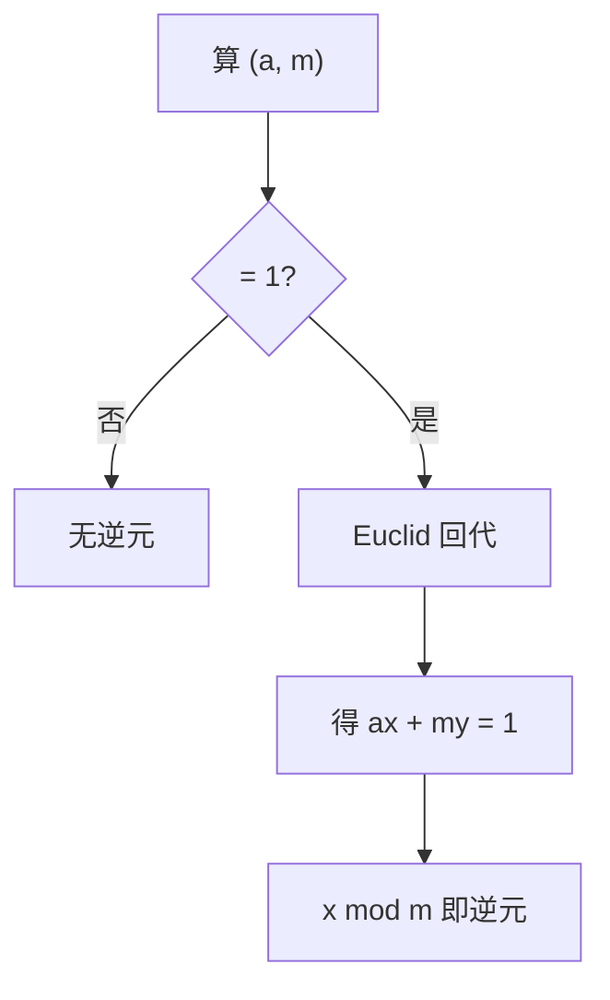

# 模m的乘法逆元的定义、存在条件与计算方法

模 $m$ 的乘法逆元是同余方程中最常用的概念之一。它的定义很直观：==对于整数 $a$ 和正整数 $m$，若存在 $b\in\mathbb Z$ 使得 $ab\equiv 1\pmod m$，则称 $b$ 为 $a$ 模 $m$ 的乘法逆元，记作 $a^{-1}\pmod m$==。换句话说，它想回答一个问题：在模 $m$ 的世界里，"$\div a$" 能不能改成 "$\times a^{-1}$"？

> [!IMPORTANT]
> 模 $m$ 的乘法逆元**不是唯一的整数**，而是模 $m$ 的一个同余类 $\overline{a^{-1}}$；不同代表元相差 $m$ 的倍数都可看作逆元。

## 为什么需要它

同余方程里最典型的式子是 $ax\equiv c\pmod m$。当 $(a,m)=1$ 时，我们希望两边同时"除以 $a$"，直接得到 $x\equiv a^{-1}c\pmod m$，一步写出解。RSA 加密、模 $p$ 求元素阶、求 $\mathbb Z_m^*$ 中的元素逆元，全都要用到它。

## 存在条件

乘法逆元不是什么时候都有。设 $(a,m)=d$，则 $ax\equiv 1\pmod m$ 等价于 $ax+my=1$ 有整数解，由裴蜀定理可知：

$$
a \text{ 模 } m \text{ 有逆元} \iff (a,m)=1 .
$$

==必要性也可以从反证快速看出：若 $d>1$，则 $d\mid a$ 且 $d\mid m$，于是 $ax-my$ 永远被 $d$ 整除，不可能等于 1==。

> [!WARNING]
> 常见坑：求 $7^{-1}\pmod{21}$ 是无意义的，因为 $(7,21)=7\ne 1$。看到"求逆元"，第一件事是算最大公约数。

## 怎么算

由 Euclid 算法回代得到 $ax+my=1$，则 $x$ 就是 $a$ 模 $m$ 的逆元代表。

示例：求 $7^{-1}\pmod{26}$。Euclid 算法给出

$$
26 = 3\cdot 7 + 5,\quad 7 = 1\cdot 5 + 2,\quad 5 = 2\cdot 2 + 1,
$$

回代

$$
1 = 5 - 2\cdot 2 = 5 - 2(7-5) = 3\cdot 5 - 2\cdot 7 = 3(26-3\cdot 7) - 2\cdot 7 = 3\cdot 26 - 11\cdot 7 .
$$

于是 $-11\equiv 15\pmod{26}$，即 $7^{-1}\equiv 15\pmod{26}$。验证：$7\times 15 = 105 = 4\times 26 + 1$ ✔。

> [!TIP]
> 回代时可以先在 $x$ 上"对 $m$ 取模归到正数"，避免手算负数乘法。

## 与相近概念的区别

| 概念 | 含义 | 关系 |
|------|------|------|
| 裴蜀等式 $ax+my=1$ | 线性组合等于 1 | 是逆元存在的等价刻画 |
| 模 $m$ 的同余类 $\overline a$ | 剩余类 | 逆元是 $\overline a$ 在 $\mathbb Z_m^*$ 中的逆元 |
| 普通倒数 $\frac1a$ | 有理数除法 | 逆元只在模意义下成立，不写分数 |

> [!NOTE]
> 若 $(a,m)=(b,m)=1$，则 $(ab,m)=1$（见课后证明题 1(1)），即 $\mathbb Z_m^*$ 中两个可逆元的乘积仍可逆，且 $(ab)^{-1}\equiv b^{-1}a^{-1}\pmod m$，乘法"可换序"。
