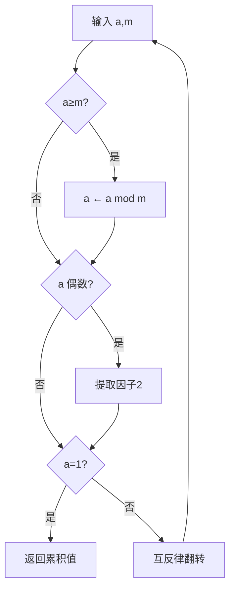

# 雅可比符号的定义、性质及其在合数模下的计算

## 雅可比符号的定义与动机

在判定 $x^2 \equiv a \pmod m$ 是否有解时，若 $m$ 是合数且分解困难，勒让德符号便无法直接使用。能否构造一个==无需分解模数==即可计算的推广符号？雅可比符号（Jacobi Symbol）正是为此而生。

设 $m = p_1^{e_1} \cdots p_k^{e_k}$ 为正奇数，$\gcd(a, m)=1$，定义：

$$
\left(\frac{a}{m}\right)_J = \prod_{i=1}^k \left(\frac{a}{p_i}\right)^{e_i}
$$

其中右边为勒让德符号。它保留了乘法性与二次互反律的形式，使计算复杂度降至 $O(\log^2 m)$。

> [!IMPORTANT]
> ==雅可比符号仅为计算工具==，当 $m$ 为合数时，$\left(\frac{a}{m}\right)_J = 1$ **不能**推出 $a$ 是模 $m$ 的二次剩余。

## 核心性质与计算流程

雅可比符号继承了勒让德符号的三条关键运算规则，使其可通过辗转相除快速求解：

-   **乘法性**：$\left(\frac{ab}{m}\right) = \left(\frac{a}{m}\right)\left(\frac{b}{m}\right)$
-   **补充律**：$\left(\frac{-1}{m}\right) = (-1)^{\frac{m-1}{2}}$，$\left(\frac{2}{m}\right) = (-1)^{\frac{m^2-1}{8}}$
-   **二次互反律**：对正奇数 $m,n$，$\left(\frac{m}{n}\right)\left(\frac{n}{m}\right) = (-1)^{\frac{m-1}{2}\cdot\frac{n-1}{2}}$

> [!TIP]
> 计算时始终将分子保持在小于分母的正奇数状态，遇到偶数提 $2$，遇到负号提 $-1$，直至分子为 $1$。

## 与勒让德符号的本质区别

| 对比维度 | 勒让德符号 | 雅可比符号 |
| :--- | :--- | :--- |
| 模数要求 | 奇素数 $p$ | 正奇数 $m$ |
| 值为 $1$ 的含义 | $a$ 是模 $p$ 二次剩余 | ==无直接数论意义== |
| 值为 $-1$ 的含义 | $a$ 非模 $p$ 二次剩余 | $a$ 必非模 $m$ 二次剩余 |
| 计算前提 | 需知 $p$ 为素数 | 无需分解 $m$ |

> [!WARNING]
> $\left(\frac{a}{m}\right)_J = -1 \Rightarrow x^2 \equiv a \pmod m$ 无解；但 $\left(\frac{a}{m}\right)_J = 1 \nRightarrow$ 有解。这是考试高频陷阱。

## 经典反例构造与验证

如何构造 $\left(\frac{a}{m}\right)_J=1$ 但方程无解的例子？关键在于让各素因子处的勒让德符号"负负得正"。

取 $p_1 \equiv p_2 \equiv 3 \pmod 4$，令 $m=p_1 p_2$，$a=-1$：

$$
\left(\frac{-1}{m}\right)_J = \left(\frac{-1}{p_1}\right)\left(\frac{-1}{p_2}\right) = (-1)(-1) = 1
$$

但 $x^2 \equiv -1 \pmod{p_i}$ 要求 $p_i \equiv 1 \pmod 4$，矛盾。故原方程无解。

> [!CAUTION]
> 切勿将雅可比符号值为 $1$ 当作二次剩余的充分条件！在密码学协议（如Goldwasser-Micali）中，正是利用这一"假阳性"特性来构造安全性。
