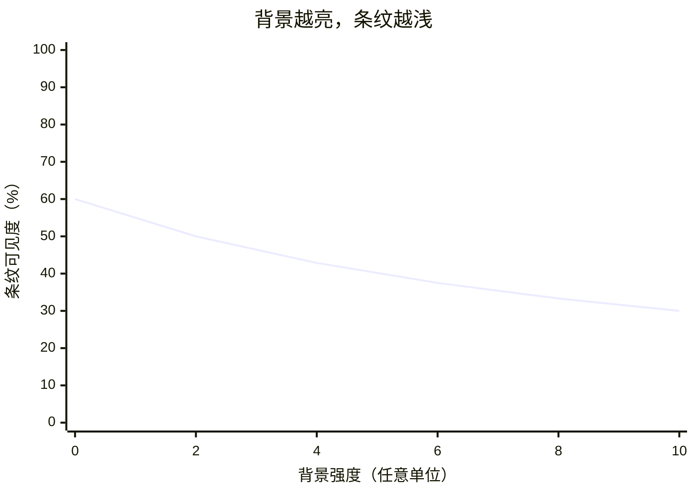

# 两束光的相干性与条纹可见度

合上干涉仪的两臂，暗纹没有变黑。先不要断定光源不相干：两臂的光强不一样时，较弱的光场即使完全反相，也抵消不了较强的光场。若偏振方向不重合，或探测积分期间相对相位变化，交叉项还会进一步减小。

设两束光偏振相同，探测器线性响应。对于稳定相干的两束光，先加振幅再求光强，得到
$$
I(\phi)=I_1+I_2+2\sqrt{I_1I_2}\cos\phi.
$$
在局部扫描相位且 $I_1,I_2$ 保持近似不变时，条纹可见度为
$$
V=\frac{I_{\max}-I_{\min}}{I_{\max}+I_{\min}}
=\frac{2\sqrt{I_1I_2}}{I_1+I_2}.
$$
光场部分相干时，在相同偏振、没有额外背景的条件下，交叉项的幅度再乘归一化互相干度的模 $|\gamma_{12}|$（介于 0 和 1）。因此，只有两臂强度相等、背景可忽略等条件满足时，测得的 $V$ 才直接等于 $|\gamma_{12}|$。如果两束线偏振光彼此正交且没有检偏投影，向量交叉项为零，同样不会出现这类强度条纹。

**自编例。** 分别遮住另一臂，探测器测得 $I_1=9$、$I_2=1$（任意单位）。若两束光完全相干且偏振相同，极大和极小分别是 $(3+1)^2=16$、$(3-1)^2=4$，得到 $V=(16-4)/(16+4)=0.60$。再加入恒定背景 $I_{\mathrm{bg}}=2$，极值变为 18 和 6，可见度为 0.50。两次测量的相干性没有变化。反过来，若挡去第一臂的多余光，使两臂均为 1 且背景消失，最大强度只剩 4，但可见度升至 1。

固定两臂光强为 9 和 1，只改变探测器收到的恒定背景。背景同时抬高亮纹和暗纹，所以两者的强度差仍为 12，但总和由 20 增至 $20+2I_{\mathrm{bg}}$。下图由 $V=6/(10+I_{\mathrm{bg}})$ 计算，不是实测数据。

背景从 0 增至 10 时，可见度正好减半；==两束光自身的相干性没有变化==。

> [!TIP]
> 遇到低可见度，先分别测两臂单独开启时的强度，再测两臂都挡住时的背景。扣除背景后，如果条纹仍不及该强度比允许的最大可见度，再检查偏振和相干性。

参考：[MIT 的双光束干涉演示：光强比与条纹对比度](https://ocw.mit.edu/courses/res-6-006-video-demonstrations-in-lasers-and-optics-spring-2008/resources/fringe-contrast-2014-intensity-ratio/)。
