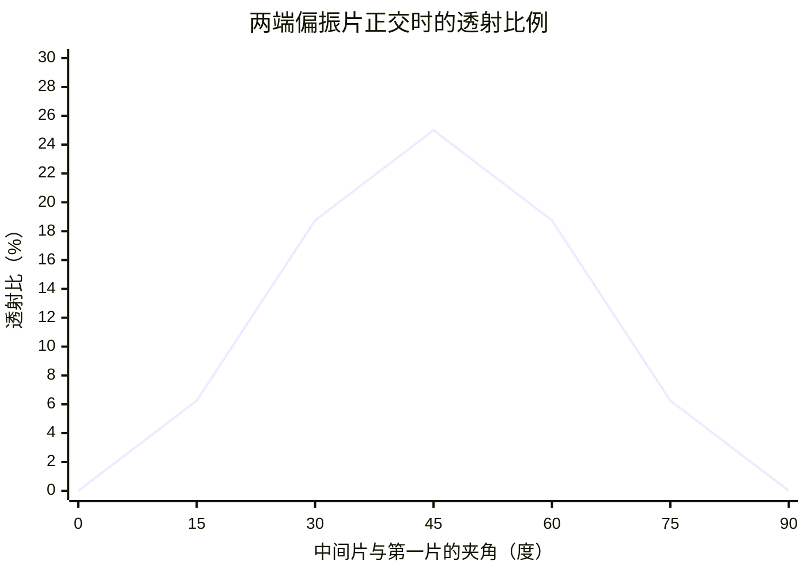

# 正交偏振片与 Jones 投影

两片理想线偏振片的透振方向相差 $90^\circ$，透射光为零。既然再放一块偏振片只会挡住一部分光，为什么插在它们之间反而能让屏幕变亮？关键不是某片会增亮，而是==中间片改变了最后一片接收到的偏振方向==。

设三片依次沿 $x$、与 $x$ 成角 $\theta$ 的方向、$y$，同一束光垂直通过。只算第一片后到第三片后的变化，把第一片后的场振幅记为 $E_0$、光强记为 $I_0$。这时入射到中间片的光已经沿 $x$ 线偏振。设某片透振轴的实单位向量为 $\mathbf u$，它把 Jones 场向量 $\mathbf E$ 投影成 $\mathbf u(\mathbf u^{\mathsf T}\mathbf E)$；前面的点积决定保留多大的场振幅，外面的 $\mathbf u$ 决定输出方向。

令 $\mathbf u=(\cos\theta,\sin\theta)^{\mathsf T}$。第一次投影保留 $E_0\cos\theta$，但输出方向变成 $\mathbf u$；第二次投影再取它的 $y$ 分量，末片输出振幅为 $E_0\cos\theta\sin\theta$。取振幅平方并除以第一片后的光强：

$$
\frac{I_{\mathrm{out}}}{I_0}=\cos^2\theta\sin^2\theta=\frac14\sin^2(2\theta).
$$

**自编例。** 从 $0^\circ$ 转到 $90^\circ$，两端都不透光：一端让中间片与第一片重复，另一端让中间片本身挡住第一片的输出。到 $45^\circ$ 时，后两片各保留前一束光的二分之一，第三片后留下 $I_0/4$。若第一片之前是自然光，理想第一片还要先取一半，所以此时输出仅为整套装置入射光的 $1/8$。

下图的分母为第一片后的光强，取样点由公式计算。

> [!TIP]
> 做多片偏振题时，逐片追踪「光强和透振方向」。如果只记得首尾正交，就漏掉中间片重新定义了下一片的输入方向；如果只说「最多四分之一」，则要先问分母是第一片前还是第一片后。

Jones 向量保留两个横向电场分量的振幅和相对相位，适合描述确定的偏振态。自然光或部分偏振光不能用一个固定 Jones 向量表示；可对互不相干的成分分别传播再相加强度，或者用相干矩阵、Stokes 参数表述。有限消光比的真实偏振片也未必在 $0^\circ$ 和 $90^\circ$ 读到严格零，本图只表示理想模型。

参考：[南邮光电信息实验教学中心：偏振光实验](https://gdgcsys.njupt.edu.cn/2013/1125/c4669a62309/page.htm)（马吕斯定律的实验背景），[MIT 偏振片讲义](https://ocw.mit.edu/courses/6-007-electromagnetic-energy-from-motors-to-lasers-spring-2011/fddc50383103d417aac29bd02d473003_MIT6_007S11_lec24.pdf)，[MIT Jones 变换讲义](https://ocw.mit.edu/courses/3-46-photonic-materials-and-devices-spring-2006/c002c8429ae1f88a78982a53f0f9bb86_3_46l4_rayoptics.pdf)。
