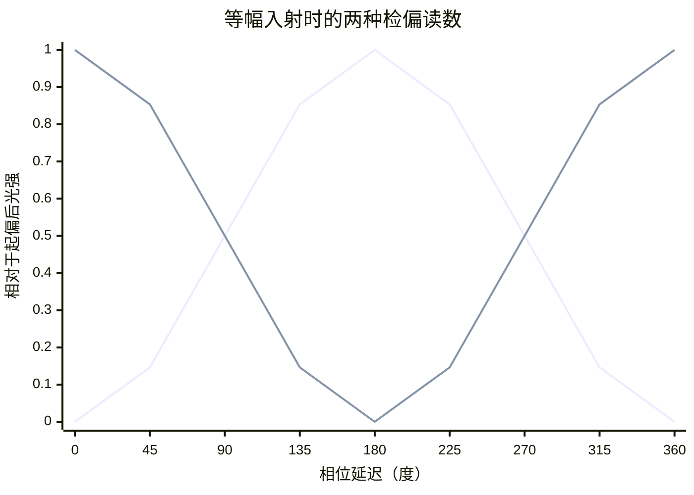

# 波片延迟量的强度判别

晶片角度和相位延迟都能改变正交检偏器的亮暗。只测一次光强，怎样知道变化究竟来自哪一个量？

## 两个正交分量怎样在检偏器处相遇

理想波片不吸收光，只给两个主轴分量加上不同的相位。因此直接在波片后测总光强，对这份相差不敏感。要把相差变成亮暗，就得让两个正交分量投影到同一方向，再把投影后的**电场**相加。这与正交偏振片的投影使用相同的矢量机制，只是这里的两个分量还带着相对相位。

设单色线偏振光正入射一块理想、无损的波片，入射偏振方向与波片快轴成 $\alpha$，波片慢轴分量相对于快轴分量的相因子记作 $e^{i\delta}$。若 $I_0$ 是波片前（即起偏后）的光强，取波片前振幅为 $E_0$，则波片后在快、慢轴基底中的复振幅为 $E_0(\cos\alpha,e^{i\delta}\sin\alpha)$。检偏器平行于入射偏振时投影到 $(\cos\alpha,\sin\alpha)$；正交时投影到 $(-\sin\alpha,\cos\alpha)$。由此，
$$
\frac{A_{\parallel}}{E_0}=\cos^2\alpha+e^{i\delta}\sin^2\alpha,\qquad
\frac{A_{\perp}}{E_0}=(e^{i\delta}-1)\sin\alpha\cos\alpha.
$$
计算模平方得到
$$
\frac{I_{\perp}}{I_0}=\sin^2(2\alpha)\sin^2\!\left(\frac{\delta}{2}\right),\qquad
\frac{I_{\parallel}}{I_0}=1-\frac{I_{\perp}}{I_0}.
$$
两个读数是同一输入下分别沿一组正交方向取样；同增益、理想投影的条件下，其和为 $I_0$，不是说把两片检偏器串联后仍能收到全部光。

## 从亮暗反推哪些量

> [!TIP]
> 见到==一对平行与正交读数==，先用 $I_{\perp}/(I_{\perp}+I_{\parallel})$ 作归一化，再检查快轴夹角是否已知。若能调到 $\alpha=45^\circ$，两个主轴分量等幅，强度比才直接给出 $\sin^2(\delta/2)$。

图中固定 $\alpha=45^\circ$。零度相差时，正交读数为零；到半波相差时，正交方向取得全部光，平行方向变暗。它们相加始终为 1。

**自编例。** 快轴夹角为 $45^\circ$ 时，正交读数为 $2~\mathrm{mW}$，平行读数为 $6~\mathrm{mW}$（同一束光、同一探测口的功率读数，比例等于光强比）。归一化得到 $1/4$，所以在一整周期内，延迟可以是 $60^\circ$ 或 $300^\circ$。只有额外给定 $0\le\delta\le\pi$，才可选中 $60^\circ$。用振幅回代：$|e^{i\pi/3}-1|=1$，正交投影再乘 $1/2$，功率比确为 $1/4$；另一个相差给出共轭振幅，功率比相同。

> [!WARNING]
> 正交方向全暗不能单独证明晶片是全波片。把入射偏振对齐快轴（$\alpha=0$）就会对任意延迟给出零读数；反过来，固定 $45^\circ$ 后仍无法靠这两项强度分辨相差的正负或整周数。宽带入射、晶片有偏振相关吸收、或检偏器有漏光时，也不能沿用理想反演式。
