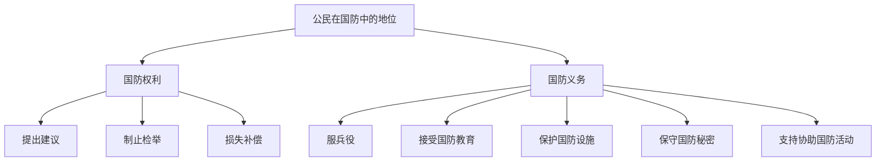
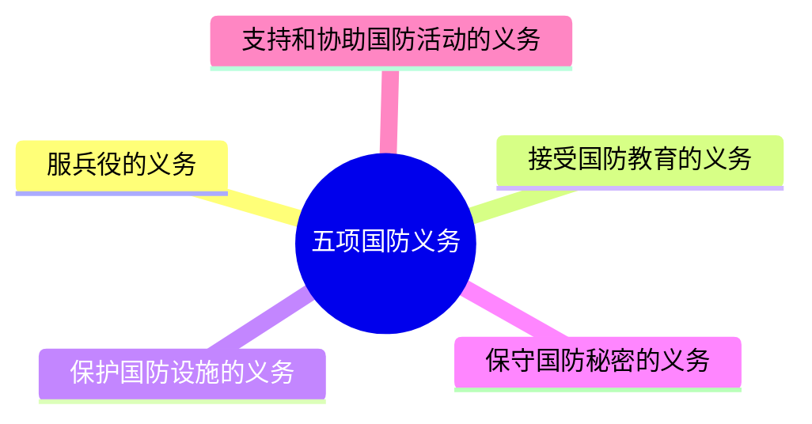
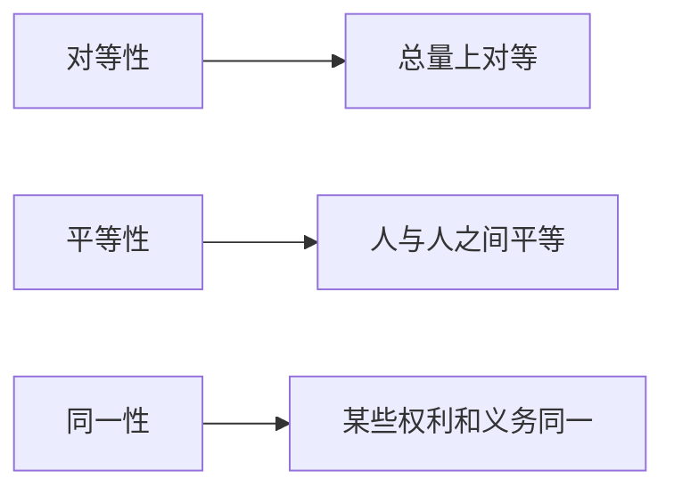

# 公民的国防权利和义务
先想一个问题：国防是国家的事，但为什么普通大学生也要清楚自己的“国防权利”和“国防义务”？因为国防活动一旦展开，会牵动每个公民的切身利益——谁来服兵役？谁承担训练任务？国防设施建在谁家门口？经济损失谁来补偿？这些问题的答案，都写在权利与义务的法律框架里。

### 两个基础概念

- **公民的国防权利**：宪法和法律赋予公民在国防活动中享有的权利或利益，国家从法律和物质上保障公民享有这种权利的可能性。
- **公民的国防义务**：宪法和法律规定的公民在国防活动中必须履行的责任，由国家强制力保证其落实。

> [!IMPORTANT]
> ==权利可以放弃，义务必须履行==。这是理解两者关系最核心的一句话。

两者的关系用一张图先建立起整体印象：

### 公民的三项国防权利

| 权利 | 内容要点 |
|------|----------|
| 对国防建设提出建议的权利 | 公民有权对国防建设中的问题提出批评和建议 |
| 制止、检举危害国防行为的权利 | 发现破坏国防设施、泄露国防秘密等行为时，有权制止并向有关部门检举 |
| 国防活动中经济损失补偿的权利 | 因国防活动（如军事演习、国防设施建设）使个人或组织的合法财产受到损失，有权获得补偿 |

> [!TIP]
> 记忆窍门：这三项权利分别对应“**说**”（提建议）、“**管**”（制止检举）、“**补**”（损失补偿）。

### 公民的五项国防义务

> [!IMPORTANT]
> ==服兵役是公民最重要的一项国防义务==。宪法规定，==保卫祖国、抵抗侵略==是中华人民共和国每一个公民的神圣职责。

#### 服兵役义务的三种履行形式

根据《兵役法》规定，中国实行“义务兵与志愿兵相结合、民兵与预备役相结合”的兵役制度。公民履行兵役义务有三种形式：

| 形式 | 说明 |
|------|------|
| 服现役 | 作为义务兵或志愿兵应征入伍，在军队中直接服役 |
| 服预备役 | 编入民兵组织或预备役部队，平时参加训练，战时准备应召 |
| 参加军事训练 | 高等学校学生参加军事训练、其他适龄公民参加预备役训练 |

> [!WARNING]
> 常见误区：认为“服兵役”就只有当义务兵入伍一种形式。实际上，==大学生参加军训也是履行兵役义务的一种形式==，服预备役同样算数。这门课如果考“公民履行兵役义务的三种形式”，答案是**服现役、服预备役、参加军事训练**。

### 权利与义务的关系：既有一般性，也有特殊性

国防权利与国防义务是==对立统一==的关系。对立，在于权利主动、可放弃，义务被动、必须履行；统一，在于两者同时产生、互为条件、相辅相成。

一致性体现在三个方面：

- **对等性**：权利和义务相对立而存在，总量对等。
- **平等性**：公民在享受权利和承担义务方面一律平等。
- **同一性**：有些国防权利和国防义务本身就是同一的（如接受国防教育，既是权利也是义务）。

但国防领域的特殊性在于：==权利和义务的一致性并不直观==，在一定范围、一定层次上表现为不对等。

> [!CAUTION]
> 两类典型的不对等：
> 一是**不同地区**的公民享受的国防权利和承担的国防义务不平等——比如边疆地区公民承担的国防勤务更重；
> 二是**同一公民**在参与国防活动时，所享权利与所担义务往往不对等——比如战时参加支前，付出大于直接收益。

### 一个例题串起关键考点

> **填空**：______是公民最重要的一项国防义务。  
> **答案**：服兵役。

> **填空**：宪法规定，______是中华人民共和国每一个公民的神圣职责。  
> **答案**：保卫祖国、抵抗侵略。

> **简答**：公民履行兵役义务有哪三种形式？  
> **答案**：服现役、服预备役、参加军事训练。

### 和“国防教育意义”的区别

有复习资料把“接受国防教育”列为义务之一，同时又问“国防教育的意义”。两者不要混淆：**义务**说的是“公民必须接受”；**意义**说的是“接受它有什么价值”。意义类答案通常包含：维系国家安全、增强综合国力、法律赋予的神圣义务、加速国防现代化建设与战时兵员动员、全面培养人才。
