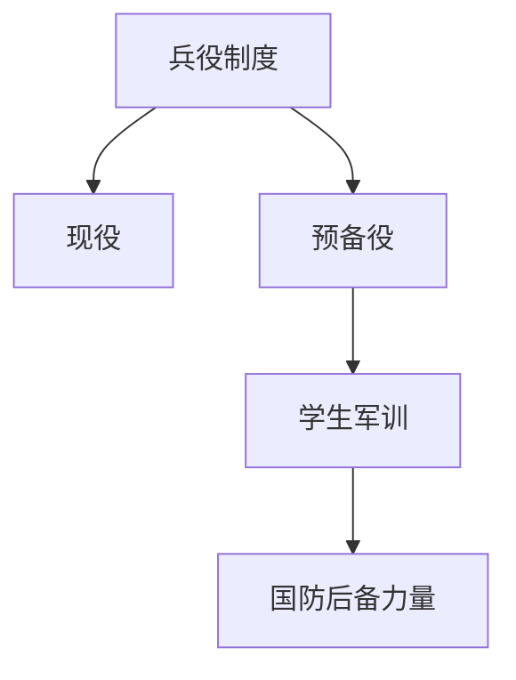
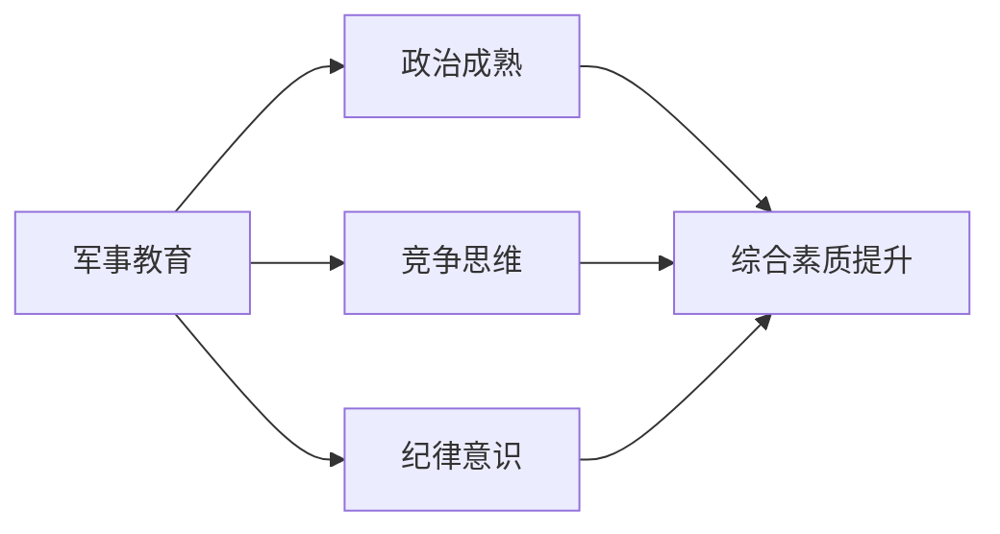

# 军训和开设军事课程的意义
大学生为什么要上军事课？这背后不是“走过场”，而是由国防制度、教育目标和人才培养逻辑共同决定的。

### 军训与兵役义务

首先需要明确一个容易被忽视的制度事实：==学生军训制度属于兵役法中的预备役制度==。换言之，参加军训不是校园活动，而是公民履行兵役义务的一种形式。我国实行义务兵役制与志愿兵役制相结合的制度，预备役是国防后备力量的核心。大学生通过军训接受基本的军事训练，实际上是在国家动员体系中“注册”了自己的预备役身份。

这一制度安排回答了“为什么要军训”的第一层答案：**

- 是公民履行兵役义务的一种形式；
- 是加强国防后备力量建设的战略举措。

> [!IMPORTANT]
> 军训的法律性质是**履行兵役义务**，而非一般性的校园教育实践。这是考试中区分“军训”与“普通课外活动”的关键判断依据。

### 军事教育与素质教育的关系

这是绪论部分的核心考点，常以简答题或论述题形式出现。

先问一个问题：如果军训只是教踢正步、叠被子，它和“素质教育”有什么关系？答案是——军事教育的功能远超技能层面，它同时触及了**政治价值观**与**方法论**两个维度。

大学生军训不仅是传授军事知识、培养军事技能的过程，同时也是培养大学生科学的世界观、方法论和正确人生观的过程。军事教育与素质教育既有区别又有内在联系：==军事教育是素质教育的一个内容，同时对素质教育起到了促进作用==。

具体来看两个层次：

**第一，促进学生政治上的成熟。** 军训期间学生“不仅学军事，而且学政治”。国防教育天然带有国家意识、集体观念和纪律要求的属性，这使学生在较短周期内形成对“个人与集体”“权利与义务”关系的直观体验。

**第二，军事知识蕴含竞争智慧。** 课件中反复引用一个例证：日本企业家坦率承认，其经济腾飞得益于学习《孙子兵法》。这说明军事知识中关于形势判断、资源调配、竞争博弈的思维方法，可以迁移到非军事领域。

> [!TIP]
> 记忆口诀：**“一义务一战略，两促进一基础”**——公民义务、后备力量战略；促进政治成熟、促进竞争思维；为综合素质打基础。

### 开设军事课程的三条核心意义

从考试归纳的角度，开设军事课程的意义可以压缩为三个要点：

| 维度 | 内容 |
|------|------|
| 观念层面 | 增强学生的国防观念和国家意识 |
| 情感层面 | 激发爱国热情和社会责任感 |
| 能力层面 | 提高综合素质，促进全面发展 |

### 常见的坑

==不要把军训等同于“吃苦教育”或“纪律训练营”==。这是最常见的理解偏差。吃苦、守纪律只是军事训练的外在表现，其制度本质是预备役义务，其教育本质是政治成熟与综合素质提升。答题时若只谈“磨炼意志”“强身健体”，得分点是不完整的。

另一个易混点：**军事教育与素质教育不是并列关系，而是包含与被包含、相互促进的关系**。不能说“军训之后开始素质教育”，也不能说“军训可以替代素质教育”。

> [!WARNING]
> 回答“大学生为什么要军训”时，务必先答**制度层面**（兵役义务、后备力量），再答**教育层面**（综合素质、政治成熟），顺序颠倒或遗漏制度层面是常见失分点。
