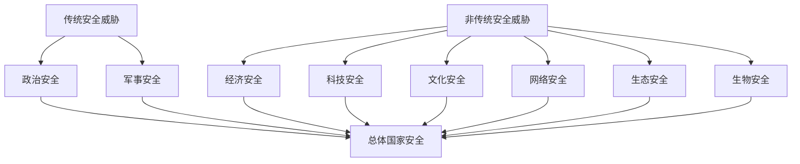

# 国家安全的内涵

## 从“没有危险”说起

要理解国家安全的内涵，可以先想一个简单的问题：一个人什么时候会觉得自己是“安全”的？

通常有两个条件——**客观上没有威胁**，**主观上不感到恐惧**。这两个条件合在一起，才构成一种真正的安全状态。国家安全在本质上也是如此，只不过它的主体从个人换成了国家。

> [!IMPORTANT]
> 《中华人民共和国国家安全法》第二条给出了法定定义：==国家安全是指国家政权、主权、统一和领土完整、人民福祉、经济社会可持续发展和国家其他重大利益相对处于没有危险和不受内外威胁的状态，以及保障持续安全状态的能力。==

这一定义可以拆解为四个层次：

| 层次 | 核心内容 | 关键词 |
| :--- | :--- | :--- |
| **主体** | 国家（不是民族、地区，也不是笼统的“国际社会”） | 国家 |
| **指涉对象** | 国家重大利益 | 政权、主权、统一、领土、人民福祉等 |
| **理想状态** | 外部不受威胁，内部没有危险 | 无危险、无威胁 |
| **核心能力** | 保障持续安全状态的能力 | ==状态＋能力== |

其中最容易忽略的，恰恰是“能力”这一点。安全不仅是“此刻没事”，更是==持续维持“没事”的能力==。一个国家的军队、法律体系、应急机制、网络安全防护，都是为了维持这种能力而存在。

> [!WARNING]
> 绝对安全是不存在的。任何国家在发展中都会遇到内外危险，真正的安全是一种相对状态，是在动态中不断防范和化解风险的过程。

## 从“枪炮”到“芯片”：安全内涵的动态演变

传统的国家安全观，几乎可以和“军事安全”画等号。冷战时期的超级大国，其国家安全战略报告中，“国家安全”主要就是防止外部军事入侵、确保本土不被攻击。

但今天再看，这一解释已经远远不够。

一些国家政权被颠覆，并非因为外敌入侵，而是内部出了问题——政治体制腐朽、经济崩溃、价值取向偏移、种族割裂。与此同时，金融危机、恐怖袭击、重大传染病、气候变化、网络攻击这些“非传统威胁”的破坏力，丝毫不亚于一场局部战争。

因此，==国家安全的内涵已从政治安全、军事安全，拓展至经济、科技、文化、网络、生态、生物等广泛领域。==

> [!TIP]
> 记忆口诀：传统看“军政”，新增记“经科文网生”——经济、科技、文化、网络、生态、生物。

## 常见的坑与辨析

**坑一：把“国家安全”等同于“国家领土不被入侵”。**
这是典型的传统安全思维。现代国家安全是全域的——一场网络攻击就能瘫痪关键基础设施，一次金融风暴就能引发社会动荡，这些同样属于安全威胁。

**坑二：以为安全只是“现在没事”。**
“没事”只是状态，“能一直保持没事”才是能力。国家安全定义的后半句——“保障持续安全状态的能力”，和前半句同等重要。

**坑三：把民族安全、地区安全、国际安全直接当作“国家安全”。**
法律明确：==国家安全的主体只能是“国家”==。全球安全要以国家安全为基础，但不是替代关系。

## 一个“算对了”的例子

期末常出这样的辨析题：

> “一个国家安全与否，主要看它有没有遭到外敌入侵。” 请用国家安全的内涵加以评析。

**正确回答思路**：
1. 指出这句话只对应传统安全观，把国家安全窄化为军事安全。
2. 引用《国家安全法》定义，说明国家安全既包括==外部不受威胁、内部没有危险的状态==，也包括==保障持续安全状态的能力==。
3. 举例说明非传统威胁同样危害国家安全——比如内部政治腐败导致政权颠覆、网络攻击导致社会瘫痪。
4. 结论：这句话片面，不符合总体国家安全观。

这样结合法定定义、正反论证的答题结构，既扣住“内涵”的核心，又展示了对动态演变的理解。
