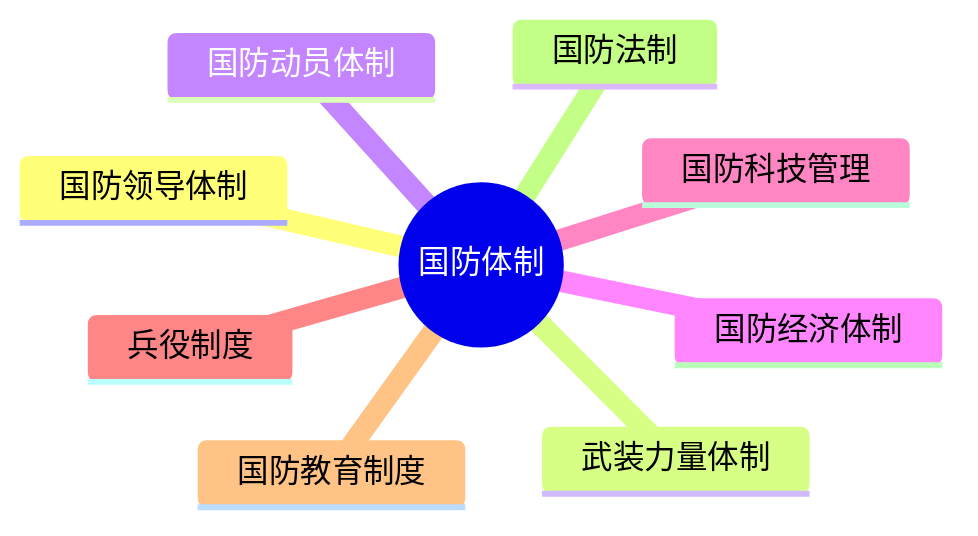

# 国防的体制、政策和军民融合

国防体制、国防政策与军民融合回答三个问题：国防活动由谁组织、国防力量怎样建设和使用、经济建设与国防建设如何协调。复习时要把三者分开记忆，再联系起来理解。

## 国防体制：组织国防活动的制度保证

国防体制是国家为组织和实施国防活动而建立的组织体系及相应制度，是国家体制的重要组成部分，也是国家安全的组织保证。它与国家政治、经济、文化、教育等体制既相互联系，又相对独立。

中华人民共和国的国防体制==坚持中国共产党的领导，贯彻民主集中制原则==。其中，国防领导体制侧重机构设置、管理权限和领导关系；武装力量体制侧重中国人民解放军、中国人民武装警察部队和民兵等力量的组织建设。复习《兵役法》《国防教育法》时，还要重点掌握公民义务、权利及大学生入伍优待政策。

## 国防政策：建设和使用国防力量的准则

国防政策是国家进行国防建设和使用国防力量的准则，通常分为总政策和具体政策，具有鲜明的阶级性。我国的国家性质、和平发展道路、独立自主的和平外交政策以及“和为贵”的文化传统，共同决定了中国始终不渝奉行防御性国防政策。

| 新时代国防政策要点 | 对应定位 |
|---|---|
| 捍卫国家主权、安全、发展利益 | 根本目标 |
| 永不称霸、永不扩张、永不谋求势力范围 | 鲜明特征 |
| 贯彻落实新时代军事战略方针 | 战略指导 |
| 坚持走中国特色强军之路 | 发展路径 |
| 服务构建人类命运共同体 | 世界意义 |

> [!IMPORTANT]
> 防御性国防不等于消极防守，也不等于不需要强大国防。中国必须有足以自卫防御的国防力量，同时坚持不称霸、不扩张。中国特色社会主义制度、国防政策和防御性军事战略，决定了我国国防是==防御型、独立自主型国防==。

## 军民融合：统筹经济发展和国家安全

军民融合旨在促进经济建设和国防建设协调发展、平衡发展、兼容发展。把它上升为国家战略，是长期探索经济建设和国防建设协调发展规律的重大成果，也是从国家发展和安全全局出发作出的重大决策。

推动深度融合，要贯彻总体国家安全观和新时代军事战略方针，强化顶层设计、加强需求统合，形成全要素、多领域、高效益的发展格局，逐步构建军民一体化国家战略体系和能力，实现战略布局一体融合、战略资源一体整合、战略力量一体运用。

重点领域可按四条掌握：国防科技和武器装备是重点及重要标志；后勤建设军地通用性、互补性强；推动融合由传统领域向新兴领域拓展；基础设施建设贯彻国防要求是重中之重。此外，国防动员也是实现军民融合发展的重要途径。

> [!WARNING]
> 常见混淆：国防体制回答“谁来组织、怎样管理”，国防政策回答“依据什么准则”，军民融合回答“军地资源怎样协同”。军民融合也不是把军队和地方简单合并，更不是以国防建设取代经济建设。

## 例题示范

**问：为什么中国奉行防御性国防政策？**

**答：**这是由中国的社会主义国家性质、走和平发展道路的战略抉择、独立自主的和平外交政策和“和为贵”的文化传统共同决定的。其根本目标是捍卫国家主权、安全、发展利益；鲜明特征是永不称霸、永不扩张、永不谋求势力范围。因此，建设足以自卫防御的国防力量与坚持和平发展并不矛盾。

> [!TIP]
> 答题可记为“体制管组织、政策管准则、融合管协同”；国防政策五点则按“目标—特征—指导—路径—意义”展开，避免只写“防御性”而遗漏具体内涵。
