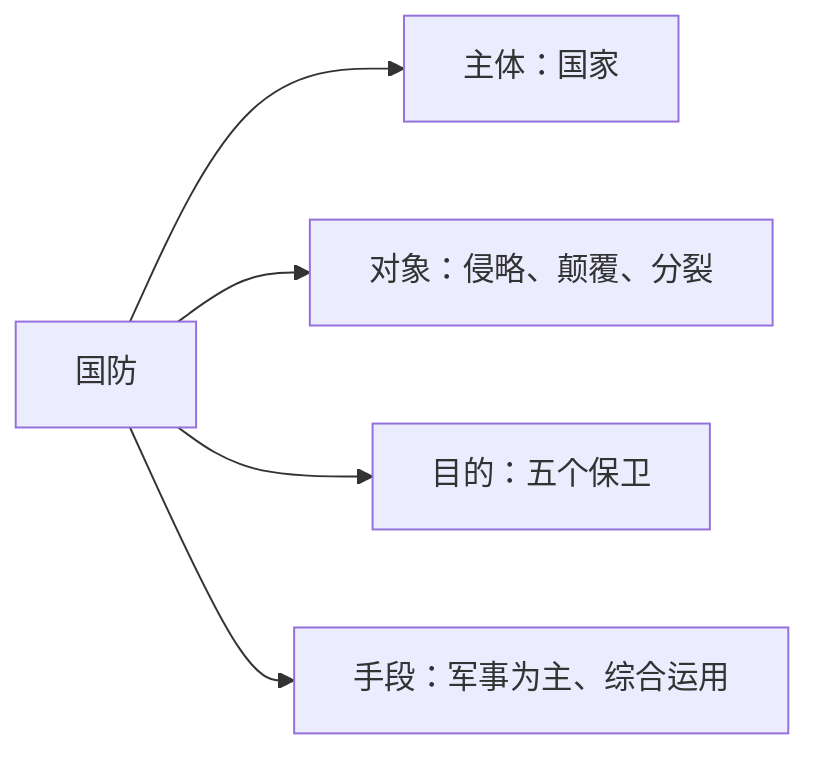
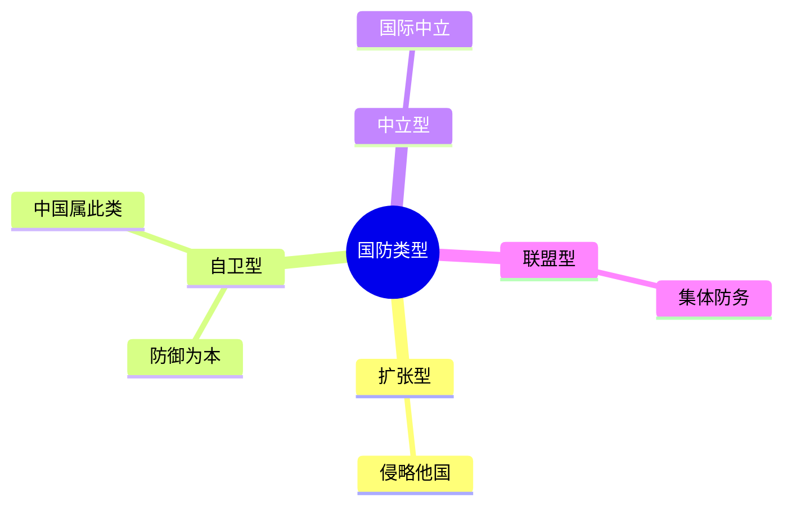

# 国防的含义、基本类型和基本特征

## 先想一个问题

一个国家可以没有军队，但不能没有国防。为什么？

因为军队是国防的“工具”，而国防是国家生存的“底线”。没有国防，主权、领土、发展利益都无从谈起。那么，国防到底是什么？

---

## 国防的含义

《中华人民共和国国防法》第 2 条给出明确定义：

> [!IMPORTANT]
> 国防是**国家**为**防备和抵抗侵略，制止武装颠覆和分裂，保卫国家主权、统一、领土完整、安全和发展利益**所进行的**军事活动**，以及与军事有关的**政治、经济、外交、科技、教育**等方面的活动。

拆开看，国防包含四个基本要素：

| 要素 | 内容 | 关键点 |
|------|------|--------|
| **主体** | 国家 | 国防是国家行为，不是个人或组织行为 |
| **对象** | 侵略、武装颠覆、分裂 | 包括==武装侵略和非武装侵略==（经济、文化、外交手段） |
| **目的** | 保卫主权、统一、领土完整、安全和发展利益 | 五个目标本质一致，是国家的最高原则 |
| **手段** | 军事 + 政治、经济、外交、科技、教育 | ==军事是主要手段、保底手段==，但不是唯一手段 |

> [!WARNING]
> 常见坑：把“国防的主体”答成“军队”或“政府”。国防的主体是**国家**，军队只是执行国防任务的武装力量。

---

## 国防的基本类型

不同国家的国防政策取向不同，可划分为四种基本类型：

| 类型 | 特征 | 代表国家 |
|------|------|----------|
| **扩张型** | 以侵略扩张为手段，把本国利益凌驾于他国之上 | 历史上的殖民国家 |
| **自卫型** | 以防卫为目的，不侵略他国 | 中国 |
| **中立型** | 在国际冲突中保持中立立场 | 瑞士、瑞典 |
| **联盟型** | 通过军事同盟实现集体防务 | 北约国家、欧盟国家 |

> [!IMPORTANT]
> 中国坚持走和平发展道路，奉行**防御性国防政策**，属于==自卫型==国防，同时也是**独立自主型**国防——不依附任何大国或军事集团。

---

## 国防的基本特征

国防作为一种国家行为，具有四个基本特征：

| 特征 | 含义 |
|------|------|
| **阶级性** | 国防从属于国家的阶级本质，服务于统治阶级利益 |
| **全民性** | 国防不是军队单打独斗，需要全社会共同参与 |
| **长期性** | 只要国家存在，国防就不能停止建设 |
| **复杂性** | 国防涉及军事、政治、经济、外交、科技等多个领域，综合性强 |

> [!TIP]
> 记忆口诀：**“阶全长复”**——阶级性、全民性、长期性、复杂性。联想到“国家一直存在，全民都参与，阶级利益决定方向，涉及面很复杂”。

---

## 一个“算对了”的例子

考试中常见的填空题形式：

**题干：** 国防的主体是 ______。

**答案：** ==国家==

**解析：** 国防法明确规定“国防是国家为防备和抵抗侵略……”，主体只能是国家，而不是政府、军队或某个人。顺着定义的第一句话就能锁定答案。

再看一题：

**题干：** 中国的国防属于哪种基本类型？

**答案：** ==自卫型（独立自主型）==

**解析：** 中国是社会主义国家，奉行防御性国防政策，不称霸、不扩张，这决定了其国防类型不是扩张型，而是自卫型；同时不参加军事联盟，所以具有独立自主的特征。

---

## 容易混淆的辨析

| 易混点 | 辨析 |
|--------|------|
| 国防 vs 军队 | 国防是**国家行为**，军队是**执行力量** |
| 军事手段 vs 唯一手段 | 军事是**主要**手段和**保底**手段，但必须综合运用政治、经济、外交等手段 |
| 自卫型 vs 中立型 | 自卫型**有自己的立场**，必要时会主动防御；中立型在国际冲突中**不选边站队** |

> [!CAUTION]
> 特别注意：中国是“自卫型”而不是“中立型”。很多同学因为中国“不干涉他国内政”就误判为中立型，但实际上中国明确表态维护国家利益和地区安全，属于积极防御的自卫型国防。
