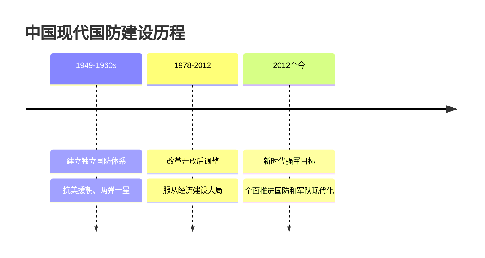

# 中国国防的历史（古代至现代）
### 一、古代国防（公元前21世纪—1840年）

**时间跨度**：从夏王朝建立到鸦片战争爆发，约4000年历史。

**主要特征**：
- **国防主体**：历代王朝，以维护封建统治为核心
- **国防形式**：以长城为代表的防御工事体系，辅以军事征伐
- **精神成果**：培育了民族凝聚力和自强不息、卫国御侮的尚武精神
- **最终形成**：多民族、大疆域的统一国家

**典型代表**：
- 军事思想：孙武《孙子兵法》、吴起《吴子兵法》、戚继光《纪效新书》
- 国防工程：万里长城、京杭大运河（军事运输）

### 二、近代国防（1840年—1949年）

**历史转折**：鸦片战争后，中国逐步沦为半殖民地半封建社会，国防有国无防。

**主要阶段**：

| 时期 | 国防状况 | 典型事件 |
|------|----------|----------|
| 晚清（1840-1911） | 被动挨打，丧权辱国 | 两次鸦片战争、甲午战争、八国联军侵华 |
| 民国（1912-1949） | 军阀混战，外敌入侵 | 抗日战争、解放战争 |

**核心教训**：落后就要挨打，弱国无国防。

### 三、现代国防（1949年至今）

**根本转变**：中华人民共和国成立，结束了中国有国无防的历史，开启了独立自主的国防建设新时期。

**发展阶段**：

**现代国防观的核心内容**：
1. 坚持国家利益至上
2. 坚持富国和强军的统一
3. 弘扬伟大的爱国主义精神
4. 推进国防和军队建设是全党全国人民的共同事业

### 四、中国国防历史的启示（核心考点）

> [!IMPORTANT]
> 强大巩固的国防有赖于：
> 1. **坚强有力的领导**（政治保证）
> 2. **政治昌明**（制度基础）
> 3. **经济发展**（物质基础）
> 4. **科技进步**（关键支撑）
> 5. **国家统一和民族团结**（根本前提）

### 五、常见易错点

> [!WARNING]
> - **时间界限**：古代国防结束于1840年鸦片战争，不是1911年辛亥革命
> - **国防类型**：中国是**防御型国防**、**独立自主型国防**，不是扩张型或联盟型
> - **历史启示**：五个方面缺一不可，注意多选题的完整性

### 六、典型例题解析

**题目**：简述中国国防历史的主要启示。

**解题思路**：
1. 先总述：中国国防历史从古代到现代，经历了从有国无防到强大国防的转变
2. 分点作答：按"领导—政治—经济—科技—统一"五个维度展开
3. 联系现实：结合新时代强军目标，说明历史启示的现实意义

**参考答案要点**：
- 坚强有力的领导是国防建设的根本保证
- 政治昌明为国防提供制度保障
- 经济发展奠定国防物质基础
- 科技进步是国防现代化的关键
- 国家统一和民族团结是国防巩固的前提

> [!TIP]
> 记忆口诀：**"领导政治经济科，统一团结保国防"**（领导、政治、经济、科技、统一团结）
