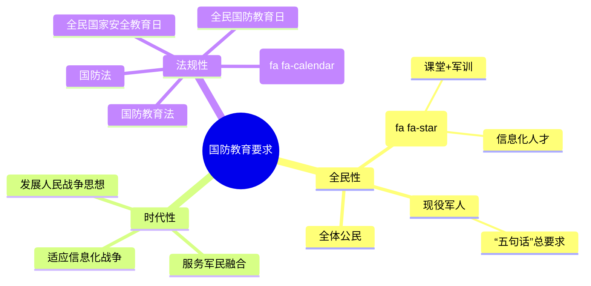

# 国防教育的概念与要求

## 国防教育的概念

国防教育，是指国家为增强公民国防观念、普及国防知识、传授国防技能而开展的有组织、有计划的教育活动。它本质上是一种全民性的“精神国防”——通过教育手段，让每一位公民在思想深处筑起一道保卫国家的无形长城。

我们可以从两个层面理解这个概念：

- **它教育什么？** 不仅是军事知识，更包括国防理论、国家安全形势、国防法规、爱国主义精神和基本的军事技能。
- **它面向谁？** 面向全体公民，但大学生群体是其中的重点对象。

> [!IMPORTANT]
> 国防教育是建设和巩固国防的==基础工程==，是增强民族凝聚力、提高全民素质的==重要途径==。它不等同于单纯的军训，军训只是国防教育中传授军事技能的一种实践形式。

### 为什么需要国防教育？

让我们思考一个问题：和平时期，为什么还要大费周章地开展国防教育？

答案并不复杂。现代战争早已不限于战场上军人的对抗，它向政治、经济、科技、网络等各领域延伸。一个国家的国防实力，最终取决于全体国民的国防意识和精神凝聚力。历史反复证明，一个民族如果失去了忧患意识，即使有再先进的武器装备，国防大厦也可能从内部崩塌。

因此，国防教育解决的是两个核心问题：一是“为何而防”——培养公民的爱国主义精神和对国家安全的责任感；二是“如何来防”——使公民掌握必要的国防知识和技能，一旦需要，能够迅速转化为保卫国家的力量。

> [!WARNING]
> 常见误区：认为国防教育就是单纯的军事训练，或只是军人的事。实际上，==国防教育以全民为对象==，核心是思想观念的塑造，《中华人民共和国国防教育法》明确规定了每一位公民都有接受国防教育的义务。

## 国防教育的要求

根据我国相关法律法规和新时代国防需要，国防教育的要求可以概括为三个维度：全民性要求、时代性要求、法规性要求。

### 全民性要求：覆盖全体公民，重点突出

国防教育不是针对特定人群的“专业教育”，而是面向全体公民的“普及教育”。在此基础上，它有着明确的重心：

- **对全体公民**：进行基本的国防知识、国防形势、爱国主义教育，树立“国不可一日无防”的观念。
- **对大学生**：作为国防后备力量的重要来源，要求更高。高校必须设置适当的国防教育课程，实行==课堂教学与军事训练相结合==。从人才素质上看，大学生不仅要熟悉信息化战争理论，还应掌握信息网络系统和信息化武器系统的运用基础。
- **对现役军人**：要求最为严格，必须深入进行政治合格、军事过硬、作风优良、纪律严明、保障有力的“五句话”总要求教育，筑牢听党指挥的军魂。

### 时代性要求：聚焦信息化，创新发展

国防教育的内容必须随着时代发展而迭代。在当前信息化、智能化浪潮下，要求集中体现在：

1.  **适应信息化战争**：国防教育必须跳出传统陆海空作战的旧框框，将网络安全、信息安全、太空安全等新型安全领域的知识纳入核心内容。公民需要理解，未来战争很可能首先在网络空间打响。
2.  **服务于军民融合战略**：军民融合已上升为国家战略，国防教育要自觉服务于这一大局。这意味着不仅要教育军人懂民用技术，更要教育民众有国防意识，在全社会形成“军民结合、平战结合”的思想基础，使基础设施建设自觉贯彻国防要求。
3.  **坚持和发展人民战争思想**：人民战争是我们的传家宝。在高技术条件下，人民战争的内涵正在拓展——从传统的“车轮滚滚”支前，向科技支前、信息支前转变。因此，==创造性地发展人民战争思想，为新时代人民战争奠定坚实的思想基础==，是国防教育不容回避的时代课题。

### 法规性要求：纳入法制轨道，明确权责

国防教育活动本身必须依法进行，同时也承担着普及国防法规的任务。

- **全民参与有法可依**：以《中华人民共和国国防法》《中华人民共和国国防教育法》为核心的国防法规体系，明确了政府、军队、学校、社会组织和公民在国防教育中的责任与义务。
- **关键时间节点法定化**：国家设立了一系列纪念日和教育活动来强化教育效果。其中，每年9月的第三个星期六为“==全民国防教育日==”，每年4月15日为“全民国家安全教育日”。这些法定日期是集中开展国防教育、强化公民忧患意识的关键抓手。

> [!TIP]
> 记忆线索：国防教育的要求可以抓住“全、新、法”三个字——**全**民覆盖有重点，时代要**新**跟得上，纳入**法**规有保障。以此来统领课件中分散的多个条目，便于理解其内在逻辑。

通过以上内容可以发现，国防教育绝非一门简单的课程，它是一项系统性的国防基础工程。对大学生而言，这门课既是履行法律义务，也是成为合格国防后备力量的必修课。
