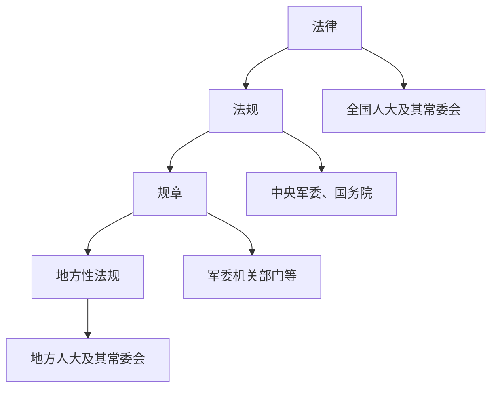

# 国防法规纵向的四个层次

## 什么是国防法规体系

国防法规体系是由不同层次、不同门类的国防法律规范构成的统一整体。它既调整国家国防建设、武装力量建设和公民国防活动中的权利义务，也保障国防活动依法进行。

其中，“纵向”考察的是不同制定主体所制定规范之间的效力层次和上下位关系；“横向”考察的是国防、军事、后勤、动员等不同门类之间的关系。

> [!IMPORTANT]
> 我国现行国防法规体系纵向分为四层：==法律、法规、规章、地方性法规==。记忆顺序是由高到低。

## 四个层次分别是什么

### 法律

由全国人民代表大会及其常务委员会制定，是国防法规体系中效力最高的层次。例如《中华人民共和国国防法》《中华人民共和国兵役法》《中华人民共和国国防动员法》《中华人民共和国国防教育法》等。

### 法规

分为军事法规和军事行政法规：中央军事委员会制定军事法规；国务院制定或国务院与中央军事委员会联合制定军事行政法规。例如《征兵工作条例》《民兵工作条例》《中国人民解放军现役士兵服役条例》等。

### 规章

主要包括中央军事委员会机关部门、战区、军兵种、中国人民武装警察部队制定的军事规章，以及国务院有关部委与中央军事委员会有关机关部门联合制定的军事行政规章。例如《中国人民解放军内务条令》《中国人民解放军纪律条令》等。

### 地方性法规

由省、自治区、直辖市人民代表大会及其常务委员会制定，主要用于贯彻实施国家国防法规，形成实施办法、实施细则和补充规定。

| 层次 | 主要制定主体 | 典型内容 |
|---|---|---|
| 法律 | 全国人大及其常委会 | 国防、兵役、动员、国防教育 |
| 法规 | 中央军委、国务院 | 征兵、民兵、现役士兵管理 |
| 规章 | 军委机关部门等 | 条令、规则、管理制度 |
| 地方性法规 | 地方人大及其常委会 | 国家国防法规的实施办法 |

## 怎么判断题目中的规范属于哪一层

先看==制定主体==，再看文件的规范名称和内容。法律通常冠以“中华人民共和国”；法规常见“条例”；规章常表现为“条令”“规定”“办法”；地方性法规则体现为某一省、自治区、直辖市的具体实施办法。

> [!TIP]
> 快速判断口诀：==人大定法律，军委国务院定法规，机关部门定规章，地方人大定地方规范==。

> [!WARNING]
> 不要仅凭文件名称判断。“条例”不一定都是法律，“办法”也不一定都是规章。考试常故意给出熟悉名称，要求先识别制定主体。

## 常见易错点

一是把四个层次记成横向分类，如“动员法规、军事法规、后勤法规”。这些属于不同门类，不是纵向层次。

二是把“地方性法规”理解为地方政府制定的普通文件。准确说法是，由地方人民代表大会及其常务委员会制定。

三是认为国务院可以制定法律。法律由全国人民代表大会及其常务委员会制定，国务院参与制定的是行政法规。

四是把军事法规与军事行政法规混为一谈。前者由中央军事委员会制定，后者由国务院制定，或由国务院与中央军事委员会联合制定。

## 算对了的例子

题目问：“我国现行的国防法规体系区分为四个层次：第一是____；第二是____；第三是____；第四是____。”

应填：

**法律；法规；规章；地方性法规。**

判断过程：题干已经限定“纵向四个层次”，只需按照效力由高到低排列。若给出《兵役法》，因由全国人大常委会制定，属于第一层“法律”；若给出《征兵工作条例》，则属于第二层“法规”；若给出《中国人民解放军内务条令》，则属于第三层“规章”。
