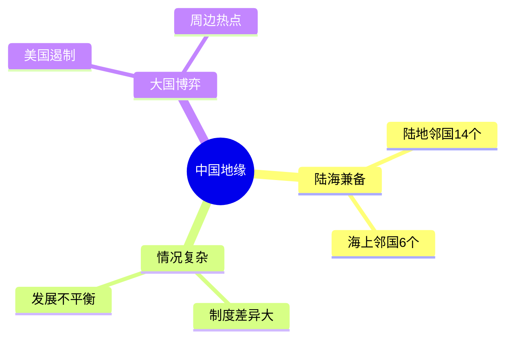
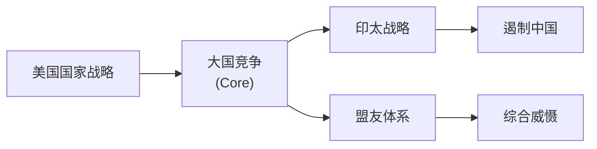

# 我国地缘、环境概况

# 我国地缘、环境概况

## 核心特征：陆海兼备与复杂周边

我国地缘环境可概括为**“陆海兼备，邻国众多”**。这既是战略优势，也是安全挑战的源头。

> [!IMPORTANT]
> ==三大基本特征==是理解本章逻辑的基石：
> 1. **陆海兼备**：拥有漫长陆地边界与海岸线。
> 2. **差异明显**：周边政治、经济、宗教情况复杂。
> 3. **大国环伺**：美、俄、印等力量交汇，热点频发。

## 面临的主要安全挑战

当前国家安全形势严峻，主要体现为外部遏制与内部隐患交织。复习时需重点记忆以下**七大挑战**：

| 挑战方向 | 具体表现 | 关键考点 |
| :--- | :--- | :--- |
| **超级大国** | 美国全方位遏制打压 | 核心对手，“印太战略” |
| **东部海域** | 中日分歧、台海复杂化 | 主权与统一问题 |
| **南部海域** | 南海问题域外介入 | 国际化、复杂化趋势 |
| **西部陆地** | 中印边界争端 | 领土主权干扰 |
| **东北亚** | 朝鲜半岛局势变数 | 核问题与安全缓冲 |
| **非传统安全** | 恐怖主义威胁 | 周边地区现实威胁 |

> [!WARNING]
> 易错点：不要只关注军事硬对抗。**非传统安全**（如恐怖主义、网络攻击）同样是地缘环境的重要组成部分，且呈蔓延趋势。

## 国际战略背景：美国动向

理解地缘环境必须结合**国际战略格局**。目前呈现**“东升西降”**趋势，但大国博弈全面加剧。

**美国军事战略核心：**
1.  **定位转变**：从反恐转向**“大国竞争”**，将中、俄定为主要竞争对手。
2.  **战略抓手**：加紧推进**“印太战略”**，构建盟友体系。
3.  **力量部署**：全球设6大战区司令部（如**印太司令部**），强调联合部队建设。

> [!TIP]
> 记忆口诀：**“一超两强多热点”**。
> *   **一超**：美国全方位遏制。
> *   **两强**：中俄被美视为主要对手。
> *   **多热点**：台海、南海、中印、朝半岛。

## 备考避坑指南

*   **坑1**：混淆“地缘特征”与“面临挑战”。特征是客观地理/政治状态（如邻国多），挑战是由此引发的安全风险（如边界争端）。
*   **坑2**：忽视美国战略的连续性。拜登政府虽策略不同，但**延续**了特朗普时期聚焦“大国竞争”的核心基调。

> [!NOTE]
> **典型例题思路**：若问及“我国地缘环境的基本特征”，必答“陆海兼备、情况复杂、大国环伺”；若问“主要挑战”，则需列举美遏制、台海、南海等具体问题。
