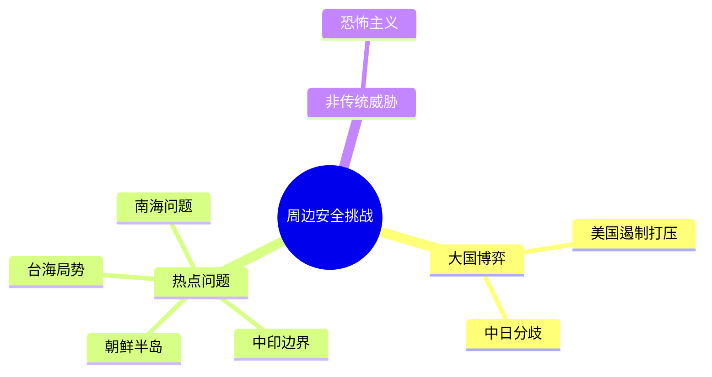

# 我国周边安全环境面临的主要挑战

## 是什么：先看清“家门口”的地图

我国地处亚洲大陆东部、太平洋西岸，==陆海兼备、邻国众多==：陆上接壤 14 国，海上相邻 8 国。这种“大国环伺、热点频发”的地缘环境，决定了周边安全挑战不是单点的，而是相互联动的。

## 为什么需要重视

想一想：为什么美国“印太战略”会让台海、南海同时升温？因为==大国竞争是牵动全局的主线==，其余热点多是这条主线的“投影”。美国把中、俄列为主要竞争对手，通过 6 大战区司令部（印太司令部首当其冲）和约 800 个海外基地，从军事、经济、技术多维度施压；其“威慑+盟友+未来联合部队”的组合，直接推高了周边紧张度。

## 怎么做：七类挑战速记

| 挑战 | 关键抓手 | 联动点 |
|------|---------|--------|
| 美国全方位遏制 | 印太战略、技术封锁 | 牵动全局 |
| 中日分歧 | 历史、领土、安全互信 | 美国盟友体系 |
| 中印边界 | 领土争端未决 | 地区稳定 |
| 朝鲜半岛 | 核问题、半岛无核化 | 大国博弈 |
| 台海局势 | 分裂势力、外部干涉 | 核心利益 |
| 南海问题 | 域外大国介入 | 印太战略支点 |
| 恐怖主义 | 周边地区现实威胁 | 非传统安全 |

> [!IMPORTANT]
> ==“大国博弈加剧”是纲，其余六条是目==。答题时先点明美国遏制是总根源，再展开热点问题。

> [!TIP]
> 口诀：**“美中印，朝台南，恐”**——美遏制、中日、中印、朝核、台海、南海、恐怖，七字不漏。

## 常见的坑

> [!WARNING]
> 不要把“中印边界”与“中印关系”混为一谈：边界争端是**影响和干扰**两国关系发展的因素，而非关系全部。选择题常在此设“全面恶化”类干扰项。

> [!CAUTION]
> 台海、南海属于==中国核心利益==，与朝鲜半岛（地区热点）性质不同，答题时层级要分清。

## 例题示范

**选择题**：下列哪项不属于我国周边安全环境面临的主要挑战？
- A. 美国全方位遏制打压中国
- B. 中印边界争端影响两国关系
- C. 国内网络安全漏洞频发
- D. 南海问题域外大国介入

**解析**：C 为国内安全议题，非“周边”环境挑战；A、B、D 均在七类挑战之列。故选 **C**。
