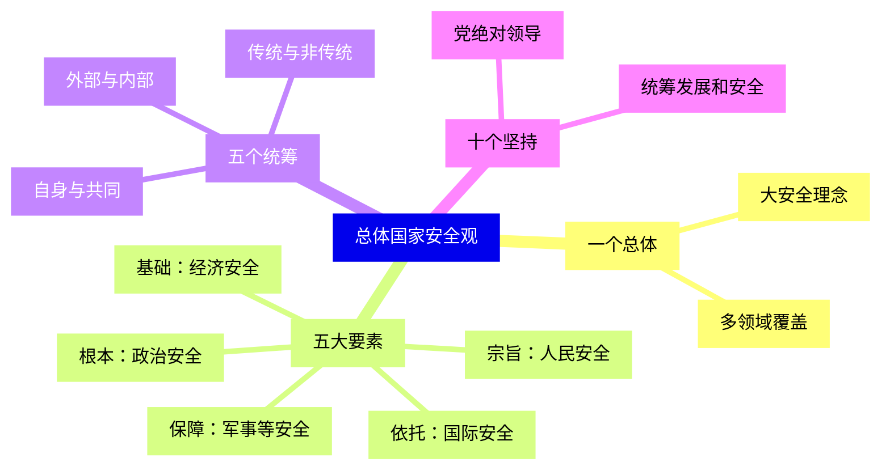

# 总体国家安全观的核心要义
要理解这部分，不妨先问自己一个问题：**什么样的安全才算真正的国家安全？** 如果只盯着军事防线，却忽略了网络攻击、金融动荡或生物威胁，国家还能稳定发展吗？总体国家安全观正是从这些现实挑战出发，给出一套系统性的回答。

### 它是什么：一个“总体”的框架

总体国家安全观的核心要义可以归纳为 ==“一个总体”“五大要素”“五个统筹”“十个坚持”==，其中“五大要素”是最基本的骨架。

> [!IMPORTANT]
> “五大要素”明确了不同领域安全的定位与关系：以人民安全为宗旨、以政治安全为根本、以经济安全为基础、以军事科技文化社会安全为保障、以促进国际安全为依托。

`“一个总体”`是关键。它不把国家安全等同于单纯的军事安全，而是涵盖政治、经济、网络、生物、太空等数十个领域，并会随社会发展不断调整。

`“五个统筹”`解决怎么落地的问题。比如：传统安全（如军事冲突）与非传统安全（如重大传染病）要一起抓，自身安全与共同安全要兼顾，强调的是一种动态协调。

`“十个坚持”`则从领导力量、道路选择、风险防范到干部队伍，搭建起实践层面的工作要求体系。

### 为什么需要：安全不是“只有战争才算”

国家安全是 ==相对没有危险、不受威胁的状态，以及保障这种状态的能力==。

威胁的来源早已超出“枪炮”。内部政治腐化、经济崩溃或社会撕裂，外部金融危机、网络攻击、气候变化，都能在特定条件下动摇国家安全。如果依然用传统军事安全的旧尺度去量，结果一定是“漏诊”——这就解释了为什么必须转向“总体”视角。

> [!CAUTION]
> 一个常见误区是把“国家安全”等同于“国家军事安全”。一些西方国家的战略报告曾直接这样画等号，但在今天，粮食、科技、数据这些领域一旦失守，同样可以动摇整个国家的根基。

### 怎么做：抓关键、防偏科

把握总体国家安全观，要抓住两条主线：

1. **分层定位**——记住“宗旨、根本、基础、保障、依托”这组词，每一层都有自己的位置。
2. **统筹兼顾**——不能只盯传统安全而忽视非传统安全，也不能只顾自身安全而不管共同安全。

与之相近的是“传统安全观”，其核心区别在于范围与逻辑：

| 对比维度 | 传统安全观 | 总体国家安全观 |
|---------|------------|-----------------|
| 关注领域 | 以政治和军事为主 | 政治、经济、网络、生物等数十个领域 |
| 安全主体 | 国家（以军事防御为中心） | 国家，并突出人民安全为宗旨 |
| 应对方式 | 侧重对抗、威慑 | 统筹发展与安全，强调合作与共同安全 |
| 特征 | 相对单一、静态 | ==“总体”==——系统、动态、全方位 |

### 一个算对了的例子（考试视角）

> **题目**：简述总体国家安全观的“五大要素”。

可以从“宗旨—根本—基础—保障—依托”这条逻辑链展开：

总体国家安全观的“五大要素”是以 ==**人民安全为宗旨**==，这是出发点和落脚点；以 ==**政治安全为根本**==，守住政权与制度的底线；以 ==**经济安全为基础**==，为国家运行提供物质支撑；以 ==**军事、科技、文化、社会安全为保障**==，形成全方位的防护力量；以 ==**促进国际安全为依托**==，营造有利的外部环境。五者相互衔接，构成一个系统完整的国家安全体系。

> [!TIP]
> 记忆口诀：“人民宗，政治根，经济基，军科文社保，国际依。” 先背住这组短句，再逐个展开阐述。
