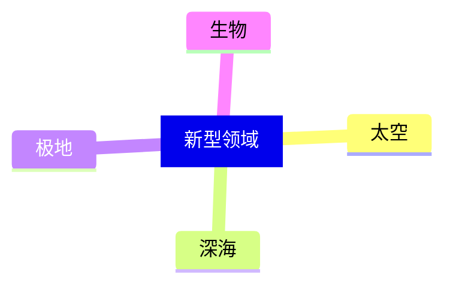
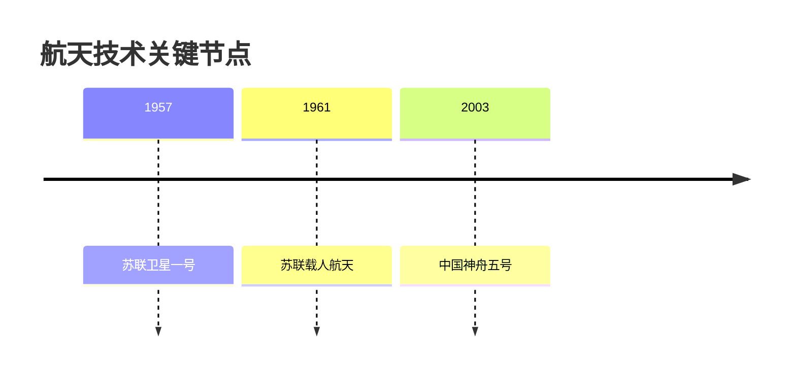

# 新型领域国家安全（太空、网络、深海、极地等）

国家安全的概念在不断动态发展。传统的国家安全侧重于生存安全，尤其体现在政治安全和军事安全上。但随着时代发展，==维护国家利益的方式不断拓展，国家安全的内涵和外延也在不断充实、发展和完善==。经济、科技、文化、网络、生态等都成为国家安全的重要组成部分。

在总体国家安全观"一个总体"的框架下，==太空、深海、极地、生物等新型领域==被明确纳入国家安全范畴。这些领域既是国家发展的战略新疆域，也是大国博弈的新战场。

## 为什么需要关注新型领域

你不妨先想一个问题：如果一个国家的通信卫星被摧毁、海底光缆被切断、极地科考站失去补给，这个国家会怎样？传统军事安全主要应对有形战场上的敌军入侵，而新型领域的安全威胁往往是==无形的、非对称的、难以预警的==。一些国家出现政局动荡或政权颠覆，其原因不一定是外部军事入侵，内部政治体制腐朽、经济崩溃、理想信念丧失等都会威胁国家安全稳定。

## 新型领域的构成与特点

| 领域 | 安全威胁举例 | 战略价值 |
|------|-------------|---------|
| 太空 | 卫星攻击、轨道干扰 | 侦察、导航、通信 |
| 深海 | 光缆破坏、潜艇渗透 | 资源、战略通道 |
| 极地 | 领土争端、资源争夺 | 科研、航道、资源 |
| 生物 | 重大传染性疾病、生物武器 | 公共卫生、生态安全 |

## 太空领域的安全

航天技术是探索、开发和利用太空以及地球以外天体的综合性工程技术，也称空间技术。它主要由航天运载器技术、航天器技术和航天测控技术组成。1957年10月4日，苏联成功发射"地球卫星1号"，标志着人类进入==航天时代==。1961年4月12日，苏联宇航员乘坐载人飞船第一次将人类遨游太空的梦想变为现实。2003年10月15日，我国"神舟"五号载人飞船发射成功，杨利伟执行了太空飞行任务。

军用航天技术是把航天技术应用于军事领域，为军事目的进入太空和开发利用太空的综合性工程技术。美军设有太空司令部，空军编有5个航天联队，并单独设立太空军。俄罗斯则将太空部队编入空天军。这说明太空已成为大国军事竞争的关键领域。

> [!IMPORTANT]
> 新型领域国家安全的核心：大国在这些领域的博弈是**非对称的、高技术的**，必须抢占战略制高点。

## 网络领域的安全

网络战、电子战、心理战、精确打击等构成了网络空间作战的主要样式。信息化战争是以信息化武器装备为主要手段，在网络空间、电磁空间等多维空间进行的战争形态。其特点是集成度高、智能性强、网络化程度高。美军设有网络司令部，专门负责网络空间作战。信息战的主要作战样式包括作战保密、军事欺骗、心理战、电子战、实体摧毁、计算机网络战等。非军事战争行动如贸易战、金融战、网络战、生态战、心理战也成为安全威胁。

## 高频考点与易错点

> [!TIP]
> 记忆口诀：新型领域"太空深海极地生物"，航天技术三要素"运载器、航天器、测控"。

> [!WARNING]
> 注意区分"航天技术"与"军用航天技术"：前者是综合工程技术，后者特指军事目的的太空开发。考试中二者常混用考查定义。

> [!NOTE]
> 世界第一个实现载人太空飞行的国家是**苏联**，不是美国。这是常考的陷阱题。

## 小结

新型领域国家安全是总体国家安全观的重要组成部分，涵盖太空、深海、极地、生物等领域。随着新军事革命的发展，信息化、智能化、无人化趋势明显，这些领域的安全直接关系国家核心利益。学生应重点掌握各领域的安全威胁、战略价值，以及航天技术、信息战等核心概念的准确表述。
