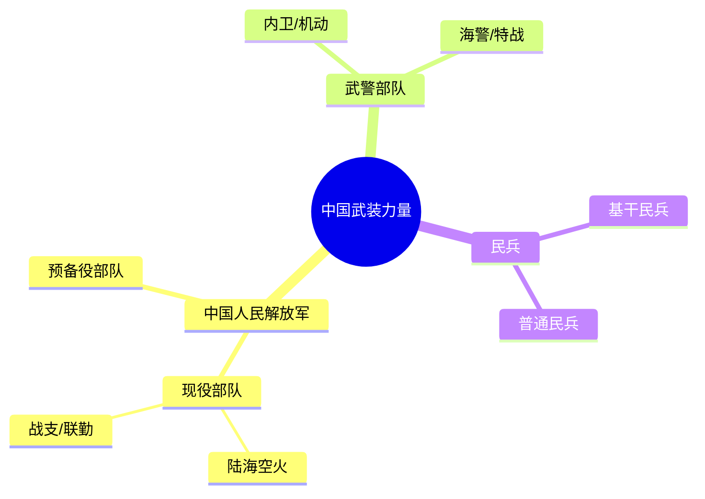

# 中国武装力量的构成

# 中国武装力量的构成

中国武装力量由 ==中国人民解放军==、==中国人民武装警察部队== 和 ==民兵== 组成。这种“三结合”体制符合我国国情，是历史发展的必然结果。

> [!IMPORTANT]
> 核心考点：我国武装力量不是单一军队，而是由 PLA、PAP 和民兵组成的复合体系。

## 它是什么：三大组成部分

为了清晰理解各部分职能，我们可以通过下表对比：

| 组成部分 | 性质与定位 | 主要任务 |
| :--- | :--- | :--- |
| **中国人民解放军** | 国家常备军 | 防卫作战、非战争军事行动 |
| **中国人民武装警察部队** | 武装性质的治安行政力量 | 执勤、处突、反恐、海上维权等 |
| **民兵** | 不脱离生产的群众武装组织 | 战时支援前线、平时抢险救灾 |

### 1. 中国人民解放军 (PLA)
PLA 分为现役部队和预备役部队。
*   **现役部队**：由陆军、海军、空军、火箭军、战略支援部队和联勤保障部队组成。
*   **预备役部队**：以复员退伍军人为主要成分，授有军旗、番号，配备武器装备。

> [!NOTE]
> 注意：2016年军改后，形成了“军委管总、战区主战、军种主建”的新格局。

### 2. 中国人民武装警察部队 (PAP)
PAP 担负国家赋予的安全保卫任务，维护社会秩序。

### 3. 民兵
民兵是中华人民共和国武装力量的重要组成部分，是解放军的助手和后备力量。

## 为什么需要：体制优势

这种结构并非随意组合，而是基于国防需求的深层逻辑：
1.  **常备与后备结合**：现役部队保持高强度战备，预备役和民兵提供巨大的人力储备。
2.  **军民融合**：民兵不脱离生产，既保证经济建设，又具备动员潜力。
3.  **全域覆盖**：解放军对外防卫，武警对内维稳，民兵基层支援，形成完整安全网。

## 常见的坑与辨析

> [!WARNING]
> 易错点：不要将“武警”误认为是“解放军”的一部分，也不要忽略“民兵”的法定地位。

*   **误区 1**：认为只有穿军装的才是武装力量。
    *   **正解**：民兵虽不常穿军装，但属于法定武装力量。
*   **误区 2**：混淆“预备役”与“民兵”。
    *   **正解**：预备役有统一编制和番号，接近正规军；民兵是群众性组织，更侧重基层。

## 算对了的例子

**题目**：下列哪项不属于中国武装力量的构成部分？
A. 中国人民解放军现役部队
B. 中国人民武装警察部队
C. 公安特警队伍
D. 民兵组织

**解析**：
根据《国防法》，中国武装力量由 PLA、PAP 和民兵组成。
*   A、B、D 均属于法定构成部分。
*   C 项公安特警属于公安机关人民警察序列，虽具武装性质，但**不属于**国防意义上的“武装力量”构成部分（除非在特定战时状态下被征用，但在常规分类中不列入）。

因此，正确答案是 **C**。

> [!TIP]
> 记忆口诀：**“解放武警加民兵，三结合体保和平”**。记住这三家，考试不丢分。
