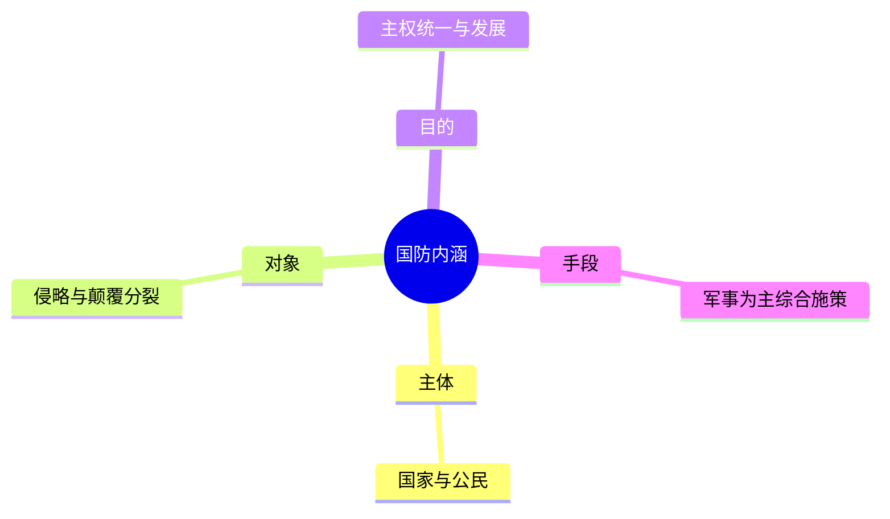

# 现代国防观的内涵

## 现代国防观的内涵

当我们谈论“国防”时，你是否还停留在“打仗只是军队的事”这一传统认知上？在现代安全环境下，如果只把国防等同于军事对抗，能否真正保卫国家的发展利益？要回答这个问题，就必须理解《国防法》对国防内涵的立法性表述。

> [!IMPORTANT]
> 现代国防观是现时代国防客观存在在头脑中的反映，其核心在于==坚持国家利益至上==，强调国防是涵盖政治、经济、外交等多领域的综合体系，而非单纯的军事行为。

### 国防内涵的四要素解析

依据《国防法》第2条，国防内涵可拆解为四个维度，这也是考试简答题的高频采分点：

- **主体**：国防的主体是==国家==。它既是国家机构的基本职能，也是全体社会公民的神圣职责，绝非仅限于武装力量。
- **对象**：防备和抵抗侵略（含武装与非武装）、制止武装颠覆和分裂。注意，非武装侵略（如经济制裁、文化渗透）同样属于国防应对范畴。
- **目的**：保卫国家主权、统一、领土完整、安全和发展利益。其中“发展利益”是现代国防观区别于传统国防观的重要增量。
- **手段**：以军事手段为主要和保底手段，同时综合运用政治、经济、外交、科技、教育等手段。==军事手段不能孤立发挥作用==，必须与其他手段有机结合形成合力。

### 与传统国防观的区别

| 比较维度 | 传统国防观 | 现代国防观 |
| :--- | :--- | :--- |
| 关注重心 | 领土防卫、战争胜负 | ==国家利益至上==、富国强军统一 |
| 手段运用 | 单一军事对抗 | 军事与非军事手段综合集成 |
| 参与主体 | 军队专属 | 全党全国人民的共同事业 |
| 精神内核 | 尚武御侮 | 弘扬伟大爱国主义精神 |

> [!TIP]
> 记忆口诀：“主国对侵目保五，手军综政经外科技教”。即主体是国家，对象是侵略颠覆，目的是保卫五项利益，手段是军事为主、多域综合。

### 常见误区警示

> [!WARNING]
> 切勿将“国防手段”等同于“军事手段”。考试中若问“国防的主要手段是什么”，答“军事手段”正确；但若问“国防的手段有哪些”，仅答军事手段则严重失分。必须强调==与军事有关的政治、经济、外交、科技、教育等活动==同样是法定国防手段。

> [!NOTE]
> 结合俄罗斯军事战略调整案例可知，即便是强调核遏制与军事保底的大国，也在同步推进非核遏制与空天防御体系建设。这印证了现代国防观中“综合手段”与“国家利益至上”的现实必要性，单纯依赖某一类武器或军种已无法应对复合型安全威胁。
