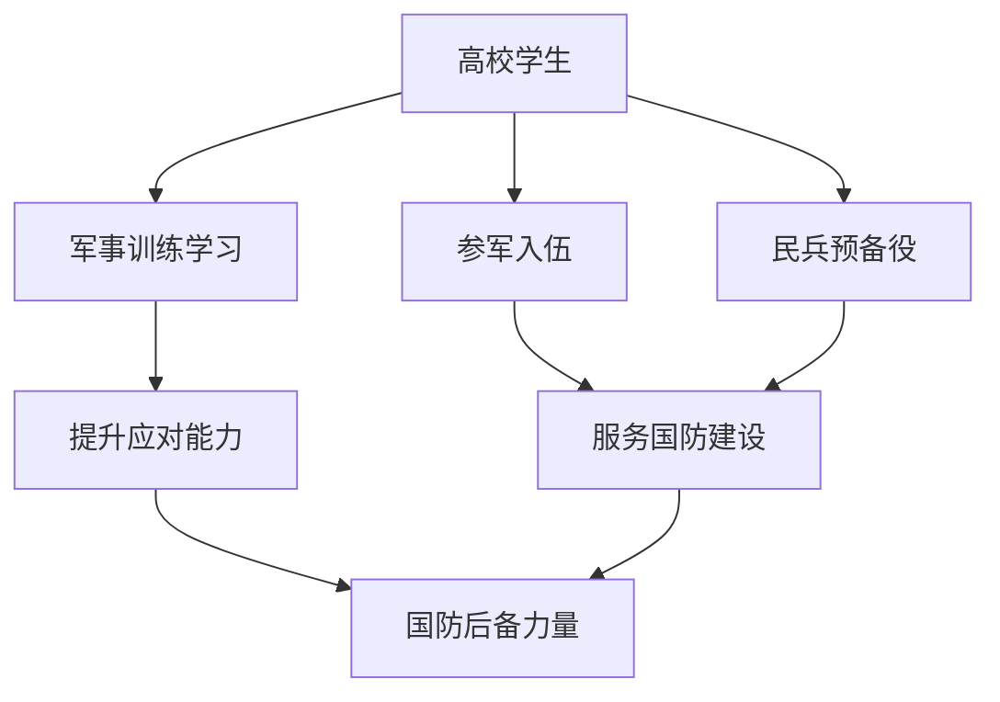

# 高校学生与国防建设的关系

> [!IMPORTANT]
> ==国防是国家的事业，是国家机构的基本职能、社会公民的神圣职责。== 高校学生作为高素质青年群体，与国防建设有着密不可分的联系。

## 它是什么

高校学生与国防建设的关系，核心在于：==大学生是国防后备力量的重要组成部分==。在和平时期，大学生可通过参军入伍、参与民兵预备役等方式直接服务于国防建设；同时，经济建设与国防建设的关系是我国现代化建设中的一个带全局性的基本关系。

我们可以用一张图理清这条逻辑链：

## 为什么需要

试想一下：现代战争打的是装备，还是人？

决定战争胜负的关键因素究竟是武器、经济、政治，还是人？答案是==人的因素==。武器装备再先进，最终也要靠高素质的人去操作和指挥。高校学生具备扎实的科学文化素养（比如咱们南邮的通信、电子、计算机专业背景），正是信息化、智能化战争最急需的兵员储备。

党的十八大以后，面对新情况新问题新挑战，必须统筹经济发展和国家安全。坚持富国和强军的统一，必须统筹经济建设和国防建设，走出一条==军民融合==式发展路子。大学生既是经济建设的未来主力军，也是国防建设的优质后备军，天然处于“军民融合”的交汇点。

## 怎么做

1. **认真参训**：通过军事训练和学习，提升应对现代战争的能力，掌握基本军事技能。
2. **履行义务**：明确公民国防权利和义务，依法服兵役或参加民兵组织。
3. **发挥专长**：将专业知识（如网络安全、通信技术）转化为国防潜力，促进经济建设和国防建设协调发展、平衡发展、兼容发展。

## 相近概念辨析

| 概念 | 侧重点 | 主体 |
| :--- | :--- | :--- |
| 国防建设 | 维护国家主权、安全的总体建设 | 国家、全体公民 |
| 军民融合 | 经济建设与国防建设统筹发展 | 国家战略层面 |
| 民兵预备役 | 不脱离生产的群众武装组织 | 符合条件的公民（含大学生） |

> [!NOTE]
> “军民融合”不是把军队变成企业，也不是让企业代替军队，而是强调两者资源共享、兼容发展。

## 常见的坑

> [!WARNING]
> 填空题中，“走出一条______式发展路子”，答案必须是【军民融合】，不要错写成“军民结合”或“寓军于民”。

> [!CAUTION]
> 选择题问“决定战争胜负的关键因素”，极易误选“武器的因素”或“经济的因素”。牢记：==关键因素永远是人的因素==。

## 真题实战

来看一道经典考题：

**题目**：决定战争胜负的关键因素是（ ）。
A. 武器的因素
B. 人的因素
C. 经济的因素
D. 政治的因素

**解析**：
武器是重要条件，经济是物质基础，政治是方向保证，但人是战争的主体。无论技术如何迭代，指挥决策、装备操作、战术执行都离不开人。因此，关键因素是人的因素。

**答案**：B

> [!TIP]
> 记忆口诀：**“国防治本靠人民，融合富国又强军；胜负关键不在铁，人才方为定海针。”** 把握住“人”这个核心，绪论部分的很多选择题就能迎刃而解。
