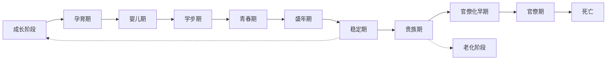

# 爱迪思的十阶段成长模型

## 它是什么

爱迪思把企业看成有生命的有机体，在《企业生命周期》中把企业成长过程划分为**成长**和**老化**两大阶段共十个时期。成长阶段从孕育期开始，依次经历婴儿期、学步期、青春期、盛年期，直到稳定期；稳定期是成长的巅峰，此后企业一般进入老化阶段，经历贵族期、官僚化早期、官僚期，最后走向死亡。

> [!IMPORTANT]
> 稳定期是企业成长的巅峰，也是成长阶段与老化阶段的分水岭：到达稳定期后，往往意味着企业开始进入老化阶段。

## 为什么需要这个模型

企业每从一个阶段转换到另一个阶段，就必须放弃旧的行为模式、学会新的行为方式，==问题在阶段转换时产生==。在生命周期的不同阶段，企业会面临不同性质的问题，管理者需要据此判断企业“病在哪里”，再决定对策。

## 正常问题与不正常问题

| 类型 | 含义 | 解决方式 |
|---|---|---|
| 正常问题 | 阶段转换中因改变行为模式而必然出现的问题 | 企业凭内在能量即可解决 |
| 不正常问题 | 超出企业自身调节能力的问题 | 需要外部干预 |

> [!WARNING]
> 不要把“问题”一概当成坏事。企业成长本身就意味着具备了处理更大、更复杂问题的能力；==创业家的职责是管理企业，使之进入下一个更富挑战性的生命阶段，把企业引向盛年并保持盛年==。

## 一个对号入座的小例子

题目若问：“某企业到达成长巅峰后，开始进入贵族期、官僚化早期、官僚期，最终死亡，这一巅峰属于哪个时期？”

- 巅峰 = 稳定期，它既是成长阶段的最后一期，也是老化阶段的起点。
- 老化阶段的顺序是：稳定期之后 → 贵族期 → 官僚化早期 → 官僚期 → 死亡，不要漏掉“官僚化早期”，也不要把它和“官僚期”合并。

> [!TIP]
> 记顺序时按“成长五期 + 巅峰 + 老化四步”背：孕育、婴儿、学步、青春、盛年、稳定，再接贵族、官僚化早期、官僚、死亡；答题先定位阶段，再判断问题是正常还是不正常。
