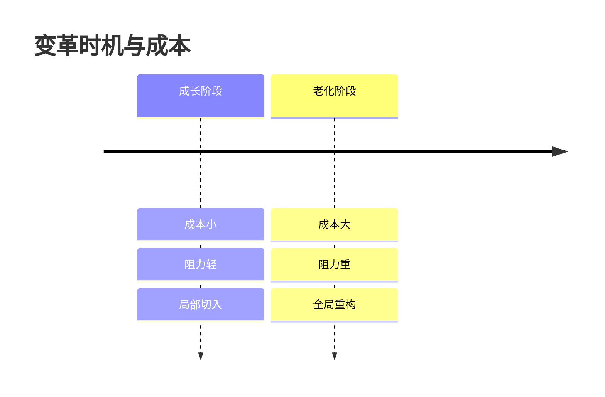
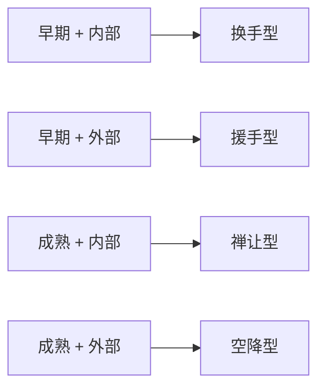

# 企业成长的管理重点与管理传承（变革成本与切入点、如何实现管理传承）

企业进入成长阶段后，管理者必须回答两个问题：==什么时候动手变革==，以及==谁来接棒带领企业继续走==。这正是「变革成本与切入点」和「管理传承」要解决的核心议题。

## 变革成本与切入点

企业成长阶段实施变革的成本相对较小，来自内部的阻力也更轻——组织尚未固化、制度仍在形成、既得利益格局还不沉重。因此，==善于把握变革的切入点，从局部推进变革，往往能在短期内取得可见效果==。相反，等到企业老化、官僚化之后再谈变革，成本与阻力都会成倍放大。

> [!TIP]
> 记忆点：**成长期早动手、小切口**；老化期才动手、要动大手术。

## 管理传承的四种类型

管理传承由两个核心要素交叉决定：==企业成长阶段==（早期 / 成熟期）与==继任者来源==（内部人 / 外部人），两两组合得到四种类型。

| 类型 | 阶段 / 来源 | 典型情境 | 风险或优势 |
|---|---|---|---|
| ==换手型== | 早期 + 内部 | 创业元老为降低用人风险，提拔创业团队内部人接替 | 创始人影响持续，易「任人唯亲」 |
| ==援手型== | 早期 + 外部 | 产品开发完成或获外部投资后，需规范化经营，引入外来者 | 弥补创始人「会创业不会管理」的短板 |
| ==禅让型== | 成熟 + 内部 | 关键环节遇瓶颈，内部长期培养考察后接班（如联想柳传志→杨元庆） | 交接平稳、文化延续 |
| ==空降型== | 成熟 + 外部 | 董事会高薪外聘「空降兵」，突破管理、技术、战略瓶颈 | 突破力强，但融合风险高 |

> [!WARNING]
> 易错点：**换手型 ≠ 禅让型**——两者都是内部接替，但换手发生在**创业初期**，禅让发生在**成长成熟期**。同理，援手型 ≠ 空降型，区别也在阶段。

## 一个对得上的例子

联想柳传志以「缝鞋垫」与「做西服」理论，从内部选拔杨元庆接班——企业已具规模与积累，接班人经长期实践考察，属于==禅让型==。若某初创公司在天使轮后引入职业经理人接管日常经营，创始人退居幕后，则属==援手型==。

> [!NOTE]
> 葛雷纳模型提示：==推动企业成长的动力往往又是阻碍其进一步成长的最大障碍==。管理传承正是突破这一悖论、让企业进入下一阶段的关键手段之一。

> [!CAUTION]
> 高危误区：把「管理传承」简单等同于「换 CEO」。实际上它包含领导权更替的时机、来源、程序与文化延续，是企业成长期的系统性管理重点。
