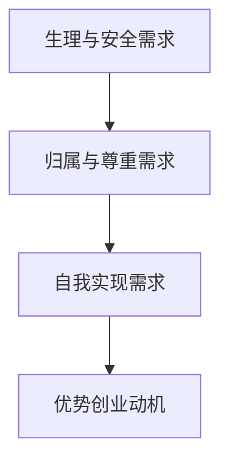

# 为什么要成为创业者（创业动机）

## 创业动机是什么

==创业动机==是引起和维持个体从事创业活动，并使活动朝向某些目标的内部动力。它不是一时冲动，而是创业者选择创业、投入资源并承受风险的心理驱动力。创业动机越清晰、越强烈，创业者通常越能坚持到最后。

创业过程可以概括为：

> [!IMPORTANT]
> 创业动机回答的是“为什么要创业”，创业机会回答的是“创业做什么”，创业能力回答的是“能不能把事做成”。

## 为什么要成为创业者

人们创办企业，往往不是因为“企业一定比就业好”，而是为了满足某种重要需求。创业者最基本的创业动机有三种：

| 基本动机 | 核心需要 | 典型表现 |
|---|---|---|
| ==自己当老板== | 自主与控制 | 不愿受组织制度约束，希望决定做什么、怎么做 |
| ==追求自己的创意== | 创造与自我实现 | 把个人想法、专利或技术转化为产品与事业 |
| ==获得财务回报== | 收入与财富积累 | 看好市场收益，希望获得利润或资本增值 |

这三种动机可以同时存在。例如，创业者既想把创意产品化，也希望自己经营并获得较高利润。

创业动机还决定创业的“底线”。创业前应想清楚：愿意为公司承受什么损失？如果投入全部积蓄仍要创业，说明动机很强；如果损失超过心理门槛就不愿继续，则动机可能不足。

## 生存型与机会型创业

根据创业动机的来源，可以把创业区分为两类：

| 类型 | 产生原因 | 主要特点 |
|---|---|---|
| 生存型创业 | 没有其他合适的工作 | 首要目标是维持生计、解决就业 |
| 机会型创业 | 发现具有吸引力的机会 | 更重视成长、财富与自我实现 |

例如，小王失业后发现社区老人缺少可靠的陪诊服务。他没有其他合适工作，因此先用这项服务维持收入，这属于生存型创业；如果他原本收入稳定，却主动发现这一市场并组建团队扩大服务，则更接近机会型创业。

> [!TIP]
> 判断口诀：==没工作被迫做，多为生存型；发现机会主动做，多为机会型。==

机会型创业者通常具有较好的知识、经验和能力，生活压力相对较小，敢于承担风险，其创业动机往往更多来自自我实现需要。

## 动机如何形成

创业动机是个人因素与外部环境共同作用的结果。直接依据马斯洛需求层次理论来看，当低层次需求得到相对满足后，较高层次需求才可能成为主导需求：

因此，收入已有保障的创业者，更可能追求独立、成就感和创意；生活压力较大的创业者，则更可能因就业和生计问题创业。

间接影响需求的宏观因素包括==社会保障、收入水平、人口统计特征==。此外，创业者的个性特点、个人环境、商业环境、个人目标和商业计划的可行性，都会影响创业决定。

## 常见误区

> [!WARNING]
> 不要把创业动机等同于创业原因。“发现一个好项目”可能说明存在创业机会，却不能单独解释个体为什么愿意行动。

- 动机强不等于项目一定成功。创业还需要机会识别、资源整合和经营管理能力。
- 财务回报并非所有创业者的首要动机；有人更看重自主权、创意实现或社会价值。
- 不能只看创业成功者。创业失败者也可能动机很强，只是资源、能力或环境不足。
- 生存型与机会型不是完全对立的类型，判断重点是创业主要由“缺乏其他选择”还是“主动发现机会”推动。

> [!IMPORTANT]
> ==创业动机是创业行为的内在起点；三种基本动机是自主、创意和回报，生存型与机会型则反映了创业动机的不同来源。==
