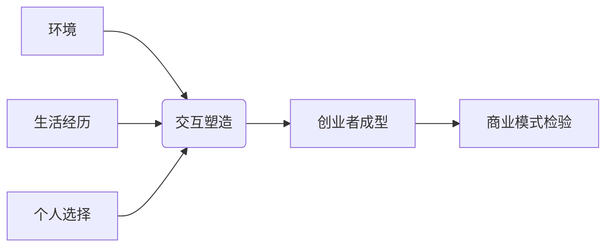

# 创业机制的内涵与构成要素

## 创业机制的内涵与本质

如果创业者并非天生异于常人，那么是什么决定了谁能成功创办并维持一家企业？是单纯的运气，还是某种可被解析的系统？

> [!IMPORTANT]
> 创业机制是指==环境、生活经历与个人选择==三者动态交互，将个体潜在特质转化为实际创业行为与能力的系统性过程。它否定了“基因决定论”，强调创业者是后天塑造的结果。

这一内涵揭示了两个核心事实：第一，每个人都有成为创业者的潜力；第二，即便拥有才智与精力等先天“泥巴”，也必须通过技术、技能、经历和关系网的多年积累才能被“塑形”。创业机制不是静态的资质清单，而是一个持续的==自我发展历程==。

## 构成要素的三维解析

理解创业机制，需将其拆解为三个相互作用的维度，而非孤立看待。

| 构成要素 | 核心内容 | 在机制中的作用 |
| :--- | :--- | :--- |
| 环境 | 政策、市场、文化、资源 | 提供机会窗口与约束条件 |
| 生活经历 | 教育、职业、失败、社交 | 积累技术、技能与关系网 |
| 个人选择 | 认知决策、风险承担、坚持 | 触发行动并主导自我发展 |

[!NOTE]
商业模式的关键构成要素（价值主张、客户细分、渠道通路等）本质上是创业机制在==经济层面的外化==。机制塑造了创业者，而创业者设计的商业模式又必须在市场上不断经受需求与效益的双重检验。

## 与相近概念的辨析

许多同学容易混淆“创业机制”与“创业者特质”，二者有本质区别：

-   **创业者特质**：侧重个体心理特征（如成就动机、风险偏好），常被视为相对稳定的内在属性。
-   **创业机制**：侧重==动态形成过程==，强调特质如何被外部环境激活、被经历重塑、被选择兑现。

> [!WARNING]
> 切勿将“凡客诚品”等失败案例简单归因为“陈年缺乏企业家精神”。这种归因忽略了机制中环境剧变（电商红利消退）、经历局限（供应链管理经验不足）与选择失误（盲目扩张）的==系统性耦合失效==。

## 实践应用：从失败案例反推机制

以课程实践练习中“凡客失败”为例，正确剖析应覆盖以下层面：

1.  **新企业生存**：初期依靠互联网环境与精准定位成功，但后续环境变化时未能及时调整。
2.  **企业成长**：生活经历中积累的服装行业认知不足以支撑多品类扩张，导致库存危机。
3.  **公司创业**：个人选择在高速增长期偏离核心价值主张，商业模式假设未经充分市场检验即全面铺开。

[!TIP]
撰写“创业失败经验总结报告”时，务必用==三要素交互框架==替代单一归因。例如：“凡客的失败并非仅因战略冒进，而是环境红利消失、创始人跨品类经验缺失与激进扩张选择三者叠加的必然结果。”

> [!CAUTION]
> 最常见的错误是将“创业机制”等同于“成功要素清单”。机制解释的是==“如何成为”==的过程，而非“为何成功”的结果。分析时必须体现时间线上的动态演化，避免静态贴标签。
