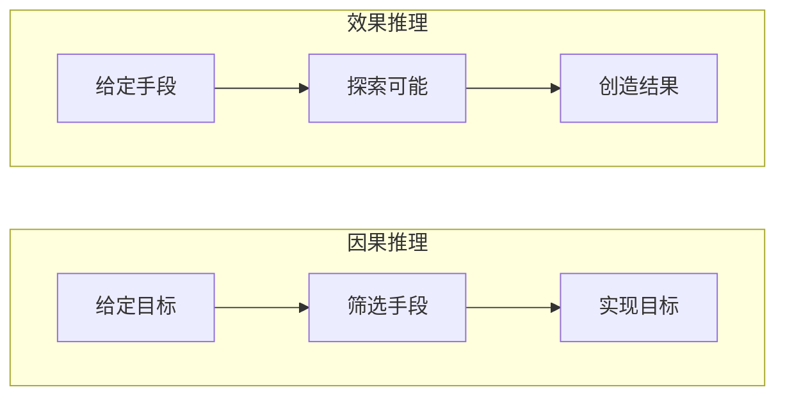

# 创业思维的内涵与特征（因果推理与效果推理）

## 创业思维的内涵与特征：因果推理与效果推理

先想象一个场景：你手上有面粉、鸡蛋、糖和黄油。因果推理的厨师会先决定“我要做戚风蛋糕”，然后查配方、补材料、严格按步骤执行。效果推理的厨师会先看看手头材料能组合出什么，做着做着发现可以烤成饼干，中途巧克力碎掉进去，最后端出一盘巧克力曲奇——味道还不错。

创业思维的核心分野，恰恰就在这两种推理方式之间。

### 因果推理：先定目标，再找手段

**因果推理（Causation）** 是传统管理学中最常见的决策逻辑。它的基本假设是：==未来可以被预测，目标可以被预先设定==。创业者先识别一个明确的机会，分析市场、细分客户、制定商业计划，然后调动资源去实现预定目标。

它的典型路径是线性的：

因果推理在**稳定、线性、可预测**的环境中非常有效。当一个市场已经成熟、需求明确、竞争格局清晰时，“先瞄准、再开枪”是高效的方式。一个大公司推出新产品线、一个加盟商进入成熟品牌体系，都更适合因果推理。

但它有一个隐含前提：**你能预测未来**。如果环境高度不确定，预测本身就是奢望，因果推理就会失灵。

### 效果推理：从手段出发，创造可能的结果

**效果推理（Effectuation）** 由学者 Saras Sarasvathy 通过对资深创业者的研究提出。它的逻辑方向与因果推理**相反**：==不预先设定目标，而是从一组给定的手段出发，探索能创造出什么结果==。

效果推理有四大核心原则：

| 原则 | 含义 | 对应问题 |
|------|------|----------|
| **可承受损失** | 只投入输得起的资源，而非追求最大回报 | “我最多能承受亏多少？” |
| **战略联盟** | 尽早引入利益相关者共同创造，而非竞争分析 | “谁能和我一起把蛋糕做大？” |
| **利用偶然性** | 把意外事件视为机会，而非需要消除的干扰 | “这个意外能带来什么新可能？” |
| **控制导向** | 关注自己能控制的内容，而非预测不可控的外部因素 | “我现在能做什么？” |

用图对比两种逻辑的方向差异：

> [!IMPORTANT]
> 因果逻辑与效果逻辑的根本区别在于起点与终点的对调：**因果逻辑从目标出发找手段，效果逻辑从手段出发创造目标本身**。

### 为什么创业者更需要效果推理？

创业环境的核心特征是 **不确定性**——你无法预测用户会怎样反应，无法预知竞争对手何时出现，甚至说不清自己的产品到底属于哪个品类。在这种情况下，因果推理的“先制定周密计划”往往变成纸上谈兵。

效果推理的价值在于：==它把“不可预测”从障碍变成了资源==。你不去赌一个五年后的市场预测，而是每次只投入可承受的损失，通过与人合作获取反馈，不断调整方向。这更像一个**控制而非预测**的过程。

> [!TIP]
> 记忆口诀：“因果是**先想后做**，效果是**先做后变**。”因果逻辑适合“已知题目求答案”，效果逻辑适合“拿着现有工具造新东西”。

### 常见的坑

**第一个坑：把效果推理当成“不做计划”**。效果推理不是随波逐流，它仍然有目标——只是在过程中逐步收敛，而不是一开始就锁定。创业者仍然需要判断“可承受损失是多少”“哪些伙伴值得建立承诺”。

**第二个坑：在成熟环境中滥用效果推理**。如果你面对的是一个验证充分、规则明确的市场（如加盟一家麦当劳），用效果推理反复试错反而低效。因果推理的预测基础在稳定环境中是成立的。

**第三个坑：混淆“不确定性”与“风险”**。风险是可以计算概率的未知（骰子有六个面），不确定性是连概率分布都不知道的未知（你甚至不知道有几个面）。因果推理依赖风险思维，效果推理面对的是真正的不确定性。

> [!WARNING]
> 考试中容易混淆的表述：效果逻辑“不在意预测信息”≠“不做任何分析”。效果逻辑强调**投资可承担损失范围内的资源**，而非不计后果地行动。

### 一个算对了的例子

某创始团队想做一个校园二手书交易平台。他们手上有 5 万元启动资金、开发能力和几个学生社群资源。

**因果推理的做法**：先做校园市场调研，预测全国高校二手书市场规模，制定三年商业计划，融资 200 万开发完整 App，大面积推广。

**效果推理的做法**：先花 5000 元做一个微信群 + 问卷表单的**最小可行产品**，验证同校学生是否愿意通过这个渠道交易。如果两周内有 50 笔成交，再考虑做小程序，同时邀请活跃用户成为“楼长”分佣——把用户变成利益共同体。每步投入都不超过自己可承受的损失，路径在验证中逐步清晰。

两者的关键差异不在地上：因果推理在不确定的校园场景下可能因预测失准而烧完钱；效果推理每一步都**用可控的代价换真实反馈**，让目标在行动中浮现。
