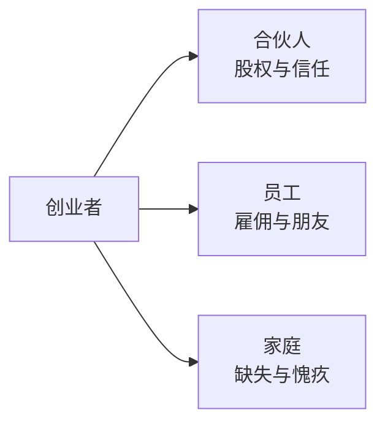
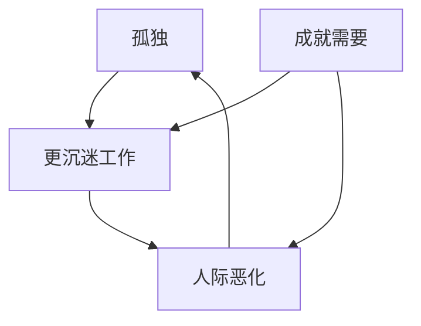

# 造成创业压力的四个原因

## 为什么创业者会“压力山大”

创业压力并非单纯因为“事情太多”。教材将其归纳为四个来源：孤独、沉迷于工作、人际问题、成就的需要。理解这四点，不是为了吓退创业者，而是为了在情绪失控前识别它、管理它。

先问一个问题：一个上班族每天工作 10 小时觉得累，一个创业者每天也工作 10 小时，为什么后者更容易崩溃？答案藏在压力的**性质**里——工作族有同事、有上级兜底、有下班边界；而创业者往往**同时失去这三样东西**。

---

## 四个压力源拆解

### 孤独：没人能商量，也没人敢商量

创业者处于组织金字塔的顶端。很多决策信息——现金流告急、合伙人矛盾、客户流失——**不能对员工讲**（动摇军心），**不能对家人讲**（徒增焦虑），**不能对投资人讲**（暴露弱点）。于是最需要倾诉的人，恰恰最没有倾诉出口。

> [!NOTE]
> 孤独不等于“一个人待着”。很多创业者天天见客户、开会、路演，依然孤独——因为那些社交是**角色扮演**，不是**情感连接**。

### 沉迷于工作：不是勤奋，是失控

创业者常把“工作狂”当勋章。但心理学上，沉迷工作（workaholism）与敬业（work engagement）有本质区别：

| 维度 | 敬业 | 沉迷工作 |
|------|------|----------|
| 驱动力 | 内在喜欢 | 内在强迫 |
| 下班后 | 能抽离 | 无法停止想工作 |
| 感受 | 充实 | 内疚、焦虑 |
| 健康后果 | 积极 | 耗竭 |

> [!WARNING]
> 沉迷工作的危险在于：它会挤掉**恢复精力的所有渠道**——睡眠、运动、爱好、家庭时间。压力没了出口，就像高压锅堵死泄压阀。

### 人际问题：角色冲突与情感账本

创业者的人际关系紧张，集中在三条线上：

- **合伙人**：共苦易，同甘难。利益分配、战略分歧会直接摧毁多年友谊。
- **员工**：创业者对“自己人”期望更高，做不到“公事公办”，员工也容易把雇佣关系当情感关系。
- **家庭**：时间与精力的单向透支，形成“情感账本赤字”。

### 成就的需要：自我价值绑定公司成败

第四点最隐蔽。很多人创业的核心动机不是钱，是**证明“我行”**。这带来两个后果：

1. 公司任何挫折都被解读为**个人失败**——“产品没卖出去=我能力不行”。
2. 对“平庸的稳定”零容忍，不断给自己加码，把企业目标无限拔高。

> [!IMPORTANT]
> ==成就需要越强，创业者越难承认“我搞不定了需要帮助”==，而这恰恰是压力演变成崩溃的关键一步。

---

## 一个算对了的例子：识别自己的压力源

某创业者最近失眠、易怒。用四因框架自查打分（1=没有，5=非常严重）：

| 压力源 | 自评 | 证据 |
|--------|------|------|
| 孤独 | 4 | 合伙人退股的事憋了 3 个月不敢说 |
| 沉迷工作 | 5 | 连续 47 天无休，睡前刷行业新闻到凌晨 1 点 |
| 人际问题 | 3 | 技术合伙人因股权分配提出散伙 |
| 成就需要 | 4 | 公司估值低于预期，觉得“丢人”，拒绝见老同学 |

合计 16/20，三个维度 ≥4 分。**结论**：当前最大压力源是“沉迷工作”和“孤独”，且二者互相加强——越沉迷越没社交，越孤独越用工作麻痹。

**干预方案**可以精确到行为：每天 19:00 后禁用工作软件；每周至少一次与同行业非竞争关系的创业者约饭（能说真话的安全社交）；把“公司估值”与“个人价值”在笔记本上写成两栏，强制分离。

> [!TIP]
> 四因框架的价值不在“对号入座”，而在**把模糊的焦虑变成可定位、可干预的具体问题**。考场上看到“创业压力的原因”，先答四因，再各用一句话解释即可。

---

## 一个高频误区

很多学生以为“这四个原因是并列的、独立存在的”。实际上它们经常**互相咬合**：

考试若出辨析或案例分析，注意指出**压力源之间的循环放大效应**，而不只是罗列四点。
