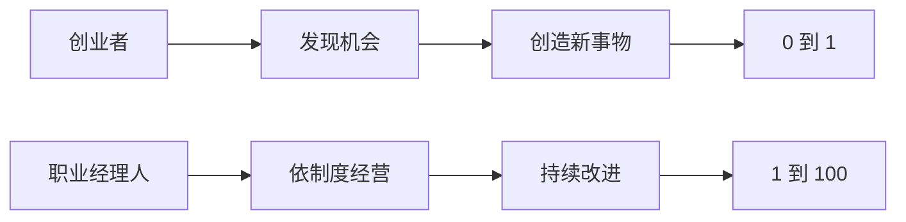

# 创业者与职业经理人的区别

## 核心区别：从 0 到 1，还是从 1 到 N？

创业者从事的是开拓性工作，通过创业活动实现==从 0 到 1==的变化：发现机会、创造新事物，把原本不存在的产品、服务或企业建立起来。职业经理人则侧重经营性活动，按照程序、制度开展工作，在维持现状的基础上保持事物的持续和演进，实现==从 1 到 10、从 10 到 100==。

因此，二者最重要的区别不是“谁的职位更高”，而是**工作性质不同**：创业者重在开拓与创造，职业经理人重在经营与规范。其次，创业者承担企业财务风险，职业经理人通常不承担此类风险，主要承担与本人雇佣契约有关的风险。

## 七个特征变量的比较

| 特征变量 | 创业者 | 职业经理人 |
| --- | --- | --- |
| 雇佣关系 | 雇佣者 | 被雇佣者 |
| 创业与否 | 创业者，与所控制资源无关 | 企业内创业 |
| 出资与否 | 出资或继承出资 | 不出资 |
| 承担企业风险 | 承担企业风险 | 承担与本人雇佣契约有关的风险 |
| 所有权与控制权 | 同时拥有 | 无所有权，有一定控制权 |
| 担任企业主管与否 | 担任 | 不一定担任 |
| 创新功能 | 更强调 | 强调 |

> [!IMPORTANT]
> 记忆时抓住三条主线：**谁雇佣谁、谁出资并承担风险、谁拥有所有权**。职业经理人的“有一定控制权”来自授权，不等于拥有企业所有权。

## 相近概念怎么辨析？

职业经理人也强调创新，并非只会机械执行制度。例如，经理人可以推动流程改进、产品升级，甚至开展企业内创业；但只要其不出资、不拥有企业所有权，主要依据雇佣契约取得报酬并承担职业风险，就不能仅因“工作有创新”而认定为创业者。

同样，创业者也不能简单等同于“能力强、会管理的人”。有些创业者善于发现和开发机会，却不一定擅长企业成长后的规范化经营，因此可能引入职业经理人。这并不否定其创业者身份，因为其已经完成了关键的开拓活动，并承担相应风险。

> [!WARNING]
> 常见误区有三：一是把职业经理人写成“完全不创新”；二是把“担任总经理”当成创业者的判断标准；三是认为创业者只承担财务风险。实际上，创业者还可能承担职业、家庭与社交、心理等风险。

## 例子：这样判断才完整

某公司创始人个人出资组建团队，发现新的市场需求，推出此前没有的产品，并承担经营失败可能造成的财产损失。企业稳定后，董事会聘请一名不出资的职业经理人，由其依据制度扩大生产、培养人才、提高市场份额。

判断时应写：创始人通过创造新企业、新产品实现从 0 到 1，且出资、拥有所有权并承担企业风险，属于创业者；受聘者推动企业从 1 到 100，拥有一定经营权但无所有权，主要承担雇佣契约相关风险，属于职业经理人。==“扩大经营规模”本身不会把职业经理人变成创业者。==

> [!TIP]
> 答题可采用“工作性质＋风险承担＋权责关系”的结构，再补充创新程度、是否担任主管等差异，避免只背“0 到 1、1 到 100”而论证不完整。
