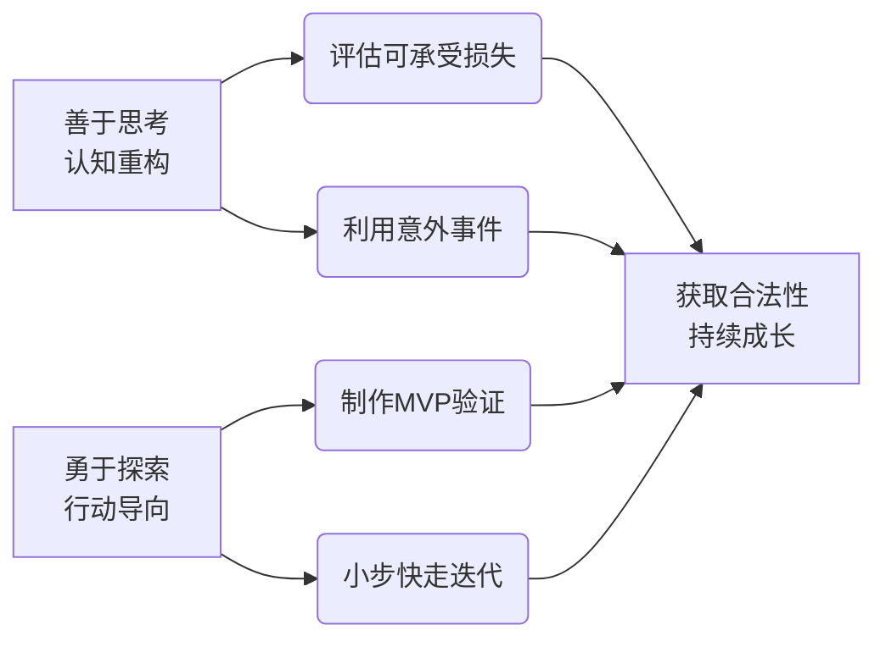

# 创业者的能力与素质要求（含善于思考、勇于探索的创新精神）

## 它是什么与为什么需要

在南邮《创新与创业管理》语境下，“善于思考、勇于探索的创新精神”不仅是技术层面的发明创造，更是==创业者在高度不确定性环境中识别机会、整合资源的核心认知能力==。

> [!IMPORTANT]
> 创新精神 $\neq$ 单纯的技术发明
> 课件明确指出：发明是技术概念（发现新事物），而创新是经济术语（将新事物付诸实践）。创业者所需的创新精神，侧重于**商业化过程中的价值创造**，包括产品、模式、制度及管理等多维度的探索。

为什么必须具备这种素质？因为创业活动具有“三高一强”特征：高度依赖个人能力、资源高度约束、环境高度不确定。面对模糊且快速变化的市场，唯有具备善于思考的认知结构（Cognitive Structure）和勇于探索的行动导向，才能利用效果逻辑（Effectuation）和精益思想，在迷雾中找到通往成功的道路。

## 怎么做：从思维到行动的转化

如何将抽象的“创新精神”转化为具体的创业行为？我们可以结合课件中的“效果逻辑”与“精益创业”来理解：

1.  **善于思考（认知层面）**：不盲目追求预期收益最大化，而是基于手头手段（Means-driven）思考“我能做什么”；将意外视为机会而非威胁，主动调整知识结构以适应非连续性变化。
2.  **勇于探索（行动层面）**：拒绝过度规划，通过制作最简可行产品（MVP）走出办公室测试假设；采用敏捷开发方式，根据反馈快速转型或坚持，在行动中吸引利益相关者加入。

> [!TIP]
> 记忆口诀：思考看“损失”与“意外”，探索靠“MVP”与“迭代”。创新精神不是空想，而是“有纪律的试错”。

## 与相近概念的区别

| 维度 | 创新精神（创业者素质） | 发明创造（技术活动） | 商业伦理（道德底线） |
| :--- | :--- | :--- | :--- |
| **核心定义** | 将新思想/组合付诸实践并创造价值 | 发现新事物、新技术 | 处理内外关系的规则与价值观 |
| **关注点** | 市场、顾客、商业化、机会 | 技术突破、新颖性 | 权利义务、自我约束、合规 |
| **结果导向** | 竞争优势、财富创造 | 专利、论文、原型 | 可持续发展、组织健康 |
| **关系** | 可包含发明，也可仅为模式重组 | 创新的来源之一，但非必要条件 | 创新精神的边界与保障 |

> [!NOTE]
> 课件强调“君子爱财，取之有道”。伦理是比社会责任更高层次的素质要求。创新精神必须在伦理框架内运行，否则即便短期获利，也无法获得长期的“合法性”。

## 常见的坑与正确示例

> [!WARNING]
> **误区**：认为只有颠覆性技术创新才叫“创新精神”，或者为了创新而无视法律与伦理边界。
> **正解**：模仿并商业化也是创业；象征性行动获取合法性不等于欺骗。

**算对了的例子（结合历年真题）：**
题目问“象征性行动是否是一种欺骗行为？如何合理开展？”
*   **错误回答**：认为是欺骗，或者只谈技术创新。
*   **正确思路**：这恰恰体现了“善于思考、勇于探索”在**合法性获取**中的应用。
    1.  **定性**：象征性行动$\neq$欺骗，它是新企业在资源约束下，通过传递信号改变利益相关者认知的==合理探索策略==。
    2.  **做法**：在个体层传递人力/社会资本信息；在组织层展示专业能力；在关系层建立联盟。这正是“勇于创新”在非技术维度的体现——用低成本方式解决信任难题，符合精益创业“花小钱办大事”的逻辑。

> [!CAUTION]
> 答题时切勿将“创新精神”等同于“违规操作”。课件明确区分了“操纵/创造合法性”与“违法违规”的界限。真正的创新精神是在伦理约束下，对资源和认知进行创造性重组的能力。
