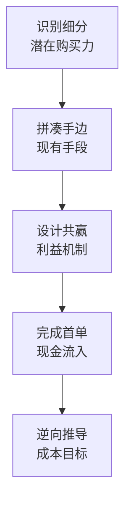

# 第一笔销售的意义与实现

新企业成立意味着以组织身份参与市场活动，但真正让创业机会价值落地的标志是什么？是拿到营业执照吗？不，是==第一笔销售==。

## 它是什么

第一笔销售是指新企业在成立后，首次将产品或服务成功交付给顾客并获得收入的行为。在创业过程的六个方面（产生创业动机、识别创业机会、整合资源、创建新企业或是新事业、实现机会价值、收获回报）中，它横跨了“实现机会价值”与“收获回报”两个阶段。

> [!IMPORTANT]
> 第一笔销售的本质不是单纯的买卖，而是市场对创业者所识别商业机会的==首次真实验证==。

## 为什么需要

- **验证商业概念**：创业更侧重财富创造，更加关注市场和顾客。没有销售，创意就只是想法。
- **启动现金流**：现金流是企业一定时期现金和现金等价物的流入和流出数量。第一笔销售带来首笔现金流入，缓解早期生存压力。
- **吸引利益相关者**：共同利益的实现需要共赢的利益机制做保证。有了销售数据，创业者更容易设计出“让对方感觉到赢而且是优先赢”的机制来整合后续资源。

## 怎么做

结合课件中的典型路径与效果逻辑，实现第一笔销售可遵循以下步骤：

1. **锁定细分市场**：通过竞争分析和市场调查，把潜在市场分成几个独立的细分市场，确定每个细分市场的潜在购买力。
2. **运用效果逻辑**：不要死等最优方案，从一组给定的手段开始，利用手边已有的东西进行**拼凑**（Bricolage），通过技巧组合创造出可能的结果。
3. **促成交易**：切实的合作需要有各方面利益真正能够实现做保证，降低顾客风险本身也是扩大收益。

## 与相近概念的区别

| 对比维度 | 第一笔销售 | 融资到位 | 签订意向书 |
| :--- | :--- | :--- | :--- |
| **性质** | 经营性现金流入 | 筹资性现金流入 | 无实际资金交割 |
| **验证对象** | 顾客需求与市场价值 | 投资人对团队的认可 | 双方初步合作意愿 |
| **对现金流影响** | 直接增加经营现金流 | 增加筹资现金流 | 无影响 |

> [!NOTE]
> 与创新相比，创业更强调机会、顾客和价值创造。融资再多，若迟迟无法转化为销售，新企业依然面临极大的财务风险。

## 常见的坑

> [!WARNING]
> **错把“熟人捧场”当市场验证**。如果第一笔销售完全依赖亲友人情，而非基于产品解决顾客实际问题，这种销售无法反映真实的潜在购买力，会导致后续成本控制目标失效。

> [!CAUTION]
> **忽视现金流的时间差**。签了合同不等于完成销售，必须按照现金收付实现制确认钱已到账，否则容易因缺乏足够资金而痛失好的投资机会。

## 算对了的例子

某南邮学生团队开发了一款校园二手教材流转小程序（虚拟企业模式运营）。

- **预设目标（因果逻辑）**：期望月利润 $P = 3000$ 元。
- **逆向损益表推导**：团队首先明确打算实现的利润是 3000 元，然后据此推导出需要多少收入以及允许的成本是多少。
- **计算过程**：已知每单抽佣比例 $r = 15\%$，单笔平均交易额 $V = 40$ 元，每月固定服务器及运营成本 $C_f = 600$ 元。

设每月需完成销售笔数为 $N$，则：

$$P = N \times V \times r - C_f$$
$$3000 = N \times 40 \times 15\% - 600$$
$$3600 = 6N$$
$$N = 600$$

即每月需完成 600 笔交易。团队据此倒推，首周必须完成至少 150 笔销售。他们利用效果逻辑，先不花钱推广，而是拼凑手边资源——联合各学院班长群发布，并在首单给予买家免配送费的“优先赢”机制，最终在第 3 天实现了第一笔销售并跑通了现金流闭环。

> [!TIP]
> 记忆口诀：**先定利润倒推量，拼凑手段促首单；莫拿人情充市场，现金到手才算完。**
