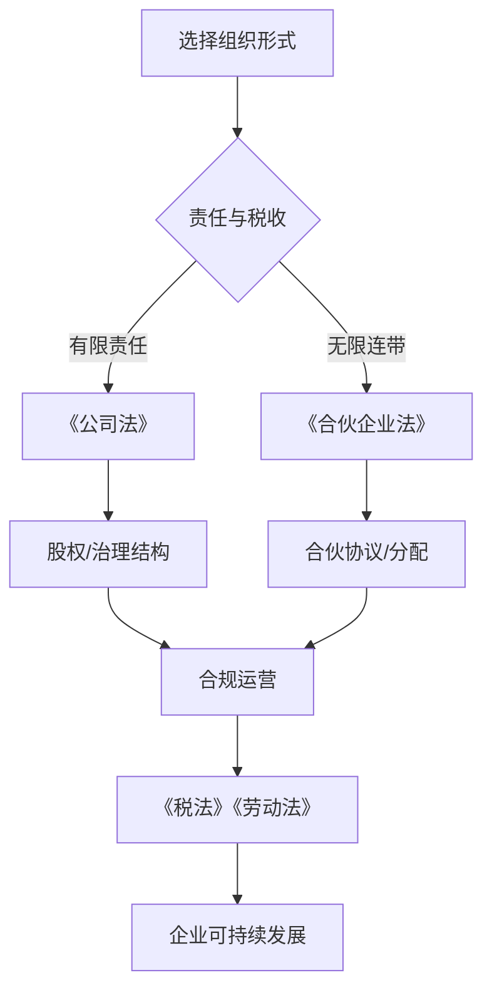

# 成立新企业需要了解的法律法规及其对新企业的影响

## 它是什么与为什么需要

成立新企业涉及的法律法规，是指创业者在==企业设立、运营及退出全生命周期==中必须遵守的规范性文件体系。它不仅包括《公司法》《合伙企业法》等组织法，还涵盖税法、劳动法、知识产权法及行业准入规定。

为什么初创团队必须重视这些“条条框框”？试想：如果股权架构设计违反《公司法》强制性规定，融资时投资人是否会直接否决？如果忽视税务合规，企业利润是否会被罚款吞噬？法律法规既是新企业的==生存底线==，也是构建竞争壁垒、保障创始人权益的==制度基石==。

## 核心法律框架与影响路径

新企业法律环境并非孤立条文，而是相互作用的系统。以下流程展示了关键法规如何作用于创业各环节：

> [!IMPORTANT]
> ==组织形式决定法律责任边界==。有限责任公司股东以认缴出资额为限担责；普通合伙人则承担无限连带责任。选错形式可能导致创始人个人资产与企业风险未隔离。

| 维度 | 有限责任公司 | 普通合伙企业 |
| :--- | :--- | :--- |
| 法律依据 | 《公司法》 | 《合伙企业法》 |
| 责任形式 | 有限责任 | 无限连带责任 |
| 税收处理 | 企业所得税+个税 | 仅缴个人所得税 |
| 治理结构 | 股东会/董事会/监事会 | 合伙人协商约定 |
| 适用场景 | 多数科技型初创企业 | 创投基金/专业服务机构 |

## 怎么做：合规落地三步法

1.  **设立前**：根据商业模式、融资需求与税负测算，依法选择最优组织形式；完成名称核准与章程起草，确保==章程备案条款==符合最新《公司法》修订要求。
2.  **设立中**：按法定程序完成出资（注意认缴期限新规）、工商登记与银行开户；同步办理税务登记与社保账户，避免“设立即违规”。
3.  **运营初期**：建立基础合规台账，包括劳动合同签署、知识产权归属约定、发票管理与纳税申报；定期审查行业许可资质有效性。

> [!TIP]
> 记忆口诀：“==形式定责税先行，章程出资要合规，劳动知产早锁定==”。初创期资源有限，优先抓住这三条生命线。

## 易混淆概念辨析

许多创业者混淆“注册资本”与“实缴资本”。注册资本是章程载明的==承诺出资额==，体现公司信用规模；实缴资本是==实际到位资金==。2024年新《公司法》要求有限责任公司股东自成立起==五年内缴足==，不再允许无限期认缴。盲目抬高注册资本而未实缴，将面临加速到期与债权人追偿风险。

## 常见坑与正确示例

> [!WARNING]
> 高危误区：认为“小公司不用签书面劳动合同”或“用个人账户收付款可避税”。前者触发双倍工资赔偿，后者涉嫌偷逃税款与职务侵占，均可能==导致企业设立失败或创始人刑责==。

**正确做法示例**：某南邮校友创办智能硬件公司，初始拟设普通合伙。经法律咨询后改为有限责任公司，注册资本设为100万元（匹配五年实缴能力），章程明确技术入股评估作价程序；设立当月即与3名核心成员签订劳动合同并约定职务发明归属；采用对公账户收支，按期申报小微企业税收优惠。结果：首年合规成本可控，顺利获得天使轮融资，未发生任何法律纠纷。

> [!CAUTION]
> 切勿套用网络模板章程！每个企业的股权结构、表决权安排、退出机制均不同，==必须结合《公司法》强制规范与自身商业诉求定制==，否则埋下控制权丧失隐患。
