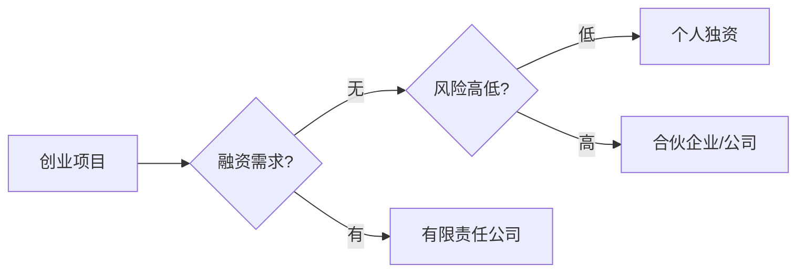

# 不同的法律组织形式分别适合什么类型的新企业及其优势

## 法律组织形式的本质与选择逻辑

成立新企业时，创业者首先面临的核心决策并非“做什么业务”，而是“以什么法律身份做”。不同的法律组织形式决定了企业的==责任边界、税负结构与融资能力==。为什么不能所有企业都选有限责任公司？因为初创项目的风险特征、资金需求与团队规模差异巨大，匹配错误的形式会导致税务浪费或无限连带风险。

> [!IMPORTANT]
> 选择法律形式的核心权衡是“有限责任保护”与“设立运营成本/税负效率”之间的平衡。

## 三类主要形式及其适用场景

### 个人独资企业

由一个自然人投资，财产为投资人个人所有。其最大特点是==投资者承担无限责任==，但设立门槛极低、经营灵活且无需缴纳企业所得税（仅缴个人所得税）。适合风险可控、规模小、无需外部融资的个体经营，如社区工作室、自媒体账号运营主体。

### 合伙企业

由两个以上合伙人订立合伙协议共同出资。普通合伙人（GP）承担无限连带责任，有限合伙人（LP）以出资额为限担责。其优势在于==税收穿透（避免双重征税）与人合性治理==，适合专业服务机构（律所、会计师事务所）及私募股权基金的持股平台。

### 有限责任公司

股东以其认缴出资额为限对公司承担责任，公司以其全部资产对债务负责。这是最主流的创业载体，具备==独立法人资格、有限责任隔离与规范化治理结构==，便于股权融资和团队激励。适合绝大多数科技型、成长型新企业。

## 关键区别与决策要点

| 维度 | 个人独资企业 | 合伙企业 | 有限责任公司 |
| :--- | :--- | :--- | :--- |
| 责任形式 | 无限责任 | GP无限/LP有限 | 有限责任 |
| 税收处理 | 仅个税 | 穿透征税 | 企业所得税+个税 |
| 融资能力 | 极弱 | 中等（LP模式） | 强 |
| 适用阶段 | 生存验证期 | 专业服务/基金 | 成长期/扩张期 |

> [!WARNING]
> 切勿将“合伙企业”等同于“多人开的公司”。普通合伙人的无限连带责任是刚性约束，若未明确区分GP与LP角色，所有合伙人均可能被追索全部债务。

## 典型案例解析

某南邮学生团队开发校园二手交易平台，初期3人合伙，预计年利润20万元，未来计划引入天使投资。若误选合伙企业，虽可节税，但投资人无法接受无限责任结构，且后续改制为公司需清算重设，成本高昂。正确做法是直接注册有限责任公司：三人各认缴10万元（实缴可分期），以出资额为限担责；利润先按25%缴企业所得税，分红再缴20%个税，虽税负略高，但==换取了融资通道与风险隔离==，符合成长型项目本质需求。

> [!TIP]
> 记忆口诀：“独资轻快险自担，合伙穿透靠人合，公司规范利融资，形式错配悔已晚。”
