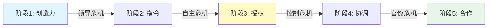

# 葛雷纳的企业成长模型

# 葛雷纳的企业成长模型

## 它是什么：演进与危机的交替

葛雷纳（Greiner）模型认为，企业成长并非线性平滑过程，而是由**演进期**（Evolution）和**变革期**（Revolution/Crisis）交替构成的。每个阶段都由特定的管理风格主导，当该风格无法解决新出现的规模性问题时，就会引发危机，迫使企业进入下一阶段。

> [!IMPORTANT]
> ==核心逻辑==：推动上一阶段成功的动力，往往成为下一阶段成长的阻力。

## 为什么需要：理解“成功陷阱”

许多初创企业在扩大规模后陷入停滞，并非因为市场消失，而是因为**管理惯性**。例如，创业初期依靠创始人个人魅力的“非正式沟通”高效灵活，但当员工增至百人，这种模式会导致信息混乱。此时，若不建立规范制度，企业将无法继续成长。

## 怎么做：识别危机并变革

企业需识别当前所处的阶段及面临的危机，通过管理变革突破瓶颈：

| 阶段 | 成长动力（演进） | 面临危机（阻碍） | 解决方案（变革） |
| :--- | :--- | :--- | :--- |
| **创业期** | 创造力、技术导向 | **领导危机**：缺乏方向 | 引入职业经理人/强领导 |
| **集体化期** | 指令、职能分工 | **自主危机**：基层无活力 | 授权、分权管理 |
| **规范化期** | 授权、激励机制 | **控制危机**：各自为政 | 建立协调系统/流程 |
| **精细化期** | 协调、矩阵结构 | **官僚危机**：程序繁琐 | 团队协作、简化流程 |
| **成熟期** | 合作、文化凝聚 | **增长危机**？ | 内部创业/外部并购 |

> [!TIP]
> **记忆口诀**：创领指自授控协官合。即：创业遇领导危机，指令遇自主危机，授权遇控制危机，协调遇官僚危机，最后走向合作。

## 常见误区与辨析

- **误区**：认为危机是坏事，应极力避免。
- **正解**：危机是成长的信号。==只有突破危机，企业才能跃迁到更高阶段==。若回避变革，企业将停滞甚至衰退。
- **与生命周期理论区别**：传统生命周期侧重生物性生老病死，葛雷纳模型侧重**管理方式与组织结构的适应性变革**。

## 算对了的例子：从“任人唯亲”到“空降兵”

**场景**：某科技公司初创期靠创始人兄弟伙打拼（阶段1），效率高但决策随意。规模扩大后，出现“领导危机”，创始人能力不足。

**错误做法**：坚持内部提拔亲戚（换手型），导致管理混乱，阻碍专业化（阶段2的指令管理无法建立）。

**正确做法**：
1. **识别危机**：意识到个人英雄主义已失效。
2. **实施变革**：聘请外部职业CEO（空降型/援手型），建立职能部门和考核制度（进入阶段2：指令导向）。
3. **结果**：虽然初期老员工不满，但公司实现了规范化管理，为后续授权（阶段3）打下基础。

> [!WARNING]
> 注意：在“禅让型”或“换手型”继任中，若未真正放权或建立新规则，只是换人不换制，则无法解决根本的**领导危机**，企业仍会卡在阶段1。
