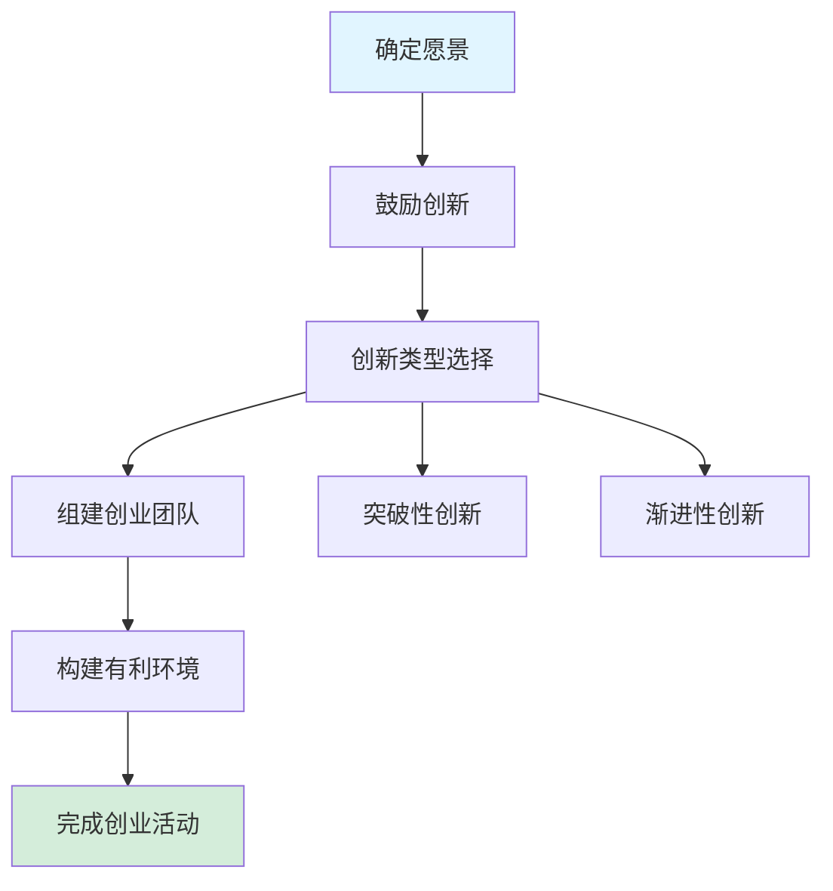

# 公司创业的实施过程、动力与阻力及促进公司创业的战略策略

公司创业是在既有企业内部开展的创新活动，通过系统化的实施过程，将员工的创业精神转化为企业的竞争优势。它不仅是新业务的孵化器，更是企业在动态环境中持续成长的==核心动力==。

## 公司创业的实施过程

公司创业遵循从战略构想到落地实施的六个关键阶段：

1. **确定愿景**：明确公司创业的战略方向，将创新活动与组织整体目标对齐
2. **鼓励创新**：营造宽容失败、奖励尝试的组织氛围
3. **突破性创新与渐进性创新**：平衡革命性变革与持续性改进
4. **组建创业团队**：跨部门配置具有企业家精神的核心成员
5. **构建内部创业的有利环境**：提供资源支持、授权机制与灵活的组织结构
6. **完成公司创业活动**：将创新成果商业化，实现价值创造

## 公司创业的动力与阻力

理解公司创业需要辩证看待其推动因素与制约条件：

| 维度 | 具体表现 |
|------|---------|
| **动力** | 应对激烈竞争环境；实现新的竞争优势；留住可能流失的优秀员工；进一步提高公司收益；合理安置老员工 |
| **阻力** | 偏重"计划——执行"逻辑，忽视机会探寻；偏重技术/资源占有，忽视资源整合；偏重稳定性，忽视快速行动；偏重流程改进，忽视成果和细节 |

> [!WARNING]
> 常见误区是将公司创业简单等同于技术创新。实际上，==最大的阻力往往来自管理逻辑==——过度强调计划控制而抑制了机会捕捉能力。

## 促进公司创业的战略策略

针对上述阻力，企业可采取六项战略举措：

1. **提高机会感知能力**：建立市场扫描机制，鼓励全员发现商机
2. **使变革成为制度**：将创新常态化，而非临时项目
3. **灌输创新想法**：通过培训与文化渗透，逐步引导员工突破思维定式
4. **投资员工想法**：提供种子资金与资源支持，降低创业门槛
5. **共同承担风险与奖励**：建立利益共享、风险共担的激励机制
6. **认识失败重要性**：将失败视为学习机会，而非单纯追责依据

> [!IMPORTANT]
> 公司创业与战略管理的"交接核心"在于**战略创业**——通过创业活动识别机会，通过战略管理建立竞争优势，二者互补实现财富最大化。

## 实例分析

以某传统制造企业面临数字化转型为例：

**正确做法**：
- **愿景层**：确立"智能服务提供商"转型愿景（对应步骤1）
- **机制层**：设立内部创新孵化器，允许员工以20%工作时间探索新项目（对应步骤5）
- **激励层**：对成功商业化项目给予团队股权奖励，失败项目复盘不追责（对应策略5、6）

**常见错误**：
- 仅投入资源占有技术专利，却忽视跨部门资源整合（触犯阻力第2条）
- 要求新项目严格遵循既有年度计划，错失市场窗口期（触犯阻力第1条）

> [!TIP]
> 记忆口诀：**"愿景-创新-团队-环境"**（实施过程四要素），**"感知-制度-投资-共担"**（战略策略四关键）。公司创业不是推翻既有企业，而是在内部培育"二次创业"的机能。
