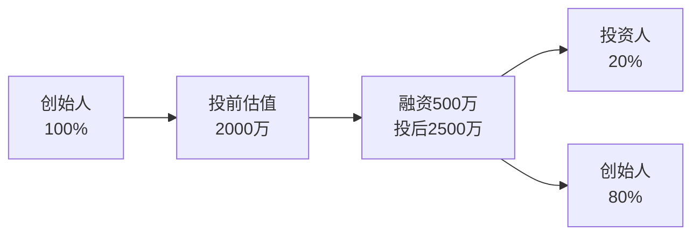

# 新企业估值方法与股权稀释

## 估值：先把“值多少钱”说清楚

创业融资的第一道坎不是“怎么开口要钱”，而是**开口要多少钱、让出多少股份**。前者取决于公司值多少钱——估值；后者取决于这一轮融多少、谁来投——股权稀释。

> [!IMPORTANT]
> 估值不是资产盘点，而是投资人与创始人==对未来价值的讨价还价==。同一家公司，投前估值不同，同样 500 万的融资额导致的股权稀释比例完全不同。

估值的常见方法有三种：

| 方法 | 核心思路 | 适用阶段 | 局限 |
|---|---|---|---|
| 资产基础法 | 净资产 = 总资产 − 总负债 | 传统重资产企业 | 不反映增长潜力 |
| 市场法（可比法） | 找同类公司，按市盈率/市销率类比 | 有对标公司时 | 早期公司难找到可比对象 |
| 收益法（DCF） | 未来现金流折现求和 | 有稳定现金流时 | 早期公司预测不可靠 |

早期创业公司往往没有利润、甚至没有收入，实践中常用 **可比法 + 行业估值区间** 做粗略锚定，或者由投资机构按“投后估值”反推可接受的股份比例。

## 股权稀释：钱进来，你的股份会怎么样

稀释的本质是：==新股的发行摊薄了原有股东的持股比例==。计算的两个关键公式：

$$投后估值 = 投前估值 + 本轮融资额$$

$$投资人持股比例 = \frac{本轮融资额}{投后估值}$$

例如投前估值 2000 万，融资 500 万，则投资人持股 $500 / 2500 = 20\%$，创始人从 100% 稀释到 80%。

> [!TIP]
> 记忆口诀：==投前是“老股的价值”，投后是“钱到了以后的公司总盘子”==。算投资人比例时，分母一定是投后估值，不是投前。

## 反稀释条款：为什么投资人要防“下一轮降价”

如果下一轮融资的估值反而比这一轮低（“降价融资”，down round），早期投资人的股份就会“被动贬值”——同样的钱，后来者拿到了更低价格对应的股份。因此投资协议中常设有 **反稀释条款（Anti-dilution）**。

最常见的两种：

| 类型 | 做法 | 对创始人影响 |
|---|---|---|
| 完全棘轮 | 早期投资人按新一轮低价重新计算股份，原来花的钱用新的最低价重新换股 | 创始人稀释极其严重 |
| 加权平均 | 按新旧价格和股份数加权计算调整后的转换价 | 相对缓和、更常见 |

> [!WARNING]
> 反稀释条款调整的是==早期投资人持有的优先股转换比例==，不是创始人的普通股自动增加。别把“投资人多了股份”误解成“创始人自动减少相同数量”，中间隔着总股本的变化。

## 一个算对了的例子

某创业公司投前估值 3000 万元，拟融资 1000 万元。

1. **投后估值**：$3000 + 1000 = 4000$ 万元  
2. **投资人持股比例**：$1000 / 4000 = 25\%$  
3. **创始人团队稀释后比例**：若融资前创始人团队持股 85%，则融资后为 $85\% \times (1 - 25\%) = 63.75\%$

> [!CAUTION]
> 常见坑：用“融资额 ÷ 投前估值”算比例（$1000/3000 = 33.3\%$），这就把投人和创始人放在了同一个“投前基数”上，**分母用错**。投资人出的钱是在投后进来的，所以分母必须是投后估值。

## 和相近概念的区别

- **估值 ≠ 融资额**：估值是整个公司的价格，融资额只是本次卖出的那部分“新股份”的价格。
- **股权稀释 ≠ 股权转让**：稀释是通过==增发新股==改变总股本；转让是老股东把自己的股份卖给他人，总股本不变。
- **投前估值 vs 投后估值**：核心差别在于融资额是否已经计入公司价值。同一个数字，说“投前”还是“投后”差了一整个融资额。

> [!NOTE]
> 实践中，投资人常说“我投 1000 万，占 20%”，这里的 20% 直接给出了投后估值为 $1000 / 20\% = 5000$ 万，投前估值就是 $5000 - 1000 = 4000$ 万。谈判时务必确认清楚口径。

估值和稀释，本质是同一个硬币的两面：**钱按什么价格进来，股份就按什么比例让出去。** 先确定投前投后的口径，再动手算比例。
